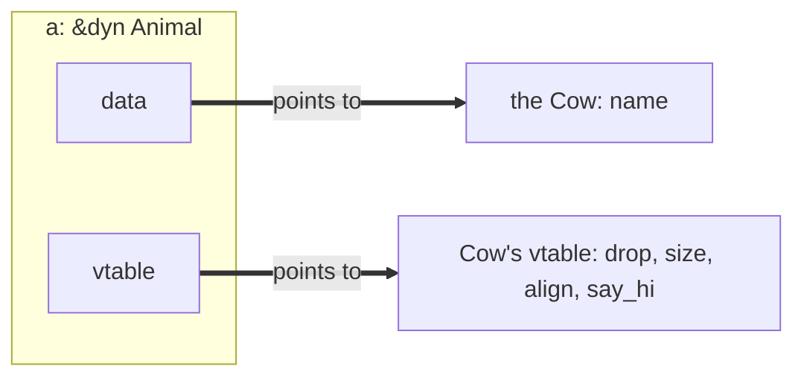

# Concurrency, Parallelism, and Rust: Closures and Trait Objects

This note continues [[Concurrency, Parallelism, and Rust/Introduction to Rust/Traits|Traits]]. It first covers **closures**, which let us pass behavior around as a value, and the `Fn` traits that describe how a closure uses what it captures. It then covers how Rust chooses which method to run for a trait: **static dispatch** with generics, and **dynamic dispatch** with `dyn Trait` trait objects. The pointer types used along the way (`Box`, `Rc`) are in [[Concurrency, Parallelism, and Rust/Smart Pointers|Smart Pointers]].

---

## Closures vs Functions

- Some functions take behavior as an argument, such as `filter` or `sort_by_key`.
- A **closure** is an unnamed function that can use the local variables around it. It is a value: bind it to a variable, or pass it to a function.
- Because a closure can use surrounding local variables, it is more flexible than a plain function, and it lets us define logic inline.

```rust
fn add_one_v1(x: u32) -> u32 { x + 1 }

fn main() {
    // we bind the value holding the closure, and call it with closure(val)
    let add_one_v2 = |x: u32| -> u32 { x + 1 };
    let add_one_v3 = |x| { x + 1 }; // types can be inferred
    let add_one_v4 = |x| x + 1;     // you can drop the curly braces

    // how to call
    add_one_v1(1);
    add_one_v2(2);
    add_one_v3(3);
    add_one_v4(4);
}
```

### Using Local Variables

```rust
let mut num_sort_ops = 0;
list.sort_by_key(|r| {
    num_sort_ops += 1; // defined outside the closure, but in the same overall scope, so it can borrow it
    r.width            // return width
});
```

### Borrow Rules Still Apply

- A closure that uses a variable borrows it, so the normal [[Concurrency, Parallelism, and Rust/Introduction to Rust/Introduction to Rust#Mutable and Immutable References|borrow rules]] apply: a shared borrow and a mutable borrow of `count` cannot be in use at the same time.

```rust
fn main() {
    // this will not compile: `inc` holds a mutable reference to count, so the
    // println! (an immutable reference) cannot happen before inc() is last used
    let mut count = 0;
    let mut inc = || count += 1;
    println!("{count}");
    inc();

    // fix: finish using the mutable borrow first
    let mut count = 0;
    let mut inc = || count += 1;
    inc();
    println!("{count}");
}
```

---

## How a Closure Captures

![[How a Closure Captures.png]]

| The body... | Captures | Example |
|---|---|---|
| only reads `x` | `&x` | `\|\| println!("{x}")` |
| changes `x` | `&mut x` | `\|\| x += 1` |
| moves `x` away | `x` itself | `\|\| x` (returns a `String`) |
| anything, with `move` before | `x` itself | `move \|\| println!("{x}")` |

- Rust picks the least it needs (it is lazy), unless you write `move`.

### Move

- `move` gives a closure **ownership** of the variables it uses.
- Like a C++ move, the closure takes ownership of the data.
- After the move, we can no longer use the data outside the closure, since we gave up ownership.
- This is how a closure is handed to another thread: see `thread::spawn` in [[Concurrency, Parallelism, and Rust/Smart Pointers#Thread-Safe Shared Ownership: Arc|Smart Pointers]].

---

## Fn, FnMut, FnOnce

Every closure implements one or more of three traits, based on what its body does with captured values.

| Trait | Meaning |
|---|---|
| `Fn` | only reads what it captures; can be called many times |
| `FnMut` | changes what it captures; can be called many times |
| `FnOnce` | may give away what it captures; can only be called once |

- Every `Fn` is an `FnMut`, and every `FnMut` is an `FnOnce`.
- To use function pointers well, you need to know about borrowing and lifetimes.

```rust
// FnMut: the function may change what it captures
fn twice<F: FnMut()>(mut f: F) {
    f();
    f();
}

// FnOnce: it can only be run once
fn once<F: FnOnce() -> String>(f: F) -> String {
    f()
}

fn main() {
    let mut count = 0;
    twice(|| count += 1);
    println!("count = {count}"); // the closure is not assigned to a variable, so twice gives up its mutable borrow

    let name = String::from("Bessie");
    twice(|| println!("hi {name}")); // we can pass something that chooses not to mutate

    let give_away = || name; // moves name out, so it is FnOnce
    println!("got {}", once(give_away));
}
```

---

## Static Dispatch

```rust
fn introduction<T: Animal>(animal: T) {
    animal.say_hi();
}
```

- The compiler makes **one copy of `introduction` per type** it is called with.
- Which code runs is decided at compile time: **static dispatch**.
- All information is known at compile time, so each call is direct and can be inlined.

### A List of Animals

- `dyn Animal`: a value of some type that implements `Animal`, where the type is known only at run time (`dyn` is short for dynamic).
- A trait is not a type, so it cannot be used as the element of a `Vec` directly:

```rust
trait Animal {
    fn say_hi(&self);
}

fn main() {
    // error: a trait is not a type
    let v: Vec<Animal>;
    // error: different animals may differ in size
    let v: Vec<dyn Animal>;
    // fine: every reference is the same size, but the Vec does not own the animals
    let v: Vec<&dyn Animal>;
    // fine: the Vec owns each animal, and every Box is the same size
    let v: Vec<Box<dyn Animal>>;
    // fine, with shared owners
    let v: Vec<Rc<dyn Animal>>;
}
```

---

## Trait Objects: dyn Animal

- A `dyn Animal` lets us accept **anything at run time that is an `Animal`**: this is **dynamic dispatch**.
- The function below is compiled **once**, not once per animal.

```rust
fn introduce(animal: &dyn Animal) {
    animal.say_hi();
}

fn main() {
    let animals: Vec<Box<dyn Animal>> = vec![
        Box::new(Cow::new(String::from("Bessie"))),
        Box::new(Dog::new(String::from("Rex"))),
    ];

    for animal in &animals {
        animal.say_hi();
    }

    introduce(&Dog::new(String::from("Fido")));
}
```

### Not Every Trait Can Be dyn

A trait function with no `self` cannot be called through a `dyn Animal`, since it would not know which animal to make.

```rust
// not good: new has no self, and returns Self
trait Animal {
    fn new(name: String) -> Self;
    fn say_hi(&self);
}

// fix
trait Animal {
    // where Self: Sized keeps new for real types like Cow,
    // and leaves it out of dyn Animal, which is never Sized
    fn new(name: String) -> Self
    where
        Self: Sized;
    fn say_hi(&self);
}

fn introduce(a: &dyn Animal) {
    a.say_hi();
}
```

- `Sized` is the marker trait from [[Concurrency, Parallelism, and Rust/Introduction to Rust/Traits#Marker Traits|Traits]].

### Trait Objects in Memory

![[Trait Objects in Memory.png]]

- `&dyn Animal` is a **fat pointer**: a pointer to the data and a pointer to the **vtable**.
- The compiler builds a vtable for each type used as a `dyn Animal`. Rust's vtable holds `drop`, `size`, `align`, and the trait's methods (here `say_hi`).
- In C++ the vtable pointer (`vptr`) is usually **inside the object**, so a plain `Animal*` is enough (see [[Systems Programming/C++ OOP/Inheritance|C++ Inheritance]]). In Rust the object stays a plain `Cow` with just its fields, and the vtable pointer travels with the reference.



### Static vs Dynamic Dispatch

![[Static vs Dynamic Dispatch in Rust.png]]

| | `T: Animal`, `impl Animal` | `dyn Animal` |
|---|---|---|
| which method runs | decided at compile time | looked up at run time |
| copies of `introduce` | one per type | one |
| a call | direct, can be inlined | through the vtable |
| one `Vec` of mixed animals | no | yes |
| methods returning `Self` | yes | only with `where Self: Sized` |

---

## Related

- [[Concurrency, Parallelism, and Rust/Introduction to Rust/Traits|Traits]]: trait bounds, `Sized`, and the `Animal` example
- [[Concurrency, Parallelism, and Rust/Smart Pointers|Smart Pointers]]: `Box`, `Rc`, `Arc`, and `Send`/`Sync`
- [[Concurrency, Parallelism, and Rust/Introduction to Rust/Borrow Checker|Borrow Checker]]: borrows and lifetimes
- [[Systems Programming/C++ OOP/Inheritance|C++ Inheritance]]: C++ vtables and virtual dispatch

## Industry Standard Terms

- **Closure** → lambda / anonymous function
- **`move` closure** → capture by value
- **Static dispatch (`T: Trait`)** → monomorphization / compile-time polymorphism (C++ templates)
- **Dynamic dispatch (`dyn Trait`)** → runtime polymorphism / virtual call (C++ `virtual`)
- **Trait object / fat pointer** → interface reference carrying a vtable pointer
- **`where Self: Sized`** → opting a method out of the vtable (object safety)
