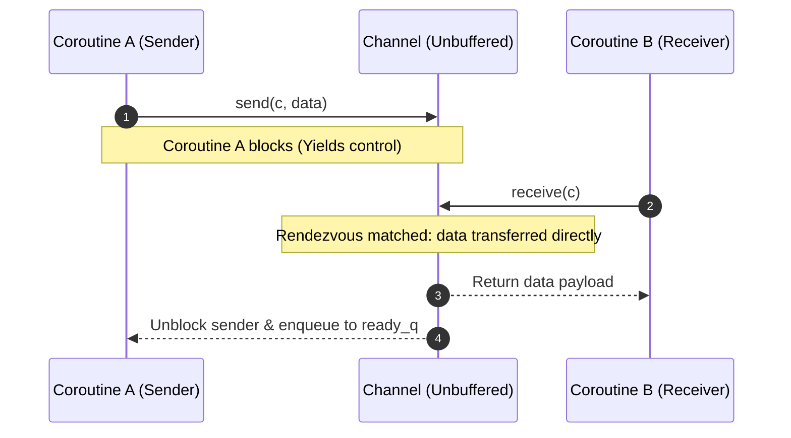

# Coroutines: Channels and Rendezvous Semantics

## Channels & Inter-Coroutine Communication (CSP Model)

Coroutines avoid raw shared-memory concurrency by communicating via **Channels**, patterned after Tony Hoare’s Communicating Sequential Processes (CSP) formalism.

### What is a Channel?
**Channel**: A synchronized communication pipe that transfers data payloads (`SendableData`) between coroutines while coordinating execution order without data races or low-level locks.
- **`SendableData`**: Defined as an opaque pointer:
  ```c
  typedef void* SendableData;
  ```
  This enables transferring arbitrary pointers to heap-allocated objects or primitive integer values cast to `(SendableData)`.
- **Multiplexing**: Channels support many-to-many communication. Any number of coroutines can share a single `Channel*` descriptor to coordinate message exchange.

### Communication Without Channels is Unsafe
Directly sharing raw global variables between coroutines without channel synchronization leads to non-deterministic temporal anomalies:

```rust
// UNSAFE: Shared global variable without channel synchronization
static mut MY_GLOBAL: i32 = 1;

fn worker() {
    unsafe { MY_GLOBAL = 2; }
}

fn main() {
    let h = spawn(worker);
    unsafe { print(MY_GLOBAL); } // Non-deterministic output: prints 1 or 2!
    join(h);
}
```

Because the scheduling interleaving between `spawn()` and the subsequent `print()` statement depends on the runtime's spawn policy (lazy vs. eager), `MY_GLOBAL` may be read before or after `worker` runs.

### Channels Enforce Causal Consistency
Channels enforce a formal **causal happens-before relationship** across independent coroutine contexts:

```rust
// SAFE: Explicit synchronization via Channel handoff
static mut MY_GLOBAL: i32 = 1;

fn worker(c: Channel) {
    unsafe { MY_GLOBAL = 2; }
    send(c, null); // Signal completion (blocks until recv)
}

fn main() {
    let (h, c) = spawn(worker);
    let _ = recv(c); // Blocks until worker executes send()
    unsafe { print(MY_GLOBAL); } // Guaranteed to ALWAYS print 2!
    join(h);
}
```

Because `recv(c)` blocks `main` until `worker` executes `send(c, null)`, the write `MY_GLOBAL = 2` strictly happens-before the read, establishing deterministic causality.

### Unbuffered Rendezvous Semantics
The runtime uses unbuffered, synchronous rendezvous channels:
- A `send(ch, data)` call **blocks** the sender until a receiver invokes `receive(ch)`.
- A `receive(ch)` call **blocks** the receiver until a sender provides data via `send(ch, data)`.
- Data transfer occurs only when both sender and receiver meet at the channel rendezvous point.



## Industry Standard Terms

| Course Term | Industry / Standard Term |
| :--- | :--- |
| **`SendableData` (`void*`)** | Type-Erased Message Payload / Generic Message Box |
| **Rendezvous** | Synchronous Handshake / Zero-Capacity Channel Transfer |

## Related

- [[Concurrency, Parallelism, and Rust/Coroutines|Coroutines]] — Hub for this topic
- [[Concurrency, Parallelism, and Rust/Coroutines/Assembly Context Switch|Assembly Context Switch]] — routine_switch.S and the x86-64 ABI
- [[Concurrency, Parallelism, and Rust/Coroutines/Channel Queue Mechanics|Channel Queue Mechanics]] — send, receive, and yieldOnto
