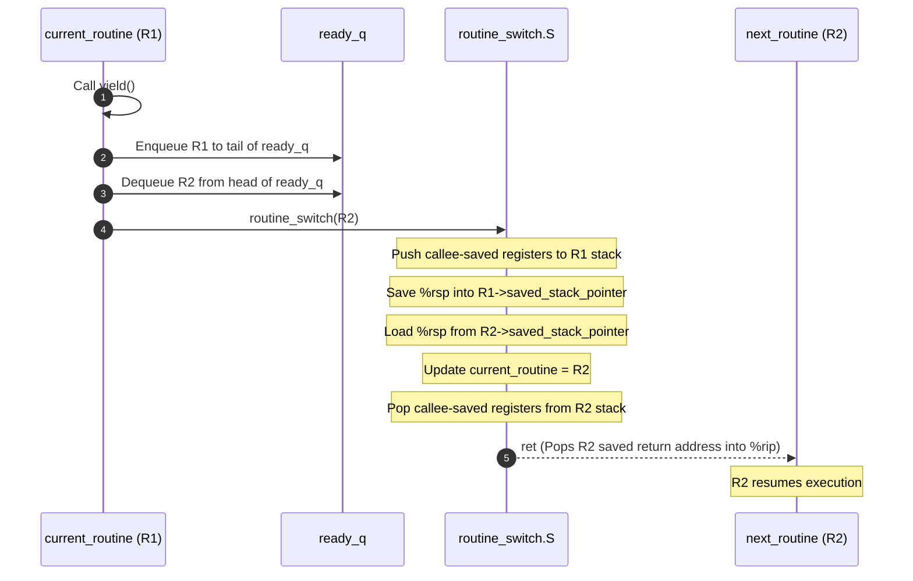

# Coroutines: Coroutine Memory Layout and Control Block

## Architecture & Core Mechanics

The coroutine runtime manages execution contexts using user-space memory structures, a centralized run queue, and an assembly context-switch trampoline.

### Coroutine Memory Layout
The system virtual address space is organized into distinct segments hosting the coroutine infrastructure:

![[Memory layout of coroutines.png]]

1. **Main Stack (`0xFF...FF`)**:
   - The primary stack created by the OS kernel when `main()` starts.
   - Used for runtime initialization (`coroutine_init()`) and executing top-level non-coroutine operations.
2. **Heap**:
   - Houses dynamically allocated `struct Routine` instances.
   - Each coroutine owns a dedicated private stack (`private_stack`) allocated directly within its `struct Routine` heap block. Local variables, function arguments, and activation frames for that routine reside within this buffer.
3. **Data Segment (`0x00...00`)**:
   - **`current_routine`**: A global pointer (`Routine* current_routine`) holding the memory address of the coroutine currently executing on the CPU core.
   - **`ready_q`**: A global FIFO run queue (managed via head and tail pointers) holding all runnable routines awaiting CPU execution.

### The `struct Routine` Control Block
Every coroutine is represented by a control structure:

```c
#define STACK_ENTRIES 4096 // 32KB stack frame (4096 * 8 bytes)

typedef struct Routine {
    void* saved_stack_pointer;              // Saved stack pointer (%rsp); MUST reside at offset 0
    uint64_t private_stack[STACK_ENTRIES];  // Dedicated execution stack for this routine
    struct Routine* next_in_queue;          // Linked-list pointer for ready_q or channel queues
    SendableData channel_data;              // Message payload slot for channel rendezvous
    bool has_terminated;                    // Status flag: true if routine has exited
    SendableData return_val;                // Cached return value delivered upon termination
} Routine;
```

> **Offset 0 Invariant**: The assembly context switch (`routine_switch.S`) assumes that `saved_stack_pointer` is the very first field in `struct Routine` (offset `0(%rdi)`). This allows the assembly code to load and store the stack pointer directly through the struct pointer with zero arithmetic offset overhead.

### Core Coroutine API Mechanics

| API Function | Operational Behavior | Queue Mechanics & Context Switch |
| :--- | :--- | :--- |
| `void coroutine_init(void)` | Initializes the runtime and bootstraps the calling thread. | Clears `ready_q`, initializes `current_routine` to anchor `main()`. |
| `Channel* spawn(SendableData (*func)(Channel*))` | Creates and initializes a new coroutine context. | Heap-allocates `struct Routine`, formats initial stack frame with entry trampoline and target function, creates a default communication channel, and enqueues to `ready_q`. |
| `bool yield(void)` | Voluntarily relinquishes the CPU to another runnable routine. | If `ready_q` is empty, returns `false`. Otherwise, enqueues `current_routine` to `ready_q`, dequeues the head routine, invokes `routine_switch()`, and returns `true` upon resumption. |
| `void join(Routine* h)` | Suspends caller until target coroutine `h` completes. | If `h` has already terminated, returns immediately. Otherwise, suspends calling routine until `h` exits and signals completion. |



## Related

- [[Concurrency, Parallelism, and Rust/Coroutines|Coroutines]] — Hub for this topic
- [[Concurrency, Parallelism, and Rust/Coroutines/Limits of OS Threads and the Coroutine Abstraction|Limits of OS Threads and the Coroutine Abstraction]] — Why coroutines, the book-reading analogy, and the design space
- [[Concurrency, Parallelism, and Rust/Coroutines/Assembly Context Switch|Assembly Context Switch]] — routine_switch.S and the x86-64 ABI
