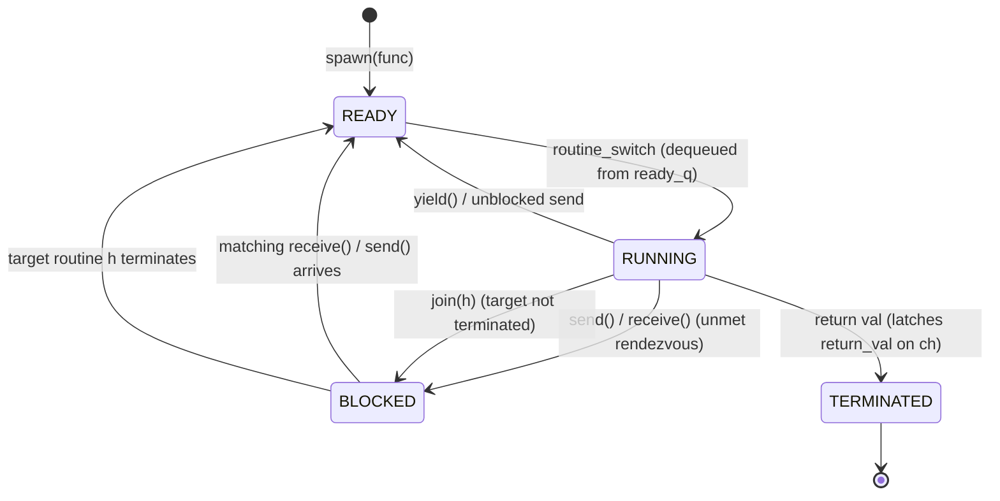

# Coroutines: Formal State Model

## Formal Analysis / Protocol Specification

### Formal Definition
Let $\mathcal{R}$ be the set of all coroutines in the runtime system, and $\mathcal{C}$ be the set of all communication channels. At any instant $t$, every coroutine $r \in \mathcal{R}$ exists in exactly one state from the state set:

$$\mathcal{S} = \{\text{RUNNING}, \text{READY}, \text{BLOCKED}, \text{TERMINATED}\}$$

#### State Transition Function
The operational state transition function $\delta$ for a cooperative scheduler is defined as:

$$\delta(\text{RUNNING}, \text{yield}()) \longrightarrow \text{READY}$$
$$\delta(\text{RUNNING}, \text{send}(c, v) \land |c.\text{blocked\_receivers}| = 0) \longrightarrow \text{BLOCKED}$$
$$\delta(\text{RUNNING}, \text{receive}(c) \land |c.\text{blocked\_senders}| = 0 \land \neg c.\text{has\_terminated}) \longrightarrow \text{BLOCKED}$$
$$\delta(\text{BLOCKED}, \text{receive}(c) \land r \in c.\text{blocked\_senders}) \longrightarrow \text{READY}$$
$$\delta(\text{BLOCKED}, \text{send}(c, v) \land r \in c.\text{blocked\_receivers}) \longrightarrow \text{READY}$$
$$\delta(\text{RUNNING}, \text{join}(h) \land \neg h.\text{has\_terminated}) \longrightarrow \text{BLOCKED}$$
$$\delta(\text{RUNNING}, \text{return } v) \longrightarrow \text{TERMINATED}$$

#### System Invariants

1. **Single Execution Invariant**:
   On a single-core runtime worker thread, exactly one coroutine occupies the `RUNNING` state at any point in time:
   $$|\{r \in \mathcal{R} \mid \text{State}(r) = \text{RUNNING}\}| = 1 \iff \text{current\_routine} \neq \text{NULL}$$

2. **System Conservation Invariant**:
   The total number of coroutines in the system equals the sum of coroutines distributed across all runtime queues:
   $$|\mathcal{R}| = 1 + |\text{ready\_q}| + \sum_{c \in \mathcal{C}} \left( |c.\text{blocked\_senders}| + |c.\text{blocked\_receivers}| \right) + |\mathcal{R}_{\text{BLOCKED\_JOIN}}| + |\mathcal{R}_{\text{TERMINATED}}|$$

3. **Cooperative Progress Invariant**:
   A coroutine transitions out of `RUNNING` if and only if it explicitly invokes an operation from the cooperative transition set $\mathcal{T}$:
   $$\text{Transition}(\text{RUNNING} \to s) \iff \text{Op} \in \{\text{yield}(), \text{send}_{\text{block}}(), \text{receive}_{\text{block}}(), \text{join}_{\text{block}}(), \text{return}\}$$

4. **Causal Happens-Before Order ($\longrightarrow_c$)**:
   Let $\longrightarrow_c$ denote the causal happens-before relation enforced by an unbuffered channel $c$. For any write operation $W(x)$ preceding `send(c, v)` and any read operation $R(x)$ following `receive(c)`:

   $$W(x) \longrightarrow_c \text{send}(c, v) \longrightarrow_c \text{receive}(c) \longrightarrow_c R(x) \implies W(x) \longrightarrow_c R(x)$$

### Simplified Explanation
A coroutine is always in one of four states: actively executing on the CPU (`RUNNING`), waiting in line for its turn (`READY`), stuck waiting for someone on a channel or join handle (`BLOCKED`), or completely finished (`TERMINATED`). Because there is no OS timer interrupting it, a running coroutine will NEVER stop running unless it explicitly chooses to pause itself or finishes its work. When it hands a message through a channel, time stops for the sender until the receiver takes the message, ensuring that all writes made before sending are guaranteed to be seen by the receiver.

## Industry Standard Terms

| Course Term | Industry / Standard Term |
| :--- | :--- |
| **`join()`** | Task Join / Thread Await |

## Related

- [[Concurrency, Parallelism, and Rust/Coroutines|Coroutines]] — Hub for this topic
- [[Concurrency, Parallelism, and Rust/Coroutines/Fibonacci Generator Trace|Fibonacci Generator Trace]] — Infinite producer-consumer stream
- [[Concurrency, Parallelism, and Rust/Coroutines/Edge Cases and Failure Modes|Edge Cases and Failure Modes]] — Starvation, stack overflow, deadlocks, and lifetime hazards (beyond lecture)
