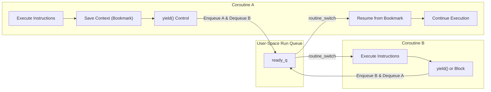

# Coroutines: Limits of OS Threads and the Coroutine Abstraction

## Coroutines Motivation & Overview

Modern concurrent software frequently coordinates thousands or millions of concurrent workflows—such as asynchronous network socket handlers, event-driven pipelines, or computational tasks.

### The Limits of Operating System Threads
Standard operating system threads (such as POSIX `pthreads` on Linux) rely on kernel-level preemptive multitasking, which imposes significant resource and architectural overhead:
- **Heavy Memory Footprint**: Every OS thread requires a substantial execution stack allocated and managed by the kernel (typically 2MB to 8MB by default). Allocating tens of thousands of OS threads rapidly exhausts both physical memory and virtual address space.
- **Costly Kernel Privilege Transitions**: Managing, suspending, and scheduling OS threads requires crossing the user/kernel privilege boundary (Ring 3 to Ring 0) via hardware interrupts and system calls (`sys_clone`, `futex`). These transitions trigger CPU pipeline flushes, register dumps, and Translation Lookaside Buffer (TLB) invalidations.
- **Preemptive Interference & Race Hazards**: Because the OS kernel scheduler preempts threads arbitrarily based on hardware timer slices, developers must guard every access to shared mutable memory with heavy synchronization primitives (mutexes, spinlocks, semaphores) to prevent data races.

### The Coroutine Abstraction
A **coroutine** (cooperative routine) solves these limitations by implementing concurrency entirely within user space:
- **Cooperative Multitasking**: Coroutines are strictly **non-preemptable**. An active coroutine retains exclusive control of the CPU worker thread until it voluntarily yields execution (`yield()`), blocks waiting on a synchronization primitive (`send()`, `receive()`, or `join()`), or terminates its execution.
- **Zero OS Kernel Involvement**: Context switches occur entirely in user-space assembly code (`routine_switch.S`). No kernel traps, privilege boundary crossings, or system calls occur during a switch.
- **Minimal State Overhead**: A coroutine is represented by a compact heap-allocated control block (`struct Routine`) paired with a dedicated user-space execution stack (`private_stack`, typically 8KB to 32KB).
- **Dependency-Respecting Control Flow**: Coroutines provide a natural programming abstraction that respects computational dependencies, forming a direct bridge to task parallelism and directed acyclic graph (DAG) dataflow on a single core.

### The Bookreading Analogy
Consider a person reading two separate books simultaneously:
- **Sequential Subroutine**: Reading Book A from cover to cover before ever opening Book B.
- **Preemptive Multitasking (OS Threads)**: An external alarm rings at unpredictable intervals, forcing the reader to drop Book A mid-sentence, record the exact word and line, and pick up Book B.
- **Cooperative Multitasking (Coroutines)**: The reader reaches the end of a section or chapter in Book A, places a bookmark at the exact page and line, voluntarily sets Book A down, and opens Book B to its saved bookmark.

To resume Book A later, the reader requires explicit **bookkeeping**: preserving the exact execution context (the bookmark) so that when control returns, execution resumes seamlessly from that saved point.

### Cooperative vs. Preemptive Multitasking
Coroutines enforce a cooperative operational contract:
- **Non-Preemptable Execution**: An active coroutine cannot be interrupted asynchronously by an OS hardware timer interrupt. Control switches away from the active routine **only** when the coroutine explicitly cooperates by calling `yield()`, blocking on a channel operation (`send()` / `receive()`), blocking on a handle (`join()`), or returning.
- **Elimination of Single-Core Data Races**: Because context switches happen only at explicit, programmer-defined yield points, code executing between suspension points is strictly atomic with respect to other coroutines running on that worker thread.
- **Microsecond to Nanosecond Efficiency**: Switching between coroutines requires only saving and restoring a handful of CPU registers in user memory, bypassing kernel schedulers and TLB invalidation.

### The Risk of Non-Cooperation (Starvation)
Because preemption is absent, cooperative runtimes rely on the **programmer contract**:
- If an active coroutine enters an infinite computation (`while(1) {}`) or executes a CPU-heavy loop without calling `yield()` or a blocking channel operation, it permanently starves all other coroutines waiting in `ready_q`.
- The worker thread remains locked into that rogue routine indefinitely.

### Many Flavors of Coroutines: The Architectural Design Space
Coroutine runtime implementations vary across several dimensions:
- **Yield Return Values**: Does `yield()` return data? In basic cooperative schedulers, `yield()` returns a boolean indicating whether a switch occurred. In generator-style coroutines, `yield(value)` emits an intermediate value to the consumer.
- **Yielding from Nested Frames**: Can regular helper functions yield? In **stackful coroutines** (such as the runtime implemented here), any nested function on the call stack can invoke `yield()`. In **stackless coroutines** (such as Rust `async`/`await`), only top-level async state machines can suspend execution.
- **Transfer Target (Symmetric vs. Asymmetric)**:
  - *Asymmetric Coroutines*: Provide distinct operations to invoke a routine (`spawn`/`resume`) and suspend back to the central scheduler (`yield`). Control always routes through a central run queue.
  - *Symmetric Coroutines*: Provide a single direct transfer primitive (`yield_to(target)`), allowing a coroutine to explicitly hand execution directly to a specified peer routine.
- **Spawn Policy (Lazy vs. Eager)**: Does `spawn()` immediately switch to the new coroutine, or does it merely enqueue it?
  - *Lazy Spawn*: Allocates the routine, pushes it onto `ready_q`, and allows the creator (parent) to continue executing.
  - *Eager Spawn*: Enqueues the parent onto `ready_q` and immediately context-switches execution to the newly spawned child.
- **Switch Requirement on Yield**: Does `yield()` always switch? If `ready_q` is empty, `yield()` cannot switch to another routine; it immediately returns `false`, and the current routine continues running.

## Industry Standard Terms

| Course Term | Industry / Standard Term |
| :--- | :--- |
| **`yield()`** | Cooperative Yield / Cooperative Descheduling |

## Related

- [[Concurrency, Parallelism, and Rust/Coroutines|Coroutines]] — Hub for this topic
- [[Concurrency, Parallelism, and Rust/Coroutines/Coroutine Memory Layout and Control Block|Coroutine Memory Layout and Control Block]] — Private stacks, struct Routine, and the core API
