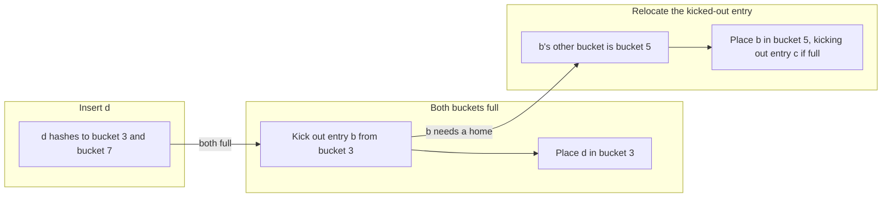

# Concurrency, Parallelism, and Rust: Cuckoo Hashmap

## What Is a Cuckoo Hashmap

- **Cuckoo hashmap**: a hashmap backed by a vector of buckets.
- Each key is hashed to 2 distinct buckets using 2 hash functions.
- Because a key can only ever live in one of those 2 buckets, lookup is $O(1)$: check at most 2 buckets.

---

## Insert

- If we are inserting and both possible buckets are full, we "kick out" one of the occupied entries and place it into its other bucket.
  - The kicked-out entry's other bucket may also be full, so this must be valid recursively: that entry kicks out another, and so on.

### What Can Go Wrong: Insertion Loops

- The chain of kicks can create an **insertion loop**: entries keep displacing each other and never settle.
- Fix: come up with the path first, and only then insert, so we never start a loop we can't finish.

---

## Insertion Paths

- Before we insert, determine the **insertion path**: the chain of buckets we would displace entries through.
- We want to find the insertion path for `insert(d)`.
  - If the first path doesn't finish within `max_displacements`, assume there is an endless loop.
  - Since each element hashes into two buckets, we can try the other bucket.
    - Checking the second bucket can also cause a loop.
  - If both cause loops, double the number of buckets and/or generate different hash functions.

### Shifting Elements Along the Path

- Once we find the insertion path, we can shift elements as necessary, following the path from right to left.
  - As long as we are in one of the two buckets, we are in a valid state.
  - Going from right to left always keeps the table in a valid state: each moved element lands in an empty bucket that is one of its own two buckets.
- Going left to right
  - Needs us to think about aborting (pushing an element out when it has nowhere to go).

---

## Making Cuckoo Support Simultaneous Inserts

- If inserts don't overlap in buckets, we can just lock the bucket and add.
- Inserts that do overlap need more care, because acquiring the locks for both buckets can lead to a deadlock (see [[Concurrency, Parallelism, and Rust/Deadlocks|Deadlocks]]).
  - If we have a global ordering, we can never get a deadlock, as we grab locks from lowest to largest (see [[Concurrency, Parallelism, and Rust/Deadlocks#Two Threads, Two Locks, and the Wait-For Graph|the wait-for graph]]).
  - Without one, we need an algorithm that can detect the deadlock and "abort".

### Tips

- Other threads may be moving elements between buckets while we are doing operations.
- All we can assume is that an element will be in one of its 2 buckets.
  - We can assume this invariant as long as everyone keeps the invariant.
- Rule: never try to lock a lower index while you're holding a higher index.
  - For simplicity, consider holding no more than 2 locks at a time.
  - You can "force" a global ordering in many ways: hashing, the memory address of the mutex, etc.
  - `MutexGuard` has a tricky lifetime, so you may need an annotated lifetime (see [[Concurrency, Parallelism, and Rust/Introduction to Rust/Borrow Checker|Borrow Checker]]).
- When moving an element along an insertion path:
  - Lock both the source (full) and destination (empty) buckets.
    - Otherwise, another thread might insert into the destination, leaving both buckets full. Now your element doesn't have a home.
  - Confirm the destination is really one of the 2 buckets for this element.
  - If the destination isn't a valid bucket, the insertion path is no longer valid, so retry and find a new insertion path.

---

## Testing with Loom

- **[[Concurrency, Parallelism, and Rust/Model Checking#Loom|Loom]]**: exhaustively tests all concurrent interleavings to reproduce rare bugs.
- Varies the order in which threads pass synchronization points such as `lock()`.
- Looks only at join points of the code.
- Tries to skip equivalent executions for efficiency.
- Requires Loom-specific versions of `Mutex`, threads, etc.

---

## Enum vs Trait Object

- **Static dispatch** is generally much better than **dynamic dispatch** (see [[Concurrency, Parallelism, and Rust/Introduction to Rust/Closures and Trait Objects#Static vs Dynamic Dispatch|Static vs Dynamic Dispatch]]).
  - It allows for deeper optimization with all types known at compile time.
  - It does not require a vtable lookup to determine which functions to run.
    - Pattern matching on an enum compiles down to branches (fewer than 4 cases) or a jump table, both of which are generally faster than vtable dereferences.
  - Exhaustive pattern matching also means it is easy to find places where code updates are necessary.

---

## Related

- [[Concurrency, Parallelism, and Rust/Deadlocks|Deadlocks]]: lock ordering and why a global order prevents deadlock
- [[Concurrency, Parallelism, and Rust/Writing Multithreaded Code/Mutual Exclusion Locks|Mutual Exclusion Locks]]
- [[Concurrency, Parallelism, and Rust/Model Checking|Model Checking]]: Loom and exhaustive interleaving exploration
- [[Concurrency, Parallelism, and Rust/Threads and Shared State in Rust|Threads and Shared State in Rust]]: `Mutex` and `MutexGuard`
- [[Concurrency, Parallelism, and Rust/Introduction to Rust/Closures and Trait Objects|Closures and Trait Objects]]: `dyn Trait`, vtables, and dispatch

## Industry Standard Terms

- **Kick out** → eviction / displacement
- **Insertion path** → displacement (eviction) chain
- **`max_displacements`** → max kick count / eviction limit
- **Insertion loop** → cuckoo cycle (triggers a rehash or resize)
- **Double the buckets / new hash functions** → resize and rehash
- **Global ordering** → lock hierarchy / lock ordering
- **Abort** → back-off and retry
- **Loom** → systematic concurrency testing
- **Enum vs trait object** → static dispatch vs dynamic dispatch
