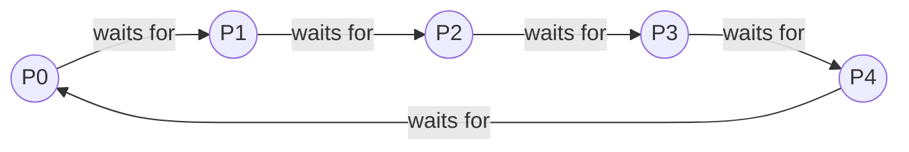

# Concurrency, Parallelism, and Rust: Deadlocks

## Deadlock: An Over-Constrained Execution

![[Deadlock Overconstrained Execution.png]]

- **Synchronization** constrains which executions can happen (see [[Concurrency, Parallelism, and Rust/Writing Multithreaded Code/Mutual Exclusion Locks|Mutual Exclusion Locks]]).
- **Deadlock**: too many constraints, so no execution can happen at all.
  - Example: $A \rightarrow B \land B \rightarrow A$ (A must run before B, and B must run before A).

---

## Resources and Deadlock

- **Resource**: something a thread needs, and waits for when it isn't available.
  - A lock, memory, disk space, a core.
- **Deadlock**: a cycle of threads, each waiting for a resource that the next one holds.
  - None of them can make progress: they wait forever.

---

## Two Threads, Two Locks, and the Wait-For Graph

![[Two threads, two locks and wait-for graph.png]]

- Each thread holds one lock and waits for the lock the other thread holds.
- Drawing an edge from each waiting thread to the thread holding what it wants gives the **wait-for graph**. A cycle in this graph is a deadlock.

---

## Dining Philosophers

![[Dining Philosophers.png]]

- Each philosopher needs both adjacent chopsticks to eat.
- If every philosopher grabs their left chopstick first, each one holds one chopstick and waits forever for the other: a cycle.



---

## What Can We Do About Deadlock

- **Ignore**: reboot, or kill the stuck program, when it happens.
- **Detect and fix**: look for cycles in the wait-for graph.
  - Fix by killing a thread and taking its resources, or by rolling back.
- **Prevent**: write the program so a cycle never forms.

---

## Four Conditions for Deadlock

All four must hold for a deadlock to occur:

1. **Limited resources (mutual exclusion)**: not enough for every thread at once.
2. **No preemption**: a thread can't be forced to give a resource up.
3. **Hold and wait**: threads hold resources while waiting for more.
4. **Circular wait**: a cycle of threads, each waiting for the next.

Prevention: make sure at least one of them can never hold.

---

## Breaking Circular Wait: Order the Locks

- Number every lock, and always take them in **increasing** order.
- Why there is no cycle: a thread waiting for lock $k$ holds only locks below $k$.
  - In a cycle, some thread would hold a higher lock while waiting for a lower one, which the ordering forbids.

![[Breaking circular wait, order the locks.png]]

### Ordering Locks in Rust

```rust
fn philosopher(i: usize, chopsticks: &[Mutex<()>]) {
	let (left, right) = (i, (i + 1) % N);
	let (first, second) = (left.min(right), left.max(right));

	for _ in 0..10_000 {
		let _a = chopsticks[first].lock().unwrap();
		let _b = chopsticks[second].lock().unwrap();
		// eat: both chopsticks held
	}
}
```

- Every philosopher takes the lower-numbered chopstick first, so the last philosopher (whose `left` is the highest index) no longer closes the cycle.

---

## Breaking Hold and Wait

- Take everything you need **before** you start.
  - Wait until all of it is free, then take it all at once.
- Or: if you can't get the next resource, **release everything** and start over.

### Release and Retry: `try_lock`

- No deadlock, but **livelock** is possible: everyone takes, fails, puts back, and retries forever without progress.

```rust
fn philosopher(i: usize, chopsticks: &[Mutex<()>]) {
	let (left, right) = (i, (i + 1) % N);

	for _ in 0..10_000 {
		loop {
			let held = chopsticks[left].lock().unwrap();
			match chopsticks[right].try_lock() {
				Ok(_right) => break, // eat
				Err(_) => drop(held), // release the lock we are holding to allow others to grab it
			}
			thread::yield_now();
		}
	}
}
```

---

## Banker's Algorithm

- Each thread **declares its maximum**, the most it will ever hold, before it starts.
- Grant a request only if the result is **safe**; otherwise make the thread wait.
  - Thread life cycle: declare your maximum, then loop (acquire a resource if safe, work), then release all resources.
- **Safe**: in some order, every thread can get the rest of its maximum, finish, and give everything back.

```rust
// safe: in some order, each customer can borrow up to their limit,
// finish, and repay, so every customer finishes
fn is_safe(mut cash: u32, limit: &[u32], loan: &[u32]) -> bool {
	let mut done = vec![false; limit.len()];
	while let Some(i) = (0..limit.len()).find(|&i| !done[i] && limit[i] - loan[i] <= cash) {
		cash += loan[i];
		done[i] = true;
	}
	done.iter().all(|&d| d)
}
```

### When to Use It

- Lets the system overcommit: maximums can sum to more than there is.
- Needs every thread's maximum in advance, which is often hard to know.
- Fits resources counted in units (memory, money, disk), not locks.
- Cost of the safety check: with $n$ threads and one resource, each round scans for someone who can finish, so $O(n^2)$ per request. With $m$ kinds of resources, each "can finish?" comparison checks $m$ counts: $O(m \cdot n^2)$.

---

## Related

- [[Concurrency, Parallelism, and Rust/Model Checking|Model Checking]]: deadlock freedom as a safety property, and finding the schedule that deadlocks
- [[Concurrency, Parallelism, and Rust/Writing Multithreaded Code/Mutual Exclusion Locks|Mutual Exclusion Locks]]
- [[Concurrency, Parallelism, and Rust/Writing Multithreaded Code/Edge Cases and Failure Modes|Edge Cases and Failure Modes]]: deadlock and double-locking
- [[Concurrency, Parallelism, and Rust/Threads and Shared State in Rust|Threads and Shared State in Rust]]: `Mutex` and poisoning

## Industry Standard Terms

- **Wait-for graph** → resource allocation graph / deadlock detection graph
- **Order the locks** → lock hierarchy / lock ordering
- **Release and retry (`try_lock`)** → back-off and retry (risk: livelock)
- **Banker's Algorithm** → deadlock avoidance (Dijkstra)
- **Safe state** → a state with a safe sequence in which all threads can finish
