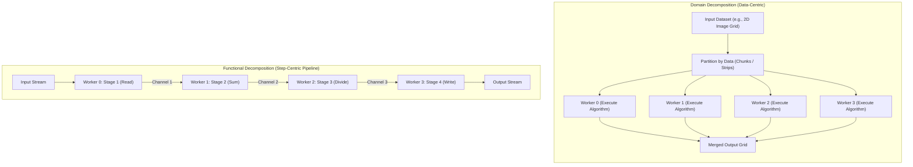

# Decomposition: Concurrency vs Parallelism and the Decomposition Mandate

## Decomposition Motivation & Overview

To exploit multicore hardware architectures, software must abandon monolithic, single-threaded execution models. However, merely spawning additional execution threads does not guarantee faster performance. Before parallel execution is physically possible, a computation must be structured to reveal independent units of work.

### Concurrency vs. Parallelism: The Core Distinction

Understanding parallel systems begins with separating the abstract structure of a computation from its physical execution on hardware:

- **[[Concurrency, Parallelism, and Rust/The Concurrent Mindset|Concurrency]]**: A structural property of the program and its underlying task dependency graph. A program is concurrent if its tasks are composed such that several operations *could* execute simultaneously because they share no immediate causal dependencies (e.g., putting on socks before shoes).
  - Even on a single-core CPU with a single physical worker thread, a program can have a rich concurrent dependency graph. The operating system or runtime simply interleaves execution across time slices or cooperative yield points (as seen in [[Concurrency, Parallelism, and Rust/Coroutines|Coroutines]]).
- **Parallelism**: A physical property of an active execution of the dependency graph on hardware. A program executes in parallel when multiple physical processing units (CPU cores, execution units, or workers) *are* actively computing multiple instructions at the exact same physical instant.
- **The Dependency Constraint**: Parallelism is **strictly possible only where the dependency graph exposes concurrency**. If a computational dependency graph is strictly sequential ($A \longrightarrow B \longrightarrow C$), no amount of additional hardware cores can execute it in parallel. Exposing concurrency is the indispensable prerequisite for achieving parallel speedup.

### The Decomposition Mandate

To transition a sequential algorithm into a concurrent dependency graph, system designers must decompose the monolithic problem. There are two primary strategies for exposing concurrency:
1. **Domain Decomposition (Data-Centric)**: Partitioning the input or output data across workers running identical code.
2. **Functional Decomposition (Step-Centric)**: Partitioning the algorithmic steps across specialized workers connected in an execution pipeline.

---

## Architecture & Core Mechanics

The choice of decomposition strategy dictates how work is distributed, how workers communicate, and how hardware resources (such as CPU caches and memory buses) are utilized.

## Industry Standard Terms

| Course Term | Industry / Standard Term |
| :--- | :--- |
| **Strips / Slices** | Chunks / Tiles / Partitions |

## Related

- [[Concurrency, Parallelism, and Rust/Decomposition|Decomposition]] — Hub for this topic
- [[Concurrency, Parallelism, and Rust/Decomposition/Domain Decomposition|Domain Decomposition]] — Data partitioning with block and cyclic strategies
