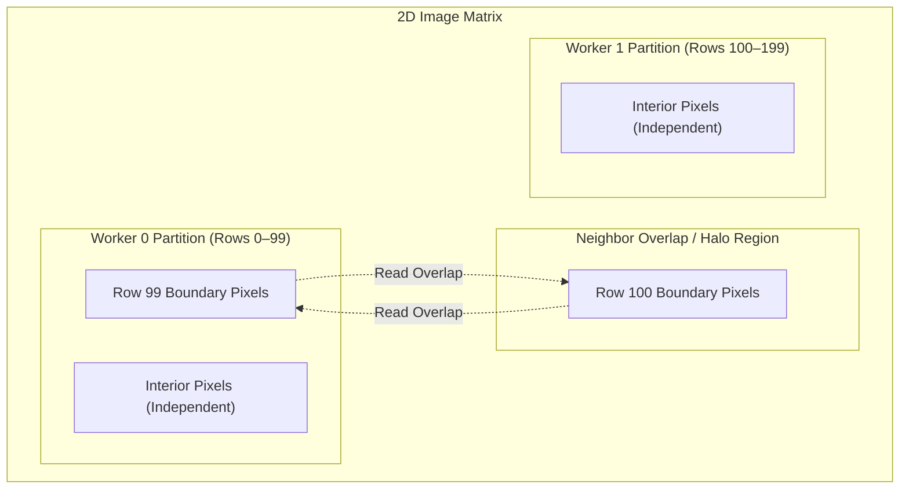

# Decomposition: Domain Decomposition

## 1. Domain Decomposition (Data Partitioning)

In **Domain Decomposition**, the primary data structure (such as an array, matrix, graph, or file collection) is divided into discrete chunks. Every worker executes the **same code** on its assigned subset of the data:

![[Domain Decomposition.png]]

- **Scaling Profile**: Domain decomposition scales naturally with dataset size and worker count. As data volume grows, the problem can be partitioned across more worker cores ($N$ workers operating on $M$ partitions).
- **Embarrassingly Parallel Workloads**: The ideal domain decomposition scenario where each worker executes its assigned chunk completely independently, requiring **zero communication or synchronization** with other workers (e.g., element-wise vector addition, independent ray tracing rays, or mapping operations). Under embarrassingly parallel conditions, speedup scales almost linearly with core count.
- **Non-Trivial Domain Decomposition & Neighbor Overlap**:
  - In most real-world algorithms, subproblems cannot execute in total isolation.
  - *Example: 2D Image Blurring (Stencil Computation)*. Each worker computes the blurred pixel values for an assigned horizontal strip or tile. However, computing the Gaussian blur for a pixel at the edge of a partition requires reading neighboring pixel values that reside inside an adjacent worker's partition:

  - **Neighbor Overlap (Halo / Ghost Cells)**: Workers must share or read boundary data. This introduces communication, synchronization barriers, and cache contention between workers.
  - Designing parallel algorithms requires addressing two fundamental architectural questions: **partitioning** (how to divide the data) and **load balancing** (how to keep all workers equally utilized).

---

## 2. Static Partitioning Strategies: Block vs. Cyclic

When tasks are distributed statically before execution begins, the allocation scheme directly affects CPU cache performance and workload balance:

| Partitioning Scheme | Description | [[Hardware & Software Interface/Cache/Spatial Locality|Spatial Cache Locality]] | Workload Balancing Behavior |
| :--- | :--- | :--- | :--- |
| **Block Distribution** | Contiguous chunks of data assigned to each worker (e.g., Worker 0 gets Rows 0–49; Worker 1 gets Rows 50–99). | **Optimal**: Highly cache-line friendly. Workers stream through contiguous memory addresses, maximizing L1/L2 cache line hits. | **Poor for Skewed Tasks**: If some rows require heavier computation than others (e.g., complex foreground vs. blank sky), workers with lighter blocks finish early and idle. |
| **Cyclic Distribution** | Interleaved round-robin assignment (e.g., Worker 0 gets Rows 0, 2, 4, 6...; Worker 1 gets Rows 1, 3, 5, 7...). | **Sub-optimal**: Workers skip across memory strides, degrading cache line utilization and risking false sharing if strides align within a 64-byte cache line. | **Optimal for Skewed Tasks**: Distributes computationally intense regions evenly across all workers, preventing single-worker stragglers. |

## Industry Standard Terms

| Course Term | Industry / Standard Term |
| :--- | :--- |
| **Domain Decomposition** | Data Parallelism / Data Partitioning / Domain Partitioning |
| **Embarrassingly Parallel** | Perfectly Parallel / Pleasingly Parallel / Map-Only Job |
| **Neighbor Overlap** | Halo Exchange / Ghost Cells / Stencil Boundary |

## Related

- [[Concurrency, Parallelism, and Rust/Decomposition|Decomposition]] — Hub for this topic
- [[Concurrency, Parallelism, and Rust/Decomposition/Concurrency vs Parallelism and the Decomposition Mandate|Concurrency vs Parallelism and the Decomposition Mandate]] — Core distinction and why work must be decomposed
- [[Concurrency, Parallelism, and Rust/Decomposition/Dynamic Allocation and Granularity|Dynamic Allocation and Granularity]] — Pull model, overhead, and task granularity
