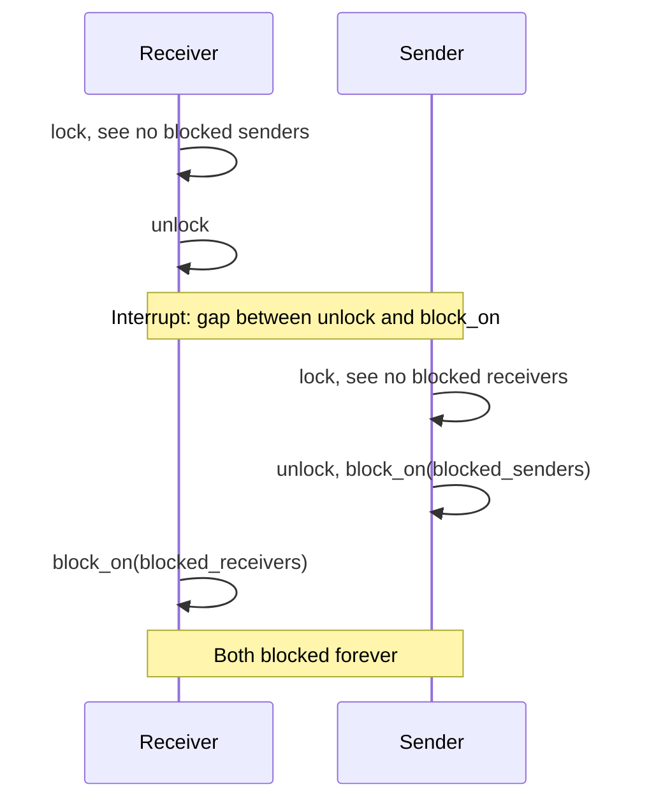
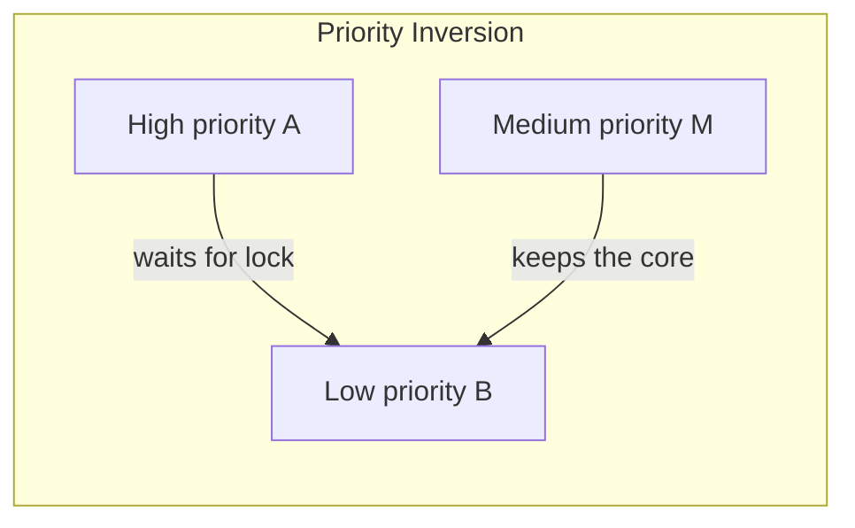

# Concurrency, Parallelism, and Rust: Implementing Synchronization Primitives

This file builds blocking [[Concurrency, Parallelism, and Rust/Synchronization Primitives|synchronization primitives]] out of the pieces from [[Concurrency, Parallelism, and Rust/Implementing Threads|Implementing Threads]]. The path so far: [[Concurrency, Parallelism, and Rust/Coroutines|coroutines]] became threads by adding timer interrupts, and a single core became multiple cores by adding atomics and spinlocks. Combining the two gives the **interrupt-safe spinlock (ISL)**, which protects the scheduler's `yield` on any number of cores. The ISL is then the foundation for a thread-safe channel, a mutex, and every other primitive in this file.

---

## Why an ISL and Not a Mutex

- A mutex would need itself: waiting for a mutex means switching to another thread, exactly like `yield` does, and that goes through the ready queue, the very thing the lock protects.
- The ISL is the synchronization primitive's primitive: everything else is built on top of it.
- In normal code we never want a spinlock:
  - We would rather block so the CPU can do other work until the lock is ours.
  - Spinning burns cycles and hogs the memory bus.
- Inside the kernel, ISLs are the common mechanism for making a critical section on a multithreaded, multicore machine (code can also be lock-free).
- ISLs allow us to implement all sorts of synchronization primitives.

---

## Making a Thread-Safe Channel

Each channel needs its own lock, because the channel's two queues are shared state that several threads modify.

```c
struct Channel {
	TaskQueue blocked_senders;
	TaskQueue blocked_receivers;
	InterruptSpinLock isl;
};
```

### Attempt 1: No Lock

```c
long unsafe_receive(Channel* ch) {
	if (empty(&ch->blocked_senders)) {
		block_on(&ch->blocked_receivers);
		return current->value; // a sender left it here
	}
	Task* s = pop(&ch->blocked_senders);
	long v = s->value; // the value s is sending
	wake(s); // back on ready queue
	return v;
}
```

Nothing protects the queues, so two threads can read and modify them at the same time.

### Attempt 2: Releasing the Lock Before Blocking

A constant bug in concurrency is the **time of check to time of use (TOCTOU)** bug: a condition is checked under the lock, the lock is released, and the condition is acted on after it may no longer be true.

```c
long unsafe2_receive(Channel* ch) {
	ch->isl.lock();
	if (empty(&ch->blocked_senders)) {
		ch->isl.unlock();
		block_on(&ch->blocked_receivers); // gap: interrupted before we are on the queue
		return current->value; // a sender left it here
	}
	Task* s = pop(&ch->blocked_senders);
	long v = s->value; // the value s is sending
	wake(s); // back on ready queue
	ch->isl.unlock();
	return v;
}
```

- Assume the receiver is interrupted right after releasing the lock and before `block_on` runs, which is inside the region it still needs to be protected.
- A sender can now attempt to send, find no receiver on `blocked_receivers`, and enter `blocked_senders`.
- The receiver then resumes and blocks. Both are blocked and neither will ever wake the other.



### Attempt 3: Holding the Lock While Blocking

The lesson is to find the dangerous section and always release the lock, preferably at the end with one exit point.

```c
long holds_lock_receive(Channel* ch) {
	ch->isl.lock();
	long val;
	if (empty(&ch->blocked_senders)) {
		block_on(&ch->blocked_receivers); // blocks WITH the lock held
		val = current->value; // a sender left it here
	} else {
		Task* s = pop(&ch->blocked_senders);
		val = s->value; // the value s is sending
		wake(s); // back on ready queue
	}
	ch->isl.unlock();
	return val;
}
```

- This closes the TOCTOU gap, but it never blocks safely: never block while holding `ch->isl` (and with interrupts off).
- Every other task that calls `send` or `receive` on this channel now spins forever, because the only thread that could unlock is the one that is asleep.

### Blocking and Unlocking Atomically

We need to be able to block and release the lock at the same time: the lock must be released only after the thread is on the waiter queue, and only after its registers are saved.

```c
void classic_yield() {
	isl.lock();
	ready_queue.push(current);
	next = ready_queue.pop();
	switch(next, current);
	isl.unlock();
}

// unlock `lock` only after this task's registers are saved
// isl is the scheduler's: it protects the ready queue
// lock is the caller's (ch->isl): it protects the channel
// in switch, we call unlock(lock) on the lock that is passed in
void classic_yield2(ISL* lock) {
	isl.lock();
	ready_queue.push(current);
	next = ready_queue.pop();
	switch(next, current, lock);
	isl.unlock();
}
```

With this, `block_on2` puts the thread on the waiter queue and unlocks the caller's lock inside the context switch, so no other thread can take `ch->isl` before the receiver is on `blocked_receivers`:

```c
long receive(Channel* ch) {
	ch->isl.lock();
	long val;
	if (empty(&ch->blocked_senders)) {
		// releases the lock atomically with blocking
		block_on2(&ch->blocked_receivers, &ch->isl);
		val = current->value; // a sender left it here
	} else {
		Task* s = pop(&ch->blocked_senders);
		val = s->value; // the value s is sending
		wake(s); // back on ready queue
	}
	ch->isl.unlock();
	return val;
}
```

- Always hold the lock when entering the queue, but support releasing it during the context switch.
- To block a thread, put it on our waiter queue instead of the ready queue, then yield and unlock the channel's lock.

---

## Mutex

A **blocking lock (mutex)** keeps a queue of blocked threads instead of spinning:

- `lock`: if it is free, take it. If it is taken, block.
- `unlock`: if there are blocked threads, unblock one.

```c
struct Mutex {
	TaskQueue blocked;
	bool taken;
	ISL isl; // protects taken and blocked
};

void correct_unlock(Mutex* m) {
	m->isl.lock();
	m->taken = false;
	if (!empty(&m->blocked)) wake(pop(&m->blocked));
	m->isl.unlock();
}
```

### A Buggy Lock

```c
void buggy_lock(Mutex* m) {
	m->isl.lock();
	if (m->taken) block_on2(&m->blocked, &m->isl);
	m->taken = true;
	m->isl.unlock();
}
```

- The problem is the `if`. When `unlock` wakes a blocked thread, that thread is only put on the ready queue, and we are not guaranteed to be scheduled immediately.
- Another thread can call `lock` in between and take the mutex, so by the time the woken thread runs, `taken` is true again.
- The woken thread then sets `taken = true` anyway, and two threads are inside the critical section.

### The Correct Lock

```c
void correct_lock(Mutex* m) {
	m->isl.lock();
	while (m->taken) {
		block_on2(&m->blocked, &m->isl);
		m->isl.lock(); // block_on2 released it; retake before rechecking
	}
	m->taken = true;
	m->isl.unlock();
}
```

- The `while` rechecks `taken` after every wake-up.

### Another Possible Implementation: Direct Hand-Off

- `unlock`: if a thread is blocked, wake it as the new owner. `taken` stays true.
- `lock`: a woken thread already owns the mutex, so it returns at once: no recheck, and it does not touch `taken`.
- The `while` loop is needed in the first version because another thread can take the mutex before the woken thread runs. With direct hand-off nobody can, so an `if` suffices.
- The cost is that every wake-up must come from `unlock`: there can be no spurious wake-ups.

---

## What Does Synchronize Mean

- To **synchronize** is to define an ordering between operations in different threads.
  - After `t1.join()` returns, we know all of `t1` has finished.
- Every primitive does two things:
  - `block` a thread until it is allowed to go on.
  - `unblock` threads when something changes.

### More Primitives

- Semaphore
- Read-write lock
- Condition variable
- Monitor: a language feature or pattern, so not all languages have it

What they have in common:

- They are equally expressive: each can be built from the others.
- They block instead of busy-waiting: while a thread waits, its core runs a different thread.
- Under the hood, a blocking primitive works like the mutex above: an ISL plus a queue of blocked threads.

---

## Semaphore

A **semaphore** is a counter of available resources, shared by threads.

- `down` (also `acquire`, `wait`, `P`): waits until the count is above 0, then subtracts 1, in one atomic step.
- `up` (also `release`, `signal`, `V`): adds 1, and wakes a blocked thread if there is one.
- A `Semaphore(N)` lets $N$ calls to `down` through. The $(N+1)$st blocks until someone calls `up`.

### Semaphore(1) Is Almost a Mutex

- At most one thread can be between `down` and `up`.
- But a semaphore has **no owner**: any thread may call `up`, even one that never called `down`. A mutex is unlocked by the thread that locked it.

### Bounded Buffer

A bounded buffer is the standard use of a semaphore with a count above 1.

- A producer thread sends data to a consumer thread through a buffer with room for $N$ items (a ring): the producer writes at `w`, the consumer reads at `r`, and both wrap around.
- If the buffer is **full**, the producer must wait until the consumer reads something.
- If the buffer is **empty**, the consumer must wait until the producer writes something.
- Semaphores let us sleep threads when the buffer is full or empty instead of spinning. We use two: one counting free slots and one counting filled slots.
  - The producer does `down` on free slots, writes, then `up` on filled slots. The consumer does the reverse.
- With multiple producers (or multiple consumers) we also need synchronization on the indices, so put a mutex around the write to `buf[w]` and the update of `w`.
  - Lock after `down`: blocking on slots while holding the mutex would stop the other producer for nothing.

---

## Readers Don't Race

A **data race** is two instructions from different threads accessing the same memory, at least one of them a write, with no synchronization ordering them (see [[Concurrency, Parallelism, and Rust/Writing Multithreaded Code/Data Races and Interleavings|Data Races and Interleavings]]).

- Two reads never race, so they need not take turns.
- A **read-write lock (RwLock)** allows many readers or one writer.
- In Rust, a read lock hands you a shared reference and a write lock hands you a mutable one, so the borrow checker enforces the rule.

```rust
let lock = RwLock::new(5);
let r = lock.read().unwrap();
println!("{}", *r);
// *r += 1; // compile error: cannot assign through a read guard
drop(r);
let mut w = lock.write().unwrap();
*w += 1;
```

---

## Condition Variable

A **condition variable** blocks a thread until a condition we define holds.

- It is always used with a mutex that protects the condition's data.
- Recheck the condition after waking, using a `while` and not an `if`: when `wait` returns, check again.
  - Being woken only means something changed, not that the condition is now true.
  - Some systems also allow **spurious wake-ups**: `wait` returns without any signal.

---

## Monitor

A **monitor** puts shared data together with its mutex, its condition variable, and the operations that use them. Some languages have them built in.

- **Mesa-style**: `signal` only wakes a waiter, which must recheck the condition (the `while` rule above).
- **Hoare-style**: `signal` hands the mutex straight to a waiter, so nobody can change the condition before the waiter sees it, and an `if` would do. This is like a mutex whose `unlock` gives the mutex directly to the next waiter (direct hand-off).

---

## Each Primitive Can Build the Other

- A mutex from a semaphore.
- A semaphore from a mutex and a condition variable.
- A barrier from channels.
- A whole monitor from semaphores.

---

## Problems

### Deadlock and Starvation

- **Deadlock**: threads wait for each other forever.
- **Starvation**: a thread waits for a long time, maybe forever, while others keep going.
  - A FIFO queue of waiters can help with this.

### Priority Inversion

- A high-priority thread A waits for a lock held by a low-priority thread B.
- B rarely gets a core, because a medium-priority thread runs instead. As such, A waits for both.
- Fix with **priority inheritance**: while B holds a lock A wants, B runs at A's priority.



### Busy Waiting vs Blocking

- **Busy waiting (spinning)**: wastes cores and energy, but reacts at once.
- **Blocking (context switch)**: the core does other work, but a woken thread runs only when the scheduler gets to it, so latency is unpredictable.
- Some implementations do both: spin for a while, then block.

### Performance

- Synchronization is generally slow.
- Contention is slow: many cores using the same atomic variable or lock.
- Share less, and lock rarely.

### Use the Right Tool for the Job

- Barriers and mutexes get you very far.
- Channels are best when there is no shared mutable state.
- Condition variables are very helpful in the right situation.

---

## What to Remember

- A semaphore counts resources: a bounded buffer uses one for free slots and one for items.
- An RwLock lets readers share and gives writers the data to themselves.
- A condition variable waits for a condition: wait inside a `while` loop.
- Each primitive can deadlock, starve a thread, or suffer priority inversion.

---

## Industry Standard Terms

| Course Term | Industry Equivalent |
|---|---|
| ISL (interrupt-safe spinlock) | Spinlock with IRQ save/restore (`spin_lock_irqsave` in Linux) |
| `block_on2(queue, lock)` | Atomic unlock-and-sleep, as in `pthread_cond_wait` or Linux `wait_event` |
| `down` / `up` | `P` / `V`, `wait` / `post`, `acquire` / `release` |
| Direct hand-off | Ownership handoff / fair (FIFO) lock |
| RwLock | Reader-writer lock (`pthread_rwlock_t`) |
| Mesa-style monitor | `pthread` condition variables (Java `wait`/`notify`) |
| Priority inheritance | Priority inheritance mutex (`PTHREAD_PRIO_INHERIT`) |

---

## Related

- [[Concurrency, Parallelism, and Rust/Implementing Threads|Implementing Threads]]: spinlocks, ISLs, and atomic read-modify-write instructions
- [[Concurrency, Parallelism, and Rust/Synchronization Primitives|Synchronization Primitives]]: the primitives from the user's view
- [[Concurrency, Parallelism, and Rust/Writing Multithreaded Code/Mutual Exclusion Locks|Mutual Exclusion Locks]]
- [[Concurrency, Parallelism, and Rust/Writing Multithreaded Code/Barriers|Barriers]]
- [[Concurrency, Parallelism, and Rust/Coroutines/Channel Queue Mechanics|Channel Queue Mechanics]]: the single-threaded channel this file makes thread-safe
