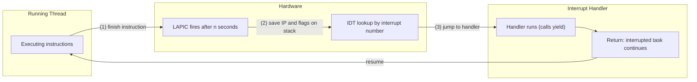

# Concurrency, Parallelism, and Rust: Implementing Threads

A **thread** is built from a [[Concurrency, Parallelism, and Rust/Coroutines|coroutine]] by making `yield()` happen automatically: a timer interrupt forces the running thread to yield after some time quantum, and another thread gets scheduled. This turns cooperative multitasking into preemptive multitasking, but it also exposes the scheduler's shared data (the ready queue) to being interrupted mid-update, which is the central problem of this file.

---

## From Coroutines to Threads

- **Coroutine to thread**: a timer interrupt calls `yield()` on the running thread's behalf.
- **Time quantum**: the amount of time a thread may run before it is forced to yield.
- **LAPIC** (core-Local Advanced Programmable Interrupt Controller): the hardware timer that interrupts every $n$ seconds (the quantum it has been given). Each core gets its own LAPIC.
- **Without a LAPIC (user-mode)**: the OS delivers **signals** that can be masked and unmasked the same way interrupts are.

### What the CPU Does When an Interrupt Occurs (x86)

1. Finish the current instruction.
2. Save the interrupted code's instruction pointer and flags on the stack.
3. Look up the handler for this interrupt's number in the **Interrupt Descriptor Table (IDT)** and jump to it.
   - The IDT is an array of handler addresses indexed by interrupt number. The OS fills it in and tells the CPU where to find it.



### Writing an Interrupt Handler

- When the handler returns, the interrupted task continues where it left off.
- If the handler itself takes longer than the $n$ given to the LAPIC, it could be interrupted by the next tick. To prevent this:
  - The CPU disables interrupts while it runs the handler. Returning turns them back on (kernel-mode only).
  - Interrupts are controlled manually with `cli` (disable / mask interrupts) and `sti` (enable / unmask interrupts).
- A **critical section** is code that only one thread may run at a time.
- Real-world considerations:
  - Re-enable interrupts only if they were on before `yield`, otherwise a nested disable would be wrongly undone.
  - Do not forget to re-enable them; a language library usually helps with this.

---

## Why Do We Have This Bug

The ready queue can be corrupted if a timer interrupt arrives while `yield()` is in the middle of modifying it.

- **Old school of thought**: we forgot a critical section around code that isn't thread-safe.
- **New school of thought**: we had shared mutable data (the ready queue) without synchronization.
  - Check all shared mutable data, not just code that "looks" dangerous.

On a single core, a critical section (interrupts off) protects shared data like the ready queue. With several cores, disabling interrupts isn't enough.

---

## Multicore

We need to synchronize across cores. A critical section must keep out the other core running the same code in parallel. Disabling interrupts only stops interrupts on *this* core; another core can still touch the ready queue at the same time.

---

## Custom Synchronization Primitives

Two strategies exist for a thread that cannot proceed yet:
- **Blocking**: go onto a queue until you can run.
- **Spinning**: loop until you can run.

### Atomic Read-Modify-Write Instructions

Spinning needs hardware-supported operations that read and modify memory in a single indivisible step:

| Instruction | Behavior |
| :--- | :--- |
| **test-and-set** | Set the value, and get the old value |
| **compare-and-swap** | Set the value **if** the old value is $x$ (and say whether it did) |
| **fetch-and-add** | Add to the value, and get the old value |

Limitations:
- This requires hardware support for atomic operations.
- The compiler can rewrite code to be more efficient in ways we did not intend. `volatile` on a value tells the compiler not to optimize and to keep reading it from memory since there are side effects. Me: this only fixes the compiler/caching problem, not ordering between cores (see [[Concurrency, Parallelism, and Rust/Writing Multithreaded Code|Writing Multithreaded Code]]).

### Spinlock

A **spinlock** is the spinning variant of a mutex: instead of blocking, keep checking whether we can grab the lock.
- It wastes a lot of energy because the core is just spinning.
- Only use it for short critical sections.

```cpp
std::atomic<int> flag{0};

void lock() {
    // Spin until we are the thread that changes flag from 0 to 1
    int expected = 0;
    while (!flag.compare_exchange_strong(expected, 1)) {
        expected = 0;  // a failed CAS overwrites expected with the current value
    }
}

void polite_lock() {
    int expected = 0;
    while (!flag.compare_exchange_strong(expected, 1)) {
        expected = 0;
        pause();  // tell the CPU we are spinning
    }
}

void unlock() {
    flag.store(0);
}
```

- We can spin more politely by using `pause` to tell the CPU to slow down while it spins. In the kernel we can also turn the core off until the atomic changes.

### Non-Preemptive Contexts

Contexts where yielding is not allowed (for example, while holding a spinlock).

### Spinlocks Don't

- Create a cyclic dependency.
- Call `lock()` twice on the same lock (the thread spins forever waiting on itself).
- Call `yield` while locked.
- Forget to call `unlock`.

### Interrupt-Safe Spinlocks (ISL)

A plain spinlock is not enough in the kernel: if a thread holds the lock and an interrupt handler on the same core tries to take it, the handler spins forever because the lock holder cannot run until the handler returns. An **Interrupt-Safe Spinlock (ISL)** also disables interrupts while the lock is held.

```cpp
atomic<bool> atom;

void unsafe_lock() {
    while (atom.test_and_set()) { pause(); }
    // Disable interrupts so the critical section can finish,
    // but this is unsafe: we can be interrupted between
    // acquiring the lock and disabling interrupts
    disable_interrupts();
}

void safe_lock() {
    disable_interrupts();
    while (atom.test_and_set()) {
        // Let interrupts through while we wait so we don't block them
        enable_interrupts();
        pause();
        disable_interrupts();
    }
}

void unlock() {
    atom.store(false);
    enable_interrupts();
}
```

Thread-safe `yield` uses the ISL around the scheduler's shared data:

```cpp
void yield() {
    isl.lock();
    // ... modify ready queue, switch routines ...
    isl.unlock();
}
```

---

## Lessons Learned

- Shared mutable state (the ready queue) is the root of evil; we need synchronization between threads.
- Locks are hard, interrupts are hard, multicores are harder, and multicore + interrupts are harder still.
  - Every instruction can be interleaved and/or interrupted unless it is in a critical section (lock).
  - In the kernel, a lock that an interrupt handler might also take must be an ISL (`spin_lock_irqsave`).
- Spinlocks and ISLs are useful for protecting scheduling code.
- Spinlocks are dangerous in user code.
  - Getting preempted while holding a spinlock is expensive: every other thread keeps spinning until the holder is scheduled again.
  - Spinlocks are only useful in scheduler code.
- ISLs are typically not exposed to user code.
- A **mutex** is what user code wants.

---

## Industry Standard Terms

| Course Term | Industry Equivalent |
| :--- | :--- |
| LAPIC | Local APIC timer |
| Time quantum | Time slice |
| Interrupt-Safe Spinlock (ISL) | `spin_lock_irqsave` (Linux) |
| `cli` / `sti` | Mask / unmask interrupts |
| test-and-set, compare-and-swap, fetch-and-add | Atomic RMW primitives (`xchg`, `cmpxchg`, `xadd` on x86) |
| Non-preemptive context | Atomic context |

---

## Related

- [[Concurrency, Parallelism, and Rust/Coroutines|Coroutines]]
- [[Concurrency, Parallelism, and Rust/Stack Management and Channels|Stack Management and Channels]]
- [[Concurrency, Parallelism, and Rust/Threads and Cores|Threads and Cores]]
- [[Concurrency, Parallelism, and Rust/Writing Multithreaded Code|Writing Multithreaded Code]]
