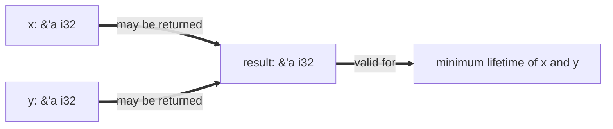

# Concurrency, Parallelism, and Rust: Borrow Checker

This note continues [[Concurrency, Parallelism, and Rust/Introduction to Rust/Introduction to Rust#Borrowing|Borrowing]]. It covers **lifetimes**, the information the **borrow checker** uses to prove that a reference never outlives the value it points to, and how we name lifetimes when a function takes references and returns one.

---

## Lifetimes

- A **lifetime** is the span of the program during which a reference is valid.
- A reference's lifetime can be **no longer than the lifetime of the value it borrows**. If it were longer, the reference would point at memory that the owner has already freed.
- Usually `rustc` works out lifetimes for us, so we do not write them.
- When it cannot, we can **name** a lifetime:
  - `'a` is a lifetime name we choose.
  - `'static` means the reference is valid for the **whole program** (it has static duration).

---

## Lifetimes Across a Function Call

Naming becomes necessary when a function takes **two or more references** and returns a reference. The returned reference points into one of the inputs, but which one can depend on runtime values, so the compiler cannot decide the returned lifetime by inspection.

- If we do not define the lifetime, we cannot reason about how long the returned reference is valid.
- Defining `'a` states a contract:
  - `'a` is the **minimum lifetime**: it is valid for as long as the other parameters are valid during that lifetime.
  - Because the return value is also annotated with `'a`, the caller knows the result is valid for at least that minimum.
  - We only guarantee the minimum lifetime, nothing longer.

```rust
// x, y, and the result all share 'a, so the result is valid
// only as long as the shorter-lived of x and y
fn pick<'a>(x: &'a i32, y: &'a i32) -> &'a i32 {
    if *x > *y { x } else { y }
}
```



### Why We Cannot Mutate Either Input

- The function **assumes both inputs are borrowed**, so we cannot mutate either `x` or `y` while the result is alive.
- Even if the lifetime of `a` is smaller than that of `b`, we still cannot modify `a` or `b`: the compiler does not know at runtime which one the result points into (i.e. which lifetime is the longest).
- This all comes down to **data races**: a mutation through one name while another reference may still be reading is exactly the problem that the borrow checker rules out (see [[Concurrency, Parallelism, and Rust/Introduction to Rust/Introduction to Rust#Data Race|Data Race]]).

---

## Related

- [[Concurrency, Parallelism, and Rust/Introduction to Rust/Introduction to Rust|Introduction to Rust]]: ownership, moves, and borrowing
- [[Concurrency, Parallelism, and Rust/Introduction to Rust/String, Slices, and Borrowing|String, Slices, and Borrowing]]: references to strings and slices, whose lifetimes this note governs
- [[Concurrency, Parallelism, and Rust/Introduction to Rust/Traits|Traits]]

## Industry Standard Terms

- **Lifetime (`'a`)** → reference scope / region (the "region" in region-based memory management)
- **`'static`** → whole-program lifetime (e.g. string literals in read-only data)
- **Borrow checker** → static aliasing and lifetime analysis (compile-time, no runtime cost)
