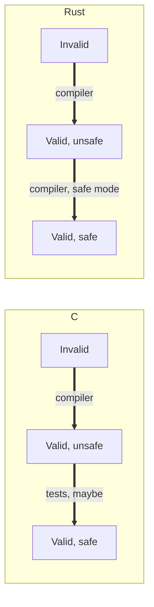

# Concurrency, Parallelism, and Rust: Introduction to Rust

**Rust** is a systems language that keeps the strengths of C (control over memory and predictable performance) while moving a large class of bugs, especially memory errors and data races, from runtime testing to compile time. This note motivates Rust by looking at what C gets right and wrong, then builds up the rules the Rust compiler enforces: mutable and immutable references, then ownership, then the stronger type system that ties them together.

---

## Why Rust

### What C Does Well

- **Direct control over how data is laid out in memory.**
- **Direct mapping from the language to machine language**, which gives predictable performance.
- **Explicit memory allocation and deallocation**, so there are no garbage-collection pauses at unexpected times.

### What C Does Badly

These are the same features seen from the other side:

| C feature | The downside |
| :--- | :--- |
| Direct control over data layout | Nothing stops you from misusing it |
| Direct mapping to machine instructions | No high-level constructs such as iterators or data structures |
| Explicit allocation and deallocation | Nothing checks that you got it right |
| **Undefined behavior** | The C standard places no requirement on what happens: the program may crash, print garbage, or seem to work |

### Concurrency Is Exceptionally Difficult

- Concurrency bugs are often **runtime errors** and need extensive test suites to catch.
- They are hard to avoid, since concurrency matters for performance.
- In C, nothing protects you from **data races**.
- Testing gives weak guarantees for concurrent systems, because a bad interleaving may simply never occur during the test.
- We want all the help we can get.

---

## What Rust Aims For

- Efficient, fearless, concurrent systems programming.
- Memory safety, with a rich type system.
- An ergonomic developer experience.
- Interoperability with C/C++.

---

## Categories of Code

Every program falls into one of three categories:

- **Invalid**: syntax errors and type errors.
- **Valid, unsafe**: undefined behavior, data races, null dereferences.
- **Valid, safe**: valid syntax, concurrency with carefully reasoned locking, and every exception and edge case handled.

### Who Checks Each Category

| Category | C | Rust |
| :--- | :--- | :--- |
| Invalid | The compiler | The compiler |
| Valid, unsafe | Tests, maybe | The compiler (in safe mode) |
| Valid, safe | Tests | Tests |



- Rust **moves the line between unsafe and safe from the tests to the compiler**.
- The compiler still cannot check that the program does what you meant: deadlocks and logic bugs are still yours.

---

## A Stronger System

The goal is to let the compiler rule out races instead of hoping tests find them.

- Problems arise when data is accessed and modified at the same time.
- So we disallow creating multiple ways of mutating one piece of data, and we want the compiler to detect any attempt.
- We give up some freedom (the freedom to be unsafe) to get a safer program.

The following pseudocode has a race: both threads increment `a` through the same reference.

```rust
fn incr(&val) {
    val += 1;
}

fn main() {
    a = 0;
    t1 = thread_run(incr, &a);
    t2 = thread_run(incr, &a);
    join(t1); join(t2);
    assert a == 2;
}
```

### Data Race

A **data race** occurs when two instructions from different threads access the same memory, at least one is a write, and no synchronization orders them.

- To rule out data races forever: data cannot be shared if at least one of the references will write.

---

## Mutable and Immutable References

Multiple access is only a problem if someone writes through a reference. Rust therefore splits references into two kinds:

- **Mutable reference**: `&mut`
- **Immutable reference**: `&`

Rules:

- Multiple immutable references are fine, as nobody writes.
- You cannot write through an immutable reference.
- Only one mutable reference to a piece of data may exist at a time.

```rust
fn incr(&mut val) { // tell the compiler we will write
    val += 1;
}

fn main() {
    a = 0;
    t1 = thread_run(incr, &mut a);
    t2 = thread_run(incr, &mut a); // 2 mutable references is a compiler error
    join(t1); join(t2);
    assert a == 2;
}
```

- A `&mut` can be passed where only a `&` is expected, because a function that only reads is satisfied by a reference that could also write.

```rust
fn incr(& val) { // tell the compiler we will only read
    val += 1;    // compiler error: cannot write through an immutable reference
}

fn main() {
    a = 0;
    t1 = thread_run(incr, &mut a);
    join(t1);
}
```

---

## Ownership

- Idea: associate memory with a **single owner variable**, which is responsible for freeing it.
- Observation: when `a` goes out of scope, nothing can reach its memory anymore, so it can be cleaned up at that point.
- We do not need `free` anymore: the memory is freed automatically at the end of `main`.

---

## Types

- Variables are **immutable by default**, which forces you to reason about mutability: a variable is only mutable if declared with `mut`.
- Reassigning to a different type is not allowed, even when the variable is mutable.
- Types can be written explicitly or **inferred** from context by the Rust compiler.

### Scalar

- Same as the integral types in C++:
  - Signed integers: `i8` up to `i128`, plus `isize` (pointer size).
  - Unsigned integers: `u8` up to `u128`, plus `usize`.
  - Floating point: `f32` and `f64`.
  - `char`: a Unicode scalar value, 4 bytes.
  - `bool`.

### Compound

- **Array**: a fixed length and a single element type.
  - `[1, 2, 3]`, or `[0; 3]` for three 0's.
- **Tuple**: a fixed length with mixed types.
  - `(1, true, 2, false)` has type `(i32, bool, i32, bool)`.

### User-Defined Types: Structs

- **Struct**: named fields, like a C-style struct.
- **Tuple struct**: a named tuple.
- **Unit struct**: no fields.

```rust
struct Unit; // unit struct, no fields
struct Pair(i32, f32); // tuple struct
struct Point { // a struct with named fields
    x: f32,
    y: f32,
}

fn main() {
    let _unit = Unit;
    let pair = Pair(1, 0.1);
    let point = Point { x: 493.0, y: 2026.0 };
    println!("{} {}", pair.0, pair.1);   // by position
    println!("{} {}", point.x, point.y); // by name
}
```

### User-Defined Types: Enums

- **Enum**: a value is exactly one of several **variants**.
  - A variant can carry data, in any of the struct flavors above.
  - It is a C `enum` and a C `union` in one (a **tagged union**): the tag records which variant the value holds, and the data is only valid for that variant.
- `match` runs the arm for the variant the value holds.
  - It must cover every variant, so adding a variant later turns every incomplete `match` into a compile error.

```rust
enum Shape {
    Dot,                  // no data
    Circle(f32),          // tuple-like
    Rect { w: f32, h: f32 }, // named fields
}

fn area(s: Shape) -> f32 {
    match s {
        Shape::Dot => 0.0,
        Shape::Circle(r) => 3.14 * r * r,
        Shape::Rect { w, h } => w * h,
    }
}
```

---

## Dropping

- Every value is **dropped** when its variable goes out of scope, even a scalar like `x`. Dropping an `i32` has nothing to free.
- If the value holds memory on the heap, that memory is freed immediately at the drop (**RAII**).

### Vec and the vec! Macro

A `Vec<T>` is a growable array whose elements live on the heap. It can be built by hand or with the `vec!` macro:

```rust
fn main() {
    let mut v: Vec<i32> = Vec::with_capacity(3);
    v.push(1);
    v.push(2);
    v.push(3);
    let w: Vec<i32> = vec![1, 2, 3]; // the same vector, written with a macro
    println!("{v:?} {w:?}");         // :? is the debug format, so it prints the whole Vec
}
```

### Returning Heap Pointers

- Can we return heap pointers? Yes. In Rust, owning heap memory is part of a value's type, so the owner is responsible for the memory.
- References can point to either stack or heap data.
- `Box` stores a value on the **heap** instead of the stack: `Box::new(493)`.

---

## Ownership Rules

- Every value in Rust has an **owner**, there is only **one owner at a time**, and once the owner goes out of scope the value is dropped.
- We can have many shared references, but only one owner.

### Moves

- A **move** transfers ownership from `a` to `b`. It happens when assigning `b = a` or calling `f(a)` where the function does not borrow.
- After a move, `a` can no longer be used.
- If the type is **Copy**, the value is copied instead and `a` can still be used.
  - Scalar types implement the `Copy` trait (a plain `memcpy`).
  - Other types can be duplicated explicitly with `clone`.

---

## Borrowing

- **References borrow** a value but never take ownership.
- There are two kinds: shared references `&T` and mutable references `&mut T`.
  - To the same data, you may have one mutable reference **or** any number of shared ones, never both at once.
- Conceptually a reference sits somewhere between a C pointer and a C++ reference.
- Use `*` to **dereference**: `*r`.
  - `let x = *r;` copies the value out, so it only works if the type is `Copy`.
- A borrow ends at its **last use**, and the compiler reasons about this for us.

---

## A Stronger Type System

- Types are how programmers communicate with the compiler.
  - Binaries have no types: the processor just reads memory at an address, with an expected size.
- Strong types enforce **invariants**.
- If you create a reference, the compiler must prove that the reference goes out of scope before the thing it points to does.
- There is no reinterpreting memory as an unrelated type, and no undefined behavior (in safe Rust).

---

## Protocol Specification

### Formal Definition

Two memory accesses $a_1$ (thread $T_1$) and $a_2$ (thread $T_2$) form a data race iff:

$$\text{addr}(a_1) = \text{addr}(a_2) \;\wedge\; T_1 \neq T_2 \;\wedge\; (\text{write}(a_1) \vee \text{write}(a_2)) \;\wedge\; \neg(a_1 \prec a_2 \vee a_2 \prec a_1)$$

where $\prec$ is the happens-before order established by synchronization.

### Simplified Explanation

Two threads touch the same spot, at least one changes it, and nothing makes one wait for the other. Rust's rule (many readers or exactly one writer) makes this combination impossible to write in safe code.

---

## Related

- [[Concurrency, Parallelism, and Rust/Introduction to Rust/String, Slices, and Borrowing|String, Slices, and Borrowing]]: `Result`, `Option`, slices, and strings
- [[Concurrency, Parallelism, and Rust/The Concurrent Mindset/Deep Dive|The Concurrent Mindset: Deep Dive]]: Rust `Send` and `Sync`
- [[Concurrency, Parallelism, and Rust/Implementing Threads/Synchronization Primitives|Synchronization Primitives]]
- [[Concurrency, Parallelism, and Rust/Threads and Cores/Threads and Cores|Threads and Cores]]
- [[Systems Programming/Smart Pointers/Shared Pointer|Shared Pointer]]: ownership in C++

## Industry Standard Terms

- **Mutable / immutable reference** → exclusive (`&mut`) / shared (`&`) borrow
- **Single owner variable** → ownership (RAII-style deterministic destruction)
- **Valid, unsafe** → memory-unsafe or undefined behavior
- **Enum (tagged union)** → sum type / algebraic data type
- **Drop** → destructor (RAII)
- **Data race** → data race (as defined by the C11 / C++11 memory models)
