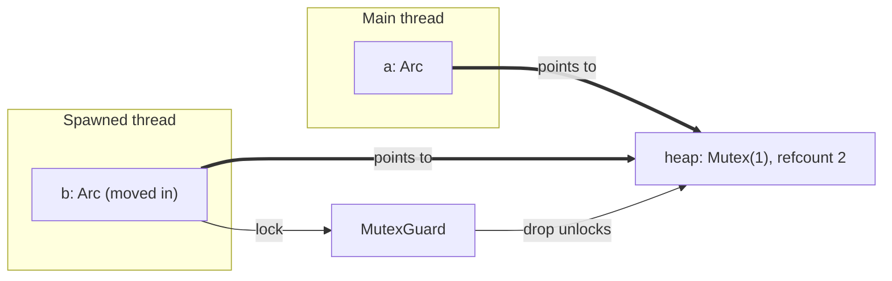

# Concurrency, Parallelism, and Rust: Smart Pointers

This note covers the pointer types Rust uses to own heap data: `Box<T>` for a single owner, `Rc<T>` and `Arc<T>` for shared ownership, and `Mutex<T>` for sharing mutable data across threads. It builds on [[Concurrency, Parallelism, and Rust/Introduction to Rust/Introduction to Rust#Ownership|ownership]] and the [[Concurrency, Parallelism, and Rust/Introduction to Rust/Borrow Checker|Borrow Checker]], and the closures it passes between threads are covered in [[Concurrency, Parallelism, and Rust/Introduction to Rust/Closures and Trait Objects|Closures and Trait Objects]].

---

## Pointer Types

Rust splits pointers by **who owns the data** and whether ownership is shared.

![[Pointer Types.png]]

| | Owned | Borrowed |
|---|---|---|
| Value | `T` | |
| Pointer | `Box<T>` | `&T` |
| Shared | `Rc<T>` | |

- Rust does not let you specify a pointer as null (see [[Concurrency, Parallelism, and Rust/Introduction to Rust/String, Slices, and Borrowing#Option<T>|Option]] for how absence is expressed).
- Raw pointers are `unsafe`.

---

## Box

- **`Box<T>`**: a `T` on the heap, with exactly one owner.
- The `Box` itself is owned by a stack variable, so the compiler knows when to drop it, and you can get a `&mut` to the value inside.
- Because there is one owner, a **double free can never happen**: `drop` itself is safe.

```rust
let a: Box<i32> = Box::new(5);
let b: Box<i32> = a; // moves a: a can no longer be used
```

- A `Box<[T]>` is a boxed slice, for example created from a `Vec`:

```rust
let s: Box<[i32]> = vec![1, 2, 3].into_boxed_slice();
```

### Swap

- `std::mem::swap()` swaps the values behind two `&mut`.
- Each side always holds a valid value, so neither side is ever left empty or moved-from.

### Is unsafe Really Unsafe

- `unsafe` marks code that is easy for a person to look at and prove correct, but that the compiler cannot prove.
- We add `unsafe` to promise the compiler that it is safe.

---

## Shared Ownership: Rc

- **`Rc<T>`**: a reference-counted smart pointer that gives a value several owners. It is similar to C++'s [[Systems Programming/Smart Pointers/Shared Pointer|shared_ptr<T>]].
- `Rc::clone()` increments the count and `drop` decrements it; the value is freed when the count reaches 0.

```rust
use std::rc::Rc;

fn main() {
    let x = Rc::new(334);
    {
        let y = Rc::clone(&x); // clones so ref_count++
        println!("{y}: count {}", Rc::strong_count(&x));
    } // y is dropped, so ref_count--
    println!("count {}", Rc::strong_count(&x));
}
```

![[Rc in Memory.png]]

- Both `x` and `y` live on the stack and point at one heap allocation that stores the strong count next to the value (`strong 2`, `334`).

---

## Thread-Safe Shared Ownership: Arc

- **`Arc<T>`**: an **atomically** reference-counted smart pointer, also similar to `shared_ptr<T>`.
- `Arc::clone()` increments the atomic refcount, and `Arc::drop()` decrements it, calling `free()` when the refcount reaches 0.

```rust
let a = Arc::new(1);
let b = a.clone();
thread::spawn(move || {
    dbg!(b);
});
```

- The `move` closure gives the spawned thread its own `Arc`, so each thread owns a handle to the data.

### Why Rc Cannot Cross Threads

- The refcount in an `Rc` is **not atomic**, so two threads updating it at once would race.
- Reference-counted pointers like `Rc` are therefore not `Send` (see below).

### Spawning a Thread

```rust
// std::thread::spawn
pub fn spawn<F, T>(f: F) -> JoinHandle<T>
where
    F: FnOnce() -> T + Send + 'static,
    T: Send + 'static,
{ ... }
```

- `FnOnce`: the closure runs once (see [[Concurrency, Parallelism, and Rust/Introduction to Rust/Closures and Trait Objects#Fn, FnMut, FnOnce|Fn, FnMut, FnOnce]]).
- `Send`: the value can safely be transferred between threads.
- `'static`: the closure cannot contain references with a lifetime shorter than `'static`, so the spawned thread cannot outlive borrowed data it uses (see [[Concurrency, Parallelism, and Rust/Introduction to Rust/Borrow Checker|Borrow Checker]]).

---

## Send and Sync

- **`Send`** (trait): a type whose values can safely be transferred between threads.
- **`Sync`** (trait): a type that can safely be shared between threads through shared references. `T` is `Sync` if and only if `&T` is `Send`.
- `Send` is about transferring ownership, while `Sync` is about sharing references.
  - `Rc` is neither `Send` nor `Sync`, since its reference count is not atomic.
  - `Arc` uses atomic reference counting, allowing thread-safe shared ownership.

---

## Sharing Mutable Data: Arc and Mutex

`Arc<T>` shares ownership, but a shared `T` cannot be mutated. Wrapping the value in a `Mutex` gives the threads a shared lock.

```rust
// creates a shared lock
let a = Arc::new(Mutex::new(1));
let b = a.clone();

thread::spawn(move || {
    let mut guard: MutexGuard<i32> = b.lock().unwrap();
    *guard += 1;
});
```

- `lock()` returns a `MutexGuard`, and **dropping the `MutexGuard` unlocks the mutex**, so the lock is released when `guard` goes out of scope.
- `MutexGuard` is not `Send`, but `Mutex` is.



---

## Related

- [[Concurrency, Parallelism, and Rust/Introduction to Rust/Closures and Trait Objects|Closures and Trait Objects]]: `move` closures, `Box<dyn Trait>`
- [[Concurrency, Parallelism, and Rust/Introduction to Rust/Introduction to Rust|Introduction to Rust]]: ownership, moves, and dropping
- [[Concurrency, Parallelism, and Rust/The Concurrent Mindset/Deep Dive|Deep Dive: Send and Sync]]
- [[Concurrency, Parallelism, and Rust/Writing Multithreaded Code/Mutual Exclusion Locks|Mutual Exclusion Locks]]
- [[Systems Programming/Smart Pointers/Shared Pointer|C++ Shared Pointer]] and [[Systems Programming/Smart Pointers/Unique Pointer|C++ Unique Pointer]] (`Box` is the Rust analogue of `unique_ptr`)

## Industry Standard Terms

- **`Box<T>`** → unique ownership pointer (C++ `unique_ptr<T>`)
- **`Rc<T>`** → non-atomic reference-counted pointer (C++ `shared_ptr<T>` with a non-atomic count)
- **`Arc<T>`** → atomic reference-counted pointer (C++ `shared_ptr<T>`)
- **`Mutex<T>` / `MutexGuard`** → mutual exclusion lock / scoped lock (C++ `std::mutex` + `lock_guard`)
- **`Send` / `Sync`** → thread-safety marker traits
