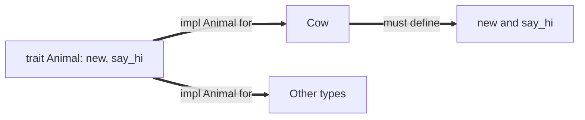

# Concurrency, Parallelism, and Rust: Traits

This note continues [[Concurrency, Parallelism, and Rust/Introduction to Rust/Introduction to Rust|Introduction to Rust]]. A **trait** describes behavior that a type must provide. It is how Rust writes code that works over many types, and it underlies things already seen: `Copy`, `Drop`, and `Iterator`.

---

## What a Trait Is

- A trait **names the required methods** a type must implement, and can also provide:
  - methods with **default bodies**, and
  - **associated types**.
- It is like a Java interface.
- `impl Trait for Type { ... }` implements the trait for a type, and we must implement every required function.

```rust
trait Animal {
    // associated function: basically a constructor
    fn new(name: String) -> Self;

    // method
    fn say_hi(&self);
}

struct Cow {
    name: String,
}

impl Animal for Cow {
    // we need to implement the functions in Animal
    fn new(name: String) -> Self {
        Cow { name }
    }

    fn say_hi(&self) {
        println!("cow named {}", self.name);
    }
}
```

- `Self`: the type implementing the trait.
- `&self`: a reference to the value the method is called on.



---

## Generics and Trait Bounds

A generic function needs to be **trait bound** when it uses behavior of its type parameter:

```rust
fn introduction<T>(animal: T) {
    animal.say_hi(); // compiler error: not every T has say_hi
}

// trait bound: ensures the type T implements the trait Animal
fn introduction<T: Animal>(animal: T) {
    animal.say_hi();
}

// shorthand for the same thing
fn introduction(animal: impl Animal) {
    animal.say_hi();
}
```

- A `where` clause lists several bounds. We want the **minimum trait bounds** that make the body compile.

```rust
fn sum_all<T>(items: &[T]) -> T
where
    // T has to implement all three of these traits
    T: std::ops::Add<Output = T> + Copy + Default,
{
    let mut total = T::default();
    for &x in items {
        total = total + x;
    }
    total
}
```

---

## Standard Library Traits

### Drop

- `T: Drop` requires `drop(&mut self)`, which runs when a `T` goes out of scope.
  - It is a **destructor**: it is how a `Vec` frees its buffer.
- You never call `t.drop()` yourself.
- To drop early, use `std::mem::drop`, which takes ownership of its argument so the value is dropped as the function returns: `pub fn drop<T>(_x: T) {}`.

### Marker Traits

Marker traits have **no methods**: they say something about a type.

- `T: Copy`: copying is a plain byte-for-byte copy, and assignment copies instead of moving (see [[Concurrency, Parallelism, and Rust/Introduction to Rust/Introduction to Rust#Moves|Moves]]).
  - Derive it along with `Clone`, and only if every field is `Copy`.
- `Sized`: the size is known at compile time.
  - Types such as `str`, `[T]`, and `dyn Trait` are not `Sized`, which is why we use them behind a reference (see [[Concurrency, Parallelism, and Rust/Introduction to Rust/String, Slices, and Borrowing#String Literals|String Literals]]).

### Derive

- `derive` is a Rust macro that **writes the impl for us** for multiple traits, when every field has it.

```rust
// this works as these are marker-style traits
#[derive(Debug, Clone, Copy)]
struct Foo {
    bar: u64,
    baz: i32,
}
```

---

## Associated Types

- A trait can name a type that each implementer chooses.
- Below, `Self::Food` is `Grass` for a `Cow`.

```rust
struct Grass;

trait Animal {
    type Food;
    fn eat(&mut self, food: Self::Food);
}

struct Cow {
    meals: u32,
}

impl Animal for Cow {
    type Food = Grass;
    fn eat(&mut self, _food: Grass) {
        self.meals += 1;
    }
}
```

---

## Iterator

- `Iterator` is a trait with an associated type `Item` and **one method to write**: `fn next(&mut self) -> Option<Self::Item>`.
- `next` returns `Some(item)` for the next item, and `None` when there are no more (see [[Concurrency, Parallelism, and Rust/Introduction to Rust/String, Slices, and Borrowing#Option<T>|Option]]).
- Once implemented, a `for` loop uses it to iterate, and we get dozens of methods for free.
- Iterators are **lazy**: each `next()` call does one step.

```rust
struct Counter {
    value: u64,
}

impl Iterator for Counter {
    type Item = u64; // set the item to u64
    fn next(&mut self) -> Option<Self::Item> {
        if self.value == 0 {
            return None;
        }

        let v = self.value;
        self.value -= 1;
        Some(v)
    }
}

fn main() {
    for num in (Counter { value: 4 }) {
        println!("num is {num}");
    }
}
```

Trace: the loop calls `next` until `None`, printing 4, 3, 2, 1.

---

## Closures

- `|r| r.width == 3` is a **closure**: an unnamed function.
- Me: like a lambda? (The original notes stop here.)

---

## Related

- [[Concurrency, Parallelism, and Rust/Introduction to Rust/Introduction to Rust|Introduction to Rust]]: ownership, moves, and dropping
- [[Concurrency, Parallelism, and Rust/Introduction to Rust/Borrow Checker|Borrow Checker]]: lifetimes on references
- [[Concurrency, Parallelism, and Rust/Introduction to Rust/String, Slices, and Borrowing|String, Slices, and Borrowing]]: `Option` and `Result`

## Industry Standard Terms

- **Trait** → interface / type class (Java interface, Haskell type class, C++ concept)
- **Trait bound** → generic constraint / bounded polymorphism
- **`impl Trait for Type`** → interface implementation
- **Associated type** → type member of an interface
- **`Drop`** → destructor (C++ RAII)
- **Marker trait** → tag interface
- **Closure** → lambda / anonymous function
