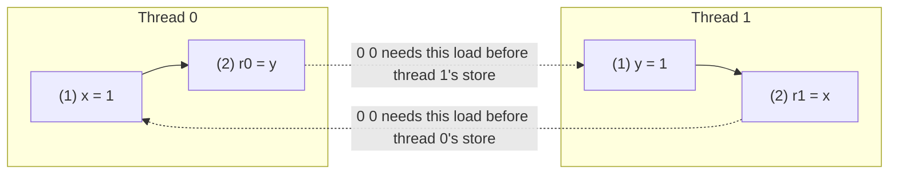
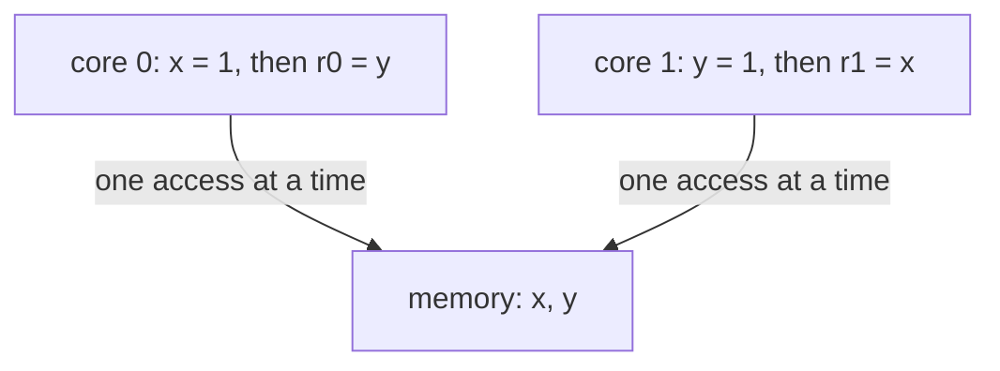
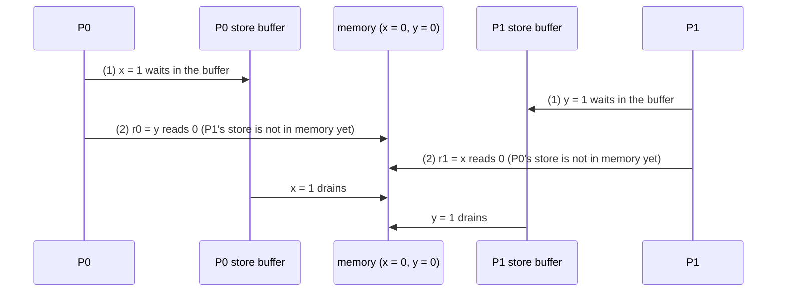
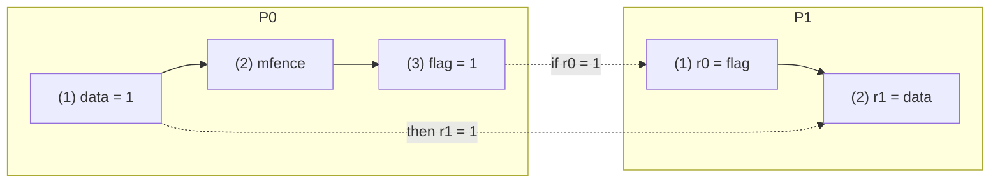

# Concurrency, Parallelism, and Rust: Memory Consistency

## Goals

- Explain what **sequential consistency** guarantees, and why hardware relaxes it.
- Explain **store buffers**, and how they can give results that differ from every interleaving.
- Identify which reorderings x86 and ARM allow, and use a **fence** to prevent certain reorderings.
- Choose a Rust atomic `Ordering`: `Relaxed`, `Release`/`Acquire`, or `SeqCst` (the choice itself continues next lecture, since this deck is "to be continued").

---

## From One Location to Many

- **Coherence** (see [[Concurrency, Parallelism, and Rust/Cache Coherence|Cache Coherence]]): the writes to **one** location are seen in one order.
- **Consistency** (today): in what order does a core see accesses to **different** locations?
- Every location can be coherent while a core still sees writes to two locations in an order that no interleaving gives. This is the whole point of the lecture.
- Review the store-buffer example from lecture 05 (see [[Concurrency, Parallelism, and Rust/Writing Multithreaded Code/Memory Reordering and Fences|Memory Reordering and Fences]]) after this lecture.

---

## What Can This Print?

```cpp
// x = y = 0

thread 0:
x = 1
r0 = y

thread 1:
y = 1
r1 = x

// thread 0 and thread 1 complete
print r0, r1
```

- Candidates: `0 0`, `0 1`, `1 0`, `1 1`.
- Interleavings, as if both threads ran on **one core**, give `0 1`, `1 0`, and `1 1`.
  - `0 1`: thread 0 runs fully first, so `r0 = 0`, then thread 1 stores `y` and loads `x = 1`.
  - `1 0`: the mirror image.
  - `1 1`: both stores run before either load.
- `0 0` needs **both loads to run before both stores**. Each thread's load comes after its own store in program order, so no interleaving does that.
- Caches are coherent (see [[Concurrency, Parallelism, and Rust/Cache Coherence|Cache Coherence]]): no core reads a stale copy of `x` or `y`. So coherence alone does not explain a `0 0`; something else must.



For `0 0`, thread 0's load must precede thread 1's store, and thread 1's load must precede thread 0's store. Combined with the two program orders, this forms a cycle, and no single order can contain a cycle.

---

## Sequential Consistency

- **Sequential consistency (SC)**, Lamport (1979): the result is as if
  - all accesses ran **one at a time**, in some order, and
  - each thread's accesses appear in **its program order**.
- So two cores give the results of **one core taking turns**.
- Because caches are coherent, we can ignore them and watch memory: memory serves one access at a time.
- This is the model we have used since lecture 06: a schedule is an interleaving (see [[Concurrency, Parallelism, and Rust/Threads and Cores/Programmer View vs Processor View|Programmer View vs Processor View]]).



### Step Through: SC

| Step | Access | Result |
|---|---|---|
| (1) | P0: `x = 1` | memory `x = 1` |
| (2) | P1: `y = 1` | memory `y = 1` |
| (3) | P0: `r0 = y` | `r0 = 1` |
| (4) | P1: `r1 = x` | `r1 = 1` |

- Final result `r0 = 1, r1 = 1`. Sequential consistency allows this, because some interleaving of the threads gives it.
- SC can give: `0 1`, `1 0`, `1 1`.
- x86-TSO can give: `0 0`, `0 1`, `1 0`, `1 1`.

---

## Store Buffers

### The Problem

- A store that misses in the cache waits while the line is fetched (from memory or another cache), possibly **hundreds of cycles**.
- Under sequential consistency, every later load would also wait, because nothing may pass the store.

### One Solution

- **Store buffer**, a performance optimization: a queue where the store waits while later loads go ahead.
- A load checks its **own core's** store buffer first, so a thread sees its own writes. Other cores cannot see what is still sitting in the buffer.

> **x86-TSO (total store order):** all cores agree on one order of stores, each core's in program order; a load can pass its own core's earlier stores.

### Step Through: x86-TSO



- Both stores wait in their store buffers while the same thread's later loads go ahead.
- Both loads read memory before either store drains, so `r0 = 0` and `r1 = 0`.
- Final result `r0 = 0, r1 = 0`. Sequential consistency never gives this. **x86-TSO allows it**: a store can wait in its store buffer while the same thread's later loads go ahead.
- Memory still ends with `x = 1, y = 1`; the buffers just drained after the loads.
- SC can give: `0 1`, `1 0`, `1 1`.
- x86-TSO can give: `0 0`, `0 1`, `1 0`, `1 1`.

### Measured on an x86 Workstation

The same test, with atomics, run for 10^6 rounds with `Relaxed` (no cross-location ordering):

```
// each round: x = y = 0

thread 0:        thread 1:
x.store(1)       y.store(1)
r0 = y.load()    r1 = x.load()

// both finish; count r0 r1
```

| r0 r1 | rounds |
|---|---:|
| 0 0 | 888,393 |
| 0 1 | 108,522 |
| 1 0 | 3,085 |
| 1 1 | 0 |

- One run; your counts will differ.
- The "impossible" `0 0` is by far the most common result, which shows that store buffering is not a rare corner case but the typical outcome when both threads start together.

---

## Relaxed Ordering

- `Relaxed` has **no cross-location ordering**.
- So the compiler and the hardware may reorder the machine code as needed to optimize it, as long as each single location stays coherent.
- This is why the measured test above can produce `0 0`.

---

## Four Kinds of Reordering

For accesses to **different** locations, with nothing between them, which orderings are kept?

| Kept in order? | SC | x86 (TSO) | PSO | ARM |
|---|:---:|:---:|:---:|:---:|
| store, then a later load | yes | no | no | no |
| store, then a later store | yes | yes | no | no |
| load, then a later load | yes | yes | yes | no |
| load, then a later store | yes | yes | yes | no |

- **SC**: sequential consistency. **TSO**: total store order. **PSO**: partial store order (SPARC's model).
- Each model relaxes one more row than the previous, going from SC to TSO to PSO to ARM.
- **ARM** (Apple Silicon, most phones) may reorder **all four**, unless a fence or a dependency orders them.
- x86's only relaxation (store then later load) is exactly what a store buffer does: the load goes ahead while the store waits.
- PSO additionally lets stores to different locations reach memory in a different order than the thread made them (the store buffer drains each location in order, but not across locations).

---

## A Fence: No Later Access Goes First

- A **fence** (`mfence` on x86) stops later accesses from going ahead of earlier ones. For a store buffer, it makes the core drain its buffer before any later load runs.

### Step Through: Store Buffering with `mfence`

```
P0:           P1:
x = 1         y = 1
mfence        mfence
r0 = y        r1 = x
```

- P0's `x = 1` must reach memory before `r0 = y` executes, and likewise for P1.
- So at least one load sees the other thread's store. For example, `r0 = 0, r1 = 1` is allowed: some interleaving of the threads gives it.
- With the fences, x86-TSO can give: `0 1`, `1 0`, `1 1`. The `0 0` result is gone, so the fenced program behaves like sequential consistency.

---

## Message Passing

Message passing is a common pattern: one thread writes `data`, then sets a `flag`; the other waits for the `flag`, then reads `data`.

```
P0:            P1:
data = 1       r0 = flag
flag = 1       r1 = data
```

- If `r0 = 1` (P1 saw the flag), then `r1` should be `1` (P1 should see the data).
- The bad result is `r0 = 1, r1 = 0`: P1 saw the flag but not the data.
- SC can give: `0 0`, `0 1`, `1 1`.

### x86-TSO

- Result `r0 = 1, r1 = 1` is allowed (and so are `0 0` and `0 1`).
- x86-TSO can give: `0 0`, `0 1`, `1 1`. It **never gives `1 0`**, because stores are not reordered with other stores and loads are not reordered with other loads. Message passing works on x86 with no fence.

### PSO

- Final result `r0 = 1, r1 = 0`. Sequential consistency never gives this, and neither does x86-TSO.
- **PSO allows it**: stores to different locations can reach memory in a different order than the thread made them. `flag = 1` becomes visible before `data = 1`.
- PSO can give: `0 0`, `0 1`, `1 0`, `1 1`.

### PSO with a Fence

```
P0:            P1:
data = 1       r0 = flag
mfence         r1 = data
flag = 1
```

- The fence makes `data = 1` reach memory before `flag = 1`, so seeing the flag implies seeing the data. The `1 0` result goes away and the program behaves like SC.



---

## Compilers Reorder Too

- As in lecture 05, a compiler may **reorder, merge or remove** accesses when one thread can't tell (see [[Concurrency, Parallelism, and Rust/Writing Multithreaded Code/Memory Reordering and Fences|Memory Reordering and Fences]]).
- `while !done {}` on a plain `bool` may read `done` once and loop forever, because within one thread nothing in the loop changes `done`.
- So each **language** has a **memory model**, which says what the compiler *and* the hardware may do.

---

## The Rule in C, C++ and Rust

- A **data race** is undefined behavior. It means: two threads access one location, at least one writes, at least one access isn't atomic, and nothing orders them. Safe Rust doesn't compile a data race (see [[Concurrency, Parallelism, and Rust/Writing Multithreaded Code/Data Races and Interleavings|Data Races and Interleavings]]).
- A program with **no data races** whose atomics all use `SeqCst` behaves as if **sequentially consistent**.
- Weaker orderings (`Relaxed`, `Release`, `Acquire`) allow more results, so each use needs its own argument for program correctness.

> Locks, channels and `OnceLock` already order accesses: a lock's `unlock` **releases** and its `lock` **acquires**.

| Ordering | Guarantee |
|---|---|
| `SeqCst` | all atomics behave as one sequentially consistent order |
| `Release` / `Acquire` | the pairing used by `unlock` / `lock` |
| `Relaxed` | no cross-location ordering |

See [[Concurrency, Parallelism, and Rust/Threads and Shared State in Rust|Threads and Shared State in Rust]] for atomics in Rust.

---

## Formal Analysis

### Formal Definition

A multiprocessor execution is sequentially consistent if there exists a total order $<_m$ over all memory accesses such that

$$\forall \text{ threads } t,\ \forall\, a, b \text{ issued by } t:\ a <_{p(t)} b \Rightarrow a <_m b$$

and every load returns the value of the most recent store to its location in $<_m$.

A memory model's relaxation is described by which program-order pairs it drops from this requirement. With $S$ = store and $L$ = load and $X \to Y$ meaning "$X$ then a later $Y$ to a different location":

| Model | Pairs kept in $<_m$ |
|---|---|
| SC | $S\to L,\ S\to S,\ L\to L,\ L\to S$ |
| TSO | $S\to S,\ L\to L,\ L\to S$ |
| PSO | $L\to L,\ L\to S$ |
| ARM | none (without fences or dependencies) |

### Simplified Explanation

Pretend there is one shared line at memory and cores take turns, each in the order its program says. Real hardware lets a core's later accesses jump ahead of earlier ones (a load past a waiting store, in x86), so what you see can be a result no turn-taking order gives. A fence says "finish everything before me first."

---

## Deep Dive

- The two programs in this lecture are standard **litmus tests**: the first (store then load on two locations) is usually called **store buffering (SB)**, and the second is **message passing (MP)**. Each isolates exactly one pair from the four-kinds-of-reordering table, so running them on a machine shows which relaxations it has.
- The rule in C, C++ and Rust is often summarized as **data-race-free implies sequentially consistent (DRF-SC)** when all atomics use `SeqCst`. The language gives you SC if you promise no data races.
- For how real memory systems and coherence interact with consistency in a datacenter machine, see [[Datacenter Systems/Server Memory Systems/Memory Consistency and Cache Coherence|Memory Consistency and Cache Coherence]].

---

## Related

- [[Concurrency, Parallelism, and Rust/Cache Coherence|Cache Coherence]]: coherence orders one location; consistency orders many
- [[Concurrency, Parallelism, and Rust/Writing Multithreaded Code/Memory Reordering and Fences|Memory Reordering and Fences]]: compiler and hardware reordering, `mfence`
- [[Concurrency, Parallelism, and Rust/Threads and Cores/SMT and Out-of-Order Execution|SMT and Out-of-Order Execution]]
- [[Concurrency, Parallelism, and Rust/Writing Multithreaded Code/Data Races and Interleavings|Data Races and Interleavings]]
- [[Concurrency, Parallelism, and Rust/Threads and Shared State in Rust|Threads and Shared State in Rust]]: atomics and `Ordering`
- [[Datacenter Systems/Server Memory Systems/Memory Consistency and Cache Coherence|Memory Consistency and Cache Coherence]]

## Industry Standard Terms

- **Sequential consistency** → SC memory model (Lamport)
- **x86-TSO** → Total Store Order, x86's memory model
- **PSO** → Partial Store Order, SPARC's relaxed model
- **Store buffer** → write buffer / store queue
- **Fence** → memory barrier (`mfence` on x86, `dmb` on ARM)
- **Message passing** → MP litmus test
- **Store buffering** → SB litmus test
- **`Release` / `Acquire`** → release-acquire (C++11 `memory_order_release` / `memory_order_acquire`)

## Sources

- CSE 493L Autumn 2026, Lecture 19: Memory consistency (Chris Thachuk)
