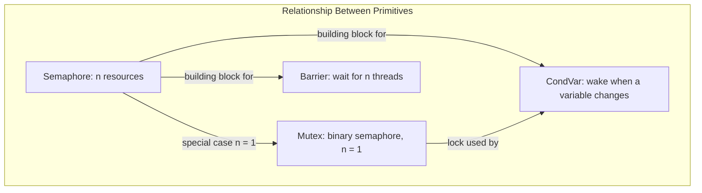

# Concurrency, Parallelism, and Rust: Synchronization Primitives

Threads that share mutable state need a way to coordinate. The primitives below (semaphore, mutex, barrier, condition variable) are the standard coordination tools, and all of them are ultimately built on the kernel's ability to briefly disable interrupts and on [[Concurrency, Parallelism, and Rust/Implementing Threads|spinlocks and interrupt-safe spinlocks]]. This file lists the primitives, explains how they relate to each other, and then walks through the interrupt-safe lock that Homework 3 uses to protect the scheduler.

---

## The Primitives

### Semaphore

A **semaphore** is the building block for all the other primitives.

- It allocates a certain number of resources and atomically takes one out (a thread acquires a resource) and puts one back in (a thread releases it).
- It supports queuing: threads that arrive when no resources are left wait in line, so a semaphore can protect $n$ copies of a resource at once.
- A mutex is a special case (sub-category) of a semaphore, see below.
- Because it is the building block, the other primitives can be implemented using semaphores.

### Mutex

A **mutex** (see [[Concurrency, Parallelism, and Rust/Writing Multithreaded Code/Mutual Exclusion Locks|Mutual Exclusion Locks]]) protects exactly one resource.

- It is a **binary semaphore**: a semaphore whose count is 1, so only one thread can hold it at a time.

### Barrier

A **barrier** (see [[Concurrency, Parallelism, and Rust/Writing Multithreaded Code/Barriers|Barriers]]) is a rendezvous point for a group of threads.

- $n$ threads wait at the barrier until all $n$ threads have arrived, and only then do they all continue.

### Condition Variable (CondVar)

A **condition variable** is a way of using a mutual exclusion lock to wait for something to happen.

- A thread holding the lock waits on the condition variable, which releases the lock and sleeps the thread.
- The thread wakes up when another thread signals that a variable has changed.



### Turing Equivalence

The primitives are **Turing equivalent**: two primitives are equivalent when one can be swapped out for the other. Anything a barrier or condition variable does can be expressed with a semaphore, which is why the semaphore is considered the base building block.

### Why Primitives Are Kernel-Mode

Concurrency primitives are implemented in kernel-mode.

- Implementing them requires disabling interrupts so the check-and-update of the primitive's state is not split by a context switch.
- Malicious code could abuse this ability in user-mode (disable interrupts and never give the CPU back), so user code is never allowed to disable interrupts directly.

---

## Homework 3

Be aware of `schedule()` and `yield_to()` in `threads.cpp`:

- `yield_to` places the **current thread** onto the queue and unlocks the ISL.
- `schedule` places the **TCB** (thread control block) onto the ready queue.

---

## InterruptSafeLock (ISL)

The **InterruptSafeLock (ISL)** is the lock Homework 3 uses to protect scheduler data. It is the same idea as the [[Concurrency, Parallelism, and Rust/Implementing Threads#Interrupt-Safe Spinlocks (ISL)|Interrupt-Safe Spinlock]], implemented with an atomic `exchange` and by remembering whether interrupts were enabled before the lock was taken.

```cpp
void InterruptSafeLock::Lock() {
    bool was = Interrupts::disable();
    while (taken.exchange(true)) {
        Interrupts::enable_to(was);
        pause();
        was = Interrupts::disable();
    }
    was_enabled = was;
}

void InterruptSafeLock::Unlock() {
    bool was = was_enabled;
    taken.set(false);
    Interrupts::enable_to(was);
}
```

### How It Works

- **Lock**:
  - Interrupts are disabled first, and the previous state is saved in `was`.
  - `taken.exchange(true)` atomically sets the flag and returns the old value. If the old value was `true`, someone else holds the lock.
  - While the lock is taken, interrupts are restored to their previous state (`enable_to(was)`) before `pause()`, so that waiting does not block interrupts on this core, and then disabled again before retrying.
  - Once the lock is acquired, the saved state is stored in `was_enabled` so `Unlock` can restore it.
- **Unlock**: reads `was_enabled` into a local, releases the flag, and then restores interrupts to their prior state. The order matters: the saved value is read before the lock is released, because after release another thread can overwrite `was_enabled`.

### Rules for Using It

- Interrupts are disabled while the lock is held.
- This cannot be done in user-mode, because user code must not be able to disable interrupts (assume malicious user code).
- Make sure you are not already holding the lock when you go to disable interrupts.
- If the lock is taken, yield to another thread rather than spinning in a context where that is permitted.

---

## Industry Standard Terms

| Course Term | Industry Equivalent |
| :--- | :--- |
| Semaphore | Counting semaphore |
| Mutex | Binary semaphore / mutual exclusion lock |
| CondVar | Condition variable (`pthread_cond_t`, `std::condition_variable`) |
| Barrier | Barrier / rendezvous (`pthread_barrier_t`) |
| InterruptSafeLock (ISL) | `spin_lock_irqsave` (Linux) |
| TCB | Thread control block / task struct |
| Ready queue | Run queue |

---

## Related

- [[Concurrency, Parallelism, and Rust/Implementing Threads|Implementing Threads]] — Preemption, critical sections, spinlocks, and interrupt-safe spinlocks
- [[Concurrency, Parallelism, and Rust/Writing Multithreaded Code|Writing Multithreaded Code]] — Barriers, data races, and mutual exclusion locks
- [[Operating Systems/Concurrency/Synchronization/Mechanics/Locks/Locks|Operating Systems: Locks]] — Hardware atomic instructions and OS sleep locks
- [[Operating Systems/Concurrency/Synchronization/Mechanics/Counting Semaphore|Operating Systems: Counting Semaphore]] — Semaphore semantics in the OS course
- [[Operating Systems/Concurrency/Synchronization/Mechanics/Binary Semaphore|Operating Systems: Binary Semaphore]] — Mutex as a binary semaphore
- [[Operating Systems/Concurrency/Synchronization/Mechanics/Condition Variables|Operating Systems: Condition Variables]] — Waiting and signaling with a lock
