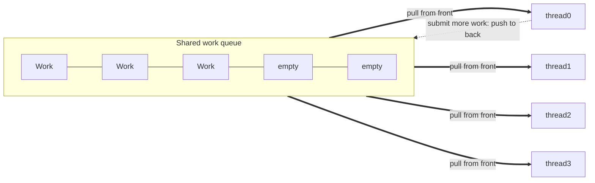
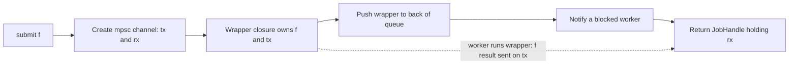
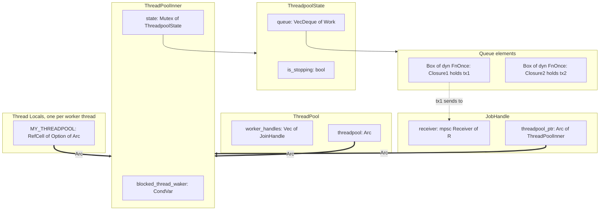

# Concurrency, Parallelism, and Rust: Threadpool

This note covers the **ThreadPool** built in Homework 7. It starts with the idea (worker threads pulling closures from a shared queue), then the Rust machinery needed to store and move closures between threads (capture, `Fn`/`FnMut`/`FnOnce`, `Box<dyn FnOnce()>`, `Send + 'static`). It then walks through the API (`new`, `submit`, `JobHandle::join`, `drop`, `cancel_pending`), the **thread local** state that `join` needs, and finishes with how all the pieces sit together in memory.

---

## The ThreadPool Idea

- Each thread pulls work from the **front** of the ThreadPool's shared **work queue**.
- Each piece of **Work** is a closure that may itself submit more pieces of work.
  - Such work is pushed to the **back** of the work queue.



This is the pull model from [[Concurrency, Parallelism, and Rust/Decomposition/Dynamic Allocation and Granularity|Dynamic Allocation and Granularity]]: idle threads take the next piece of work, so the load balances itself.

---

## Closures as Work

Work is a closure, so we first need to know what a closure looks like in memory and what types it can have. The basics are in [[Concurrency, Parallelism, and Rust/Introduction to Rust/Closures and Trait Objects|Closures and Trait Objects]]; this section covers what the ThreadPool needs from them.

### Closures in Memory

- A closure **captures references** to the variables it uses from outside.
- In memory, the closure holds a pointer to its function code (`func`) and its captured data.

```rust
let s = String::from("hi");
let closure = || {
    println!("{s}");
};

println!("{s}"); // fine: the closure only holds &s, a shared borrow
closure();
```

- The closure holds `&s`, which points to the `String` (a pointer, a length of 2, and a capacity of 5 in the slide's picture).

The `move` keyword moves all needed captured variables into the closure.

```rust
let s = String::from("hi");
let closure = move || {
    println!("{s}");
};

closure(); // the String itself now lives inside the closure
```

- The closure now stores the `String` struct itself next to `func`, with no reference back to the original `s`.

### Does This Compile

```rust
let mut s = String::from("hi");
let closure = || {
    s.push('!');
    println!("{s}");
};

println!("{s}");
closure();
```

- **No.** The closure holds `&mut s`, and that exclusive borrow lasts until the closure is last used, so `s` cannot be borrowed again by the `println!` before `closure()` runs.

### The Closure Hierarchy

- Different closures capture different variables, so **each closure has a unique type**.
- Each closure automatically implements some of three traits:

| Trait | What the closure can do |
|---|---|
| `Fn` | Can be called multiple times, and holds no exclusive references to captured data |
| `FnMut` | Can be called multiple times, but holds some exclusive references to captured data |
| `FnOnce` | Can be called once. Maybe it drops something it captures, preventing it from being called again |

- Is a function that is `FnMut` also `FnOnce`? **Yes.** If it can be called many times, it can certainly be called once.
- Is a function that is `FnMut` also `Fn`? **No.** It holds exclusive references, which `Fn` forbids.


The direction of "restrictive" flips depending on whether you are writing a closure or asking for one:

| | `Fn` | `FnMut` | `FnOnce` |
|---|---|---|---|
| Restrictiveness when **writing a closure** | high | medium | low |
| Permissiveness when **used as a trait bound** | low | medium | high |

- A closure that is `Fn` satisfies the most promises, so it is the hardest to write.
- A function that asks for `F: FnOnce` accepts every closure, so it is the most permissive bound. `submit` uses `FnOnce` for this reason: it runs each piece of work exactly once.

### Queues of Closures: Box<dyn FnOnce()>

- The size of a closure depends on what variables it captures, so a closure is `!Sized`.
- But we want to create **queues of closures**. A queue needs elements of one known size.
- Fix: introduce indirection to a trait object, such as `Box<dyn FnOnce()>`.
  - `Vec<Box<dyn FnOnce()>>` can then be constructed, since `Box` is sized.
  - See [[Concurrency, Parallelism, and Rust/Introduction to Rust/Closures and Trait Objects#Trait Objects: dyn Animal|Trait Objects]] for fat pointers and vtables.

### Moving Work Between Threads: Send + 'static

We expect to move these closures between threads. Can a `Box<dyn FnOnce()>` be moved between threads?

- **No**, it may capture a type that is NOT `Send`.
- **No**, it may capture a reference, which does not live long enough.

```rust
let s = Rc::new(String::from("hi"));
let closure = move || {
    println!("{s:?}");
};
// closure captures an Rc, which is not Send, so it cannot go to another thread
```

- `Rc` is not `Send` (see [[Concurrency, Parallelism, and Rust/Introduction to Rust/Smart Pointers#Send and Sync|Send and Sync]]).
- A captured reference might point to something that is gone by the time another thread runs the closure. A `'static` bound means the closure holds no borrowed data that could expire (see [[Concurrency, Parallelism, and Rust/Introduction to Rust/Borrow Checker|Borrow Checker]]).

So we add the bounds to the type of Work:

```rust
type Work = Box<dyn FnOnce() + Send + 'static>;
```

---

## The ThreadPool API

### new

```rust
impl ThreadPool {
    pub fn new(num_threads: usize) -> Self {
        todo!()
    }
}
```

Returns a new `ThreadPool` struct. It:

- Spawns worker threads and saves their handles so the threads can be joined later.
- Creates the work queue and properly shares it between each thread.
- Creates the extra state required to manage stopping the pool.

### What Each Thread Runs: worker_entrypoint

What should each thread run when it is created? Some function (`worker_entrypoint`) that repeatedly tries to pull from the queue:

- If the thread has nothing to run, it blocks on a condition variable (CV), waiting for work to be submitted. See [[Concurrency, Parallelism, and Rust/Threads and Shared State in Rust#Condvar|Condvar]].
- If the ThreadPool has been stopped, it finishes the work on the queue and returns.

All worker `thread_local!` state is initialized in `worker_entrypoint` (see [[#Thread Local]]).

### submit

```rust
pub fn submit<F, R>(&self, func: F) -> JobHandle<R>
where
    F: (FnOnce() -> R) + Send + 'static,
    R: Send + 'static,
{
    todo!()
}
```

Submits a piece of work to the ThreadPool.

- `JobHandle<R>` can be used to wait for the return value of type `R`.
- If called, it pushes the work to the back of the queue.

### Creating Work Out of funcs

The submitted `func` does not have the same type as `Work`:

- The queue stores `type Work = Box<dyn FnOnce() + Send + 'static>;`, which takes no result.
- But we submit closures with signature `F: FnOnce() -> R + Send + 'static`, which returns an `R`.

How can we convert a `FnOnce() -> R` to a `FnOnce()`? Wrap it in a closure that calls `f()` and sends the result over a channel, so the `JobHandle<R>` can access it.

```rust
fn submit<F, R>(mut f: F) -> JobHandle<R>
where
    F: FnOnce() -> R + Send + 'static,
{
    let (tx, rx) = mpsc::channel();

    let wrapper = || {
        // Call f() and send res over channel
    };
    // put work on queue
    // Notify some thread to work on this
    // Send the handle
}
```



- The wrapper has type `FnOnce()`, so it fits in the queue. The result of `f` travels over the channel instead of being returned.
- The `JobHandle<R>` holds the receiving end `rx`, so it is how the caller later gets the `R` back.

### JobHandle::join

```rust
impl<R> JobHandle<R> {
    pub fn join(self) -> Option<R> {
        todo!()
    }
}
```

Gets the return value from running some previously submitted work (`F`).

- If `cancel_pending()` was called before the job started, it returns `None`.
- If the associated Work has not yet finished running:
  - Called **from outside the ThreadPool**: block until the return value is ready.
  - Called **from a worker thread**: do other work until the return value is ready.
    - If a worker simply blocked, every worker could end up blocked in `join` while the work they wait on sits in the queue with nobody left to run it. Running other work instead keeps the pool making progress.
    - Fun fact: this is *kind of like* a user-space context switch (compare [[Concurrency, Parallelism, and Rust/Coroutines/Coroutines|Coroutines]]).

Because `join` behaves differently depending on who calls it, it needs to know whether the current thread is a worker (see [[#Thread Local]]).

### drop

```rust
impl ThreadPool {
    pub fn drop(&mut self) {
        todo!()
    }
}
```

Lets all workers finish what is left in the queue and joins them all.

- Set a flag (`is_stopping`).
  - If there is no work and the flag is set, the thread should return.
  - Join all worker threads after that.
- Remember to make sure all threads are able to join: a worker blocked on the CV must be woken up so it can see the flag and return.

### cancel_pending

```rust
impl ThreadPool {
    pub fn cancel_pending(self) {
        todo!()
    }
}
```

Lets workers finish their **current** job and then stops the ThreadPool. Joins all worker threads.

- Causes `job_handle.join()` to return `None` for jobs that are pending on the queue.
- Drops the ThreadPool when done (it takes `self` by value).

| | `drop` | `cancel_pending` |
|---|---|---|
| Current jobs | finish | finish |
| Jobs still on the queue | all run to completion | never run; `join()` returns `None` |
| Worker threads | joined | joined |

---

## Thread Local

`JobHandle::join()` behaves differently depending on whether it was called by a worker thread. Use **thread local** variables to maintain thread-specific state.

- Thread locals are like global variables, but **each thread has its own copy**.
- They are destructed when the thread stops.
- At the least, you will need:
  - An `Arc` pointer to this thread's ThreadPool (maybe `None` if it is not a worker).
  - ...whatever other state you decide will be useful.

### Declaring and Accessing a Thread Local

```rust
thread_local! {
    // BAR starts as None
    static BAR: RefCell<Option<String>> = RefCell::new(None);
}

BAR.with(|refcell| refcell.replace(Some(String::from("hi")))); // initialize BAR
let s_clone = BAR.with(|refcell| refcell.borrow().clone());     // access BAR
```

- All code sections within each thread can potentially access `BAR`.
  - Therefore, we cannot hand out `&mut BAR`; we can only access `&BAR`.
  - Use `RefCell` for interior mutability.
  - `RefCell` panics if there is more than one mutable reference to the inner `Option<String>` (see [[Concurrency, Parallelism, and Rust/Threads and Shared State in Rust#RefCell|RefCell]]).
- We can only access `&BAR` inside methods like `with()`.
  - This is how Rust prevents `&BAR` from being given to another thread. Otherwise, that `&BAR` would become dangling when `BAR` is destructed when its thread stops.
  - You do not need to understand this; it is a quirk of Rust.

---

## Putting It Together: Memory Layout



- `ThreadPool` holds `worker_handles` (a `Vec` of join handles for the worker threads) and an `Arc` to the shared `ThreadPoolInner`.
- `ThreadPoolInner` holds the `blocked_thread_waker` (a `CondVar`) and the `state` behind a `Mutex<ThreadpoolState>`.
- `ThreadpoolState` holds the `is_stopping` flag and the `queue`, a `VecDeque<Work>`.
- Each queue element is a `Box<dyn FnOnce()>` pointing to a closure, which owns the sending end (`tx1`, `tx2`) of an `mpsc` channel.
- Each `JobHandle` owns the matching `mpsc::Receiver<R>` and an `Arc<ThreadPoolInner>`, so it can run other work when `join` is called from a worker.
- Each worker thread has a thread local `MY_THREADPOOL: RefCell<Option<Arc<...>>>` pointing at the same `ThreadPoolInner`.

---

## Worker Loop Specification

### Formal Definition

```text
worker_entrypoint(pool):
    MY_THREADPOOL := Some(pool)
    loop:
        lock pool.state
        while pool.state.queue is empty and not pool.state.is_stopping:
            wait on pool.blocked_thread_waker   (releases the lock while asleep)
        if pool.state.queue is empty and pool.state.is_stopping:
            return
        work := pool.state.queue.pop_front()
        unlock pool.state
        work()
```

`submit` appends to the back of `queue` and notifies the CV. `drop` sets `is_stopping` and wakes every worker before joining. `cancel_pending` additionally clears the queue so pending jobs never run.

### Simplified Explanation

Each worker is a clerk at a counter. If there is a ticket in the pile, take the oldest one and do it. If the pile is empty, nap until someone drops in a new ticket. When the shop is closing, finish what is in the pile and go home.

---

## Deep Dive

- **Why `'static`**: a thread given a plain `thread::spawn`-style closure may outlive the function that created it, so it cannot borrow from that function's stack. `thread::scope` (see [[Concurrency, Parallelism, and Rust/Threads and Shared State in Rust#Borrowing in a Thread|Borrowing in a Thread]]) relaxes this by guaranteeing the threads end before the scope does, but a long-lived pool cannot make that promise.
- **One shared queue vs per-thread queues**: a single `Mutex`-protected queue is simple but all workers contend on one lock. Per-thread queues with **work stealing** reduce contention; see [[Concurrency, Parallelism, and Rust/Decomposition/Deep Dive|Decomposition Deep Dive]] and [[Concurrency, Parallelism, and Rust/Threads and Cores/Cache Topology and Scheduler Queues|Cache Topology and Scheduler Queues]].
- **Why the `while` around the CV wait**: a woken thread must re-check the condition because another worker may have taken the work first; see [[Concurrency, Parallelism, and Rust/Implementing Threads/Implementing Synchronization Primitives#Condition Variable|Condition Variable]].

---

## Homework Dates

| Assignment | Release | Test case (hard deadline) | Code, questions |
|---|---|---|---|
| Homework 7: Threadpool | Monday, November 16th | Wednesday, November 25th | Monday, November 30th |
| Homework 8: Async server | Monday, November 30th | Monday, December 7th | Wednesday, December 9th |

---

## Industry Standard Terms

| Course term | Industry equivalent |
|---|---|
| ThreadPool | Thread pool / executor |
| Work (`Box<dyn FnOnce() + Send + 'static>`) | Task / job (type-erased, move-only callable, like C++ `std::move_only_function`) |
| JobHandle | Future / promise (Java `Future`, C++ `std::future`) |
| `worker_entrypoint` | Worker loop |
| `CondVar` | Condition variable |
| `thread_local!` | Thread-local storage (TLS) |
| `drop` on ThreadPool | Graceful shutdown (drain the queue, then join) |
| `cancel_pending` | Immediate shutdown (Java `ExecutorService.shutdownNow`) |
| `join` from a worker that runs other work | Helping join / work helping |

---

## Related
- [[Concurrency, Parallelism, and Rust/Introduction to Rust/Closures and Trait Objects|Closures and Trait Objects]]
- [[Concurrency, Parallelism, and Rust/Introduction to Rust/Smart Pointers|Smart Pointers]]
- [[Concurrency, Parallelism, and Rust/Threads and Shared State in Rust|Threads and Shared State in Rust]]
- [[Concurrency, Parallelism, and Rust/Decomposition/Dynamic Allocation and Granularity|Dynamic Allocation and Granularity]]
- [[Concurrency, Parallelism, and Rust/Implementing Threads/Implementing Synchronization Primitives|Implementing Synchronization Primitives]]
- [[Concurrency, Parallelism, and Rust/Coroutines/Coroutines|Coroutines]]
