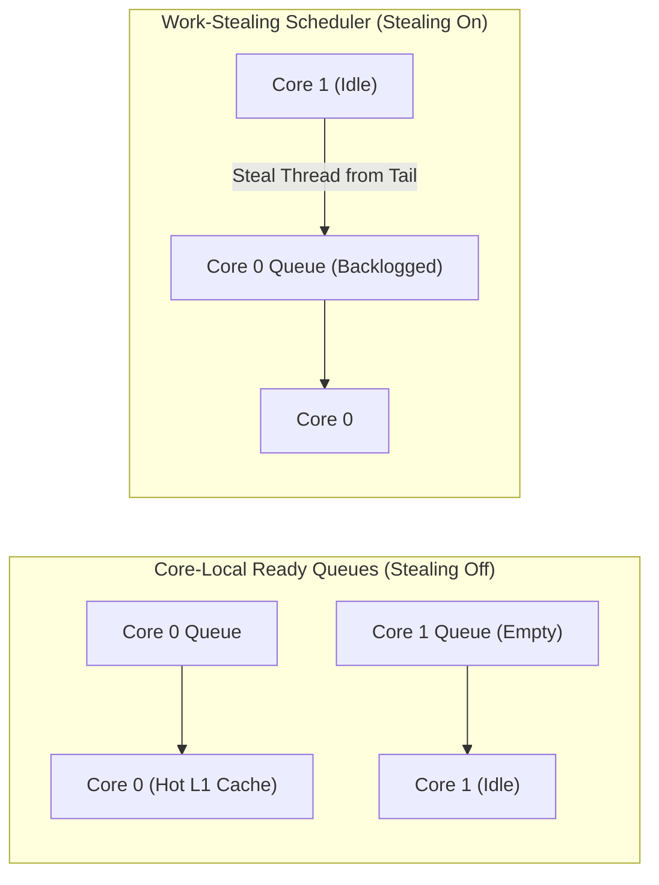

# Threads and Cores: Cache Topology and Scheduler Queues

## Hardware Complexities, Cache Dynamics & Microarchitecture

### CPU Cache Topology and Thread Migration
Modern multi-core processors use a hierarchical cache structure. Each core maintains private L1 and L2 caches, while sharing a unified L3 cache across cores.

![[realistic cache.png]]

When the OS scheduler moves a thread from **Core 0** to **Core 1**:
1. The thread's most recently modified data resides in **Core 0's private L1/L2 cache**.
2. Upon executing on **Core 1**, initial memory accesses trigger **L1/L2 cache misses**, forcing data retrieval from L3 cache or DRAM.
3. **Cache Coherence**: Hardware protocols (e.g., MESI) automatically ensure all cores observe consistent memory values across private caches. While cache coherence guarantees correctness without manual programmer intervention, invalidating and transferring cache lines across inter-core interconnects incurs significant latency penalties.

### Scheduler Queues: Core-Local vs. Work Stealing
To balance CPU utilization against cache locality, OS schedulers use distinct queuing strategies:

- **Core-Local Ready Queue (No Stealing)**:
  - Each physical core maintains its own isolated run queue. Threads return exclusively to the core that holds their warm L1/L2 cache lines.
  - *Trade-off*: Maximizes cache hit rates, but risks CPU core idling if one queue empties while another core remains backlogged.
- **Work Stealing Enabled**:
  - Idle cores actively steal ready threads from the back of backlogged cores' run queues.
  - *Trade-off*: Eliminates CPU core idling and maximizes parallel throughput, but sacrifices cache locality by migrating threads across cores.

## Related

- [[Concurrency, Parallelism, and Rust/Threads and Cores|Threads and Cores]] — Hub for this topic
- [[Concurrency, Parallelism, and Rust/Threads and Cores/Programmer View vs Processor View|Programmer View vs Processor View]] — Interleaving traces
- [[Concurrency, Parallelism, and Rust/Threads and Cores/False Sharing|False Sharing]] — Invalidation mechanics and cache line padding
