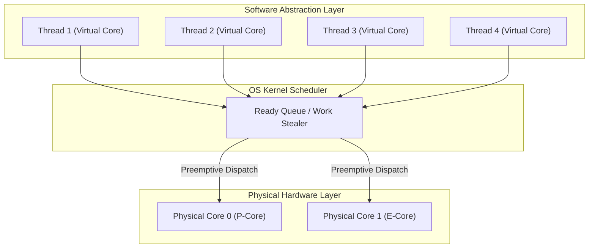

# Threads and Cores: Cores vs Threads

## Threads and Cores Motivation & Overview

Modern computer architectures feature multi-core processors capable of true hardware parallelism. To maximize hardware utilization and build scalable software, systems must divide execution across multiple independent workflows.

### The Need for Abstraction: Cores vs. Threads
- **Hardware Cores (Physical Processors)**: A physical execution unit containing its own instruction fetch unit, execution pipelines (ALUs, FPUs), and local L1/L2 caches. A single core executes exactly one stream of instructions at any given instant.
- **Scalability & DRY Principle**: Writing core-specific code (e.g., hardcoding thread 0 to core 0, thread 1 to core 1) violates the Don't Repeat Yourself (DRY) principle and fails to scale across machines with different core counts. Creating a single unified entry function executed across multiple virtual cores allows programs to dynamically scale from a 2-core laptop to a 128-core server.
- **The Thread Abstraction**: A **thread** is an execution context scheduled by the operating system kernel or runtime. It acts as a **virtual core**, allowing software to program under the assumption of having access to an arbitrarily large number of processors.

### Non-Deterministic Execution Speeds
Physical hardware cores do not execute instructions at uniform or predictable rates. A thread's execution speed varies continuously due to multiple hardware and system factors:
- **Asymmetric Core Microarchitectures**: Modern CPUs combine high-performance cores (P-cores) and power-efficient cores (E-cores) operating at different clock speeds and IPC (instructions per cycle) capacities.
- **Memory Hierarchy Latency**: A thread executing an instruction that triggers an L1 cache hit completes in ~1 ns, whereas an L3 cache miss requiring main memory (DRAM) access delays execution by ~50–100 ns.
- **Dynamic Voltage and Frequency Scaling (DVFS)**: Cores automatically adjust clock frequencies or downclock (thermal throttling) to remain within power and temperature envelopes.
- **System Interrupts and Resource Contention**: Operating system device interrupts, background processes, and competing threads dynamically usurp core cycles.

### Threads vs. Coroutines
The fundamental distinction between threads and coroutines lies in **how** execution control is transferred:
- **[[Concurrency, Parallelism, and Rust/Coroutines|Coroutines]]**: Cooperative user-space execution contexts. A coroutine switches execution **only** when explicitly requested via a yield point (`yield()`, `await`). Control flow is deterministic and predictable.
- **Threads**: Preemptive execution contexts. A thread behaves like a coroutine that is forcibly interrupted by the OS kernel timer after arbitrary instructions without developer consent. This implicit preemption enables multiplexing over physical cores but introduces non-deterministic schedule interleavings that make concurrent reasoning challenging.

## Industry Standard Terms

| Course Term | Industry / Standard Term | Real-World Context / Production Equivalent |
| :--- | :--- | :--- |
| **Virtual Core** | Logical Processor / Logical CPU | `sysconf(_SC_NPROCESSORS_ONLN)`, `/proc/cpuinfo` logical processors |
| **Thread Stealing** | Work-Stealing Scheduling | Tokio runtime thread pool, Rayon parallel iterator, Go runtime scheduler |

## Related

- [[Concurrency, Parallelism, and Rust/Threads and Cores|Threads and Cores]] — Hub for this topic
- [[Concurrency, Parallelism, and Rust/Threads and Cores/Thread Memory Layout and Abstraction|Thread Memory Layout and Abstraction]] — Shared vs private state and the thread lifecycle
