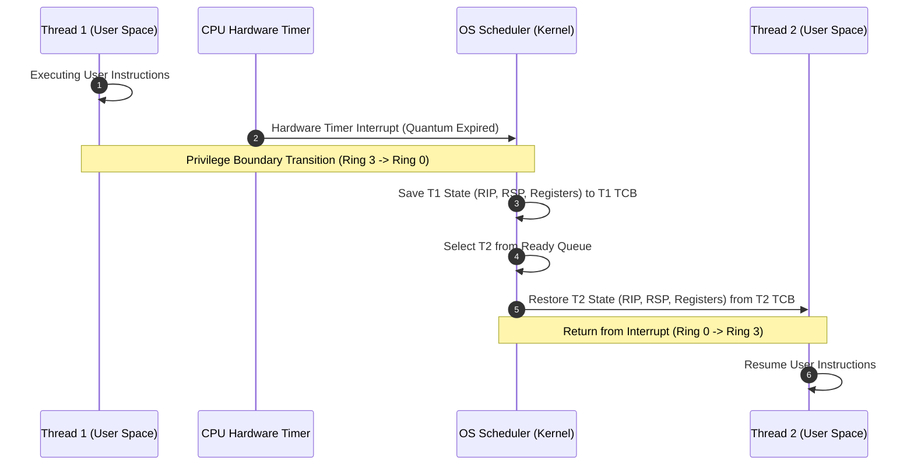

# Threads and Cores: Preemption and Time Quanta

## Preemption, Hardware Timers, and Time Quanta
When multiple threads share fewer physical cores ($M > N$), the OS kernel enforces sharing via **preemptive multitasking**:
- **Hardware Timer Interrupt**: A physical timer on the CPU generates periodic hardware interrupts.
- **Time Quantum (Slice)**: The fixed duration of CPU execution granted to a thread between timer interrupts.
- **Preemption Step**: Upon timer interrupt, the CPU hardware traps into the kernel (Ring 3 to Ring 0). The OS saves the active thread's registers to its Thread Control Block (TCB), selects the next ready thread from the run queue, restores its saved registers, and switches execution contexts.

### Preemption Frequency Trade-offs
- **High Preemption Frequency (Short Quanta)**:
  - *Advantage*: Low latency and high responsiveness; ready threads run almost immediately.
  - *Disadvantage*: High CPU overhead due to frequent context switches and cache thrashing.
- **Low Preemption Frequency (Long Quanta)**:
  - *Advantage*: High overall system throughput; minimal CPU time spent in kernel context switches.
  - *Disadvantage*: Higher scheduling latency; interactive threads experience perceptible delays.

## Related

- [[Concurrency, Parallelism, and Rust/Threads and Cores|Threads and Cores]] — Hub for this topic
- [[Concurrency, Parallelism, and Rust/Threads and Cores/Thread Memory Layout and Abstraction|Thread Memory Layout and Abstraction]] — Shared vs private state and the thread lifecycle
- [[Concurrency, Parallelism, and Rust/Threads and Cores/Programmer View vs Processor View|Programmer View vs Processor View]] — Interleaving traces
