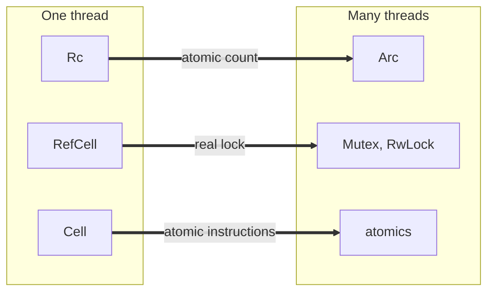

# Concurrency, Parallelism, and Rust: Threads and Shared State in Rust

This note covers how Rust lets several threads share data without data races. It starts with what safe and unsafe Rust promise, then the single-threaded tools for shared and interior mutability (`Rc`, `RefCell`), and then their multi-threaded counterparts (`Arc`, `Mutex`, atomics, `Condvar`). It builds on [[Concurrency, Parallelism, and Rust/Introduction to Rust/Smart Pointers|Smart Pointers]] and the [[Concurrency, Parallelism, and Rust/Introduction to Rust/Borrow Checker|Borrow Checker]].

---

## Safe Rust

- **Safe Rust** guarantees:
  - no dangling or null references
  - no [[Concurrency, Parallelism, and Rust/Writing Multithreaded Code/Data Races and Interleavings|data races]]
  - no use after free or double free
  - no reading past the end of an array: it panics instead
- However, it is still possible to have deadlocks, leaks, panics, and logic bugs. The compiler rules out memory-safety errors, not every bug.

## Unsafe Rust

- A **raw pointer** (`*mut T`, `*const T`) may be null, dangling, or aliased.
- Making one is safe; **dereferencing** one needs `unsafe`.
- In an `unsafe` block, you promise what the compiler cannot check, and a mistake there is **undefined behavior**.

---

## Sharing in One Thread

### Reference Count (Rc)

- **`Rc<T>`** is a reference-counted pointer (see [[Concurrency, Parallelism, and Rust/Introduction to Rust/Smart Pointers#Shared Ownership: Rc|Shared Ownership: Rc]]).
- Mutability is inherited: a value is mutable only if you hold it mutably, and an `Rc` gives **only shared access**, never `&mut T`.
- Example: several nodes share one database and each counts its own accesses in it.
  - The update below is safe in practice, but the compiler cannot know that, so it rejects `Node`.
  - The fix is to wrap the database in a `RefCell`, which moves the borrow check from compile time to run time.

```rust
struct Database {
    accesses: Vec<u32>,
}

struct Node {
    db: Rc<Database>,
    id: usize,
}

struct CorrectNode {
    db: Rc<RefCell<Database>>,
    id: usize,
}

impl Node {
    fn on_access(&self) {
        // does not compile: Rc only gives shared access.
        // this is safe but the compiler doesn't know that
        self.db.accesses[self.id] += 1;
    }
}

impl CorrectNode {
    fn on_access(&self) {
        // borrow_mut checks the borrow rules at run time
        self.db.borrow_mut().accesses[self.id] += 1;
    }
}
```

### RefCell

- **`RefCell<T>`** enforces the **same borrow checker rules, but at run time**:
  - one mutable borrow at a time, or
  - any number of shared references
- A `RefCell` holds a `T`. Through a shared `&RefCell<T>`:
  - `borrow()` gives a shared borrow of the `T`, if no one holds a mutable one
  - `borrow_mut()` gives a mutable borrow, if no one holds any borrow
  - otherwise, it **panics**
- Each borrow is a **guard**: the borrow ends when the guard is dropped, and the cell counts its current borrows (the count goes down when a guard drops).
- Because the count is tracked at run time, a borrow does not have the compiler's lifetime guarantee. Its lifetime is the guard's, which by default lasts the entire scope it was created in.

### Interior Mutability

- **Interior mutability**: changing a value through a shared reference.
- `RefCell` turns a `&RefCell<T>` into a `&mut T`. This is impossible with `&` and `&mut` alone, so inside, `RefCell` uses `unsafe` code, and the run-time borrow count is what keeps it correct.

---

## From One Thread to Many

Each single-threaded tool has a thread-safe counterpart.

![[From one thread to many.png]]

| One thread | Many threads |
|---|---|
| `Rc<T>` | `Arc<T>` |
| `RefCell<T>` | `Mutex<T>`, `RwLock<T>` |
| `Cell<T>` | atomics: `AtomicUsize`, ... |



---

## Threads

`thread::spawn` starts a thread and returns a handle that is later joined.

```rust
use std::thread;

fn main() {
    // returns the handle to be joined
    let h = thread::spawn(|| {
        println!("hello from the new thread");
        5 * 6
    });

    println!("Hello from main");
    // blocks until the thread ends and unwraps the value it returned
    let answer = h.join().unwrap();
    println!("the thread returned {answer}");
}
```

### Borrowing in a Thread

- `thread::scope` **joins every thread it starts before it returns**, so threads inside it may borrow local data. This is the same idea as C++ `std::jthread`.

```rust
use std::thread;

fn main() {
    let name = String::from("Bessie");
    thread::scope(|s| {
        // each thread grabs a shared ref to name
        s.spawn(|| println!("first thread {name}"));
        s.spawn(|| println!("second thread {name}"));
    }); // all threads must finish before returning

    println!("main still owns {name}");
}
```

- The compiler stops data races: if we try to modify `name` inside the scope, it throws an error, because there is no synchronization and the threads would hold two mutable references.

---

## Sharing Ownership Across Threads: Arc

- `Rc` is not meant for multi-threaded code. Its count is a non-atomic increment, so use `std::sync::Arc`, which increments the reference count atomically.
- Cloning and dropping an `Arc` in different threads is therefore thread safe.
- Reason about it in context: atomics cost more, so you pay that overhead only when it is necessary and required.

### Send and Sync

- A type is **`Send`** if it can be moved to another thread.
- A type `T` is **`Sync`** if `&T` can be shared with another thread (`T: Sync` means `&T: Send`).
- Both are **marker traits**: no methods, just promises to the compiler (see [[Concurrency, Parallelism, and Rust/Introduction to Rust/Traits|Traits]]). The compiler implements them automatically for a type whose fields all have them.
- `std::thread::spawn` requires its closure to be `Send`, so **everything the closure captures must be `Send`** (see [[Concurrency, Parallelism, and Rust/Introduction to Rust/Closures and Trait Objects|Closures and Trait Objects]]).

| Type | Send | Sync | Why |
|---|---|---|---|
| `Rc<T>` | no | no | non-atomic reference count |
| `RefCell<T>` | if `T` is | no | one thread at a time may use it, but two threads would race on its borrow count |
| `Mutex<T>` | if `T` is `Send` | yes | the lock serializes all access |
| `Arc<T>` | only if `T` is `Sync` (and `Send`) | only if `T` is `Sync` (and `Send`) | each clone hands out a `&T` |

- A `RefCell` can be moved to another thread, since only one thread uses it at a time, but it cannot be shared.

---

## Mutex

- With a `Mutex`, **the lock holds the data**. A `Mutex<T>` holds a `T`, and through a shared `&Mutex<T>`:
  - `lock()` blocks until it holds the lock, then gives a guard (`MutexGuard<T>`) that works like `&mut T`
  - dropping the guard unlocks
- In C, a mutex and the data it protects are separate: nothing stops code from using the data without the lock.
- In Rust, `lock()` is the only way to reach the data.
- `Mutex<T>` is `Sync`, so share it with `Arc<Mutex<T>>` (see [[Concurrency, Parallelism, and Rust/Introduction to Rust/Smart Pointers#Sharing Mutable Data: Arc and Mutex|Arc and Mutex]]).

### Poisoning

- `lock()` returns a `Result`: `Err` if a thread panicked while holding the lock.
- The panic still drops the guard, so the lock is released, but the data may be half-updated. The mutex is then **poisoned**.
- For now, assume threads don't panic and write `lock().unwrap()`. That is why we unwrap: it turns a poisoned lock into a panic instead of silently using half-updated data.

---

## Atomics

- **Atomics** are interior mutability for a single integer or bool: `fetch_add` takes `&self`, and there are also `load`, `store`, and `compare_exchange`.
- Every atomic operation takes an **ordering**, which says what other threads may see of the memory accesses around this one (see [[Concurrency, Parallelism, and Rust/Writing Multithreaded Code/Memory Reordering and Fences|Memory Reordering and Fences]]).
  - `SeqCst`: sequentially consistent; every thread sees the `SeqCst` operations in one agreed order.

```rust
use std::sync::atomic::{AtomicUsize, Ordering};

fn main() {
    let count = AtomicUsize::new(0);
    count.fetch_add(1, Ordering::SeqCst);
    println!("count = {}", count.load(Ordering::SeqCst));
}
```

---

## Condvar

- A **`Condvar`** lets a thread sleep until another thread signals that a condition holds, paired with a `Mutex` that protects the condition (see [[Concurrency, Parallelism, and Rust/Implementing Threads/Synchronization Primitives|Synchronization Primitives]]).

```rust
use std::sync::{Condvar, Mutex};
use std::thread;

fn main() {
    let ready = Mutex::new(false);
    let cv = Condvar::new();

    thread::scope(|s| {
        s.spawn(|| {
            *ready.lock().unwrap() = true;
            cv.notify_one();
        });

        let mut r = ready.lock().unwrap();
        while !*r {
            r = cv.wait(r).unwrap();
        }

        println!("ready");
    });
}
```

- You cannot wait without holding the lock: `wait` needs the guard. It releases the lock while sleeping and hands the guard back when it wakes.
- The `while !*r` loop re-checks the condition after each wake-up.

---

## Organizing Code: Visibility and Packaging

- **Visibility**: everything is private to its module by default.
  - `pub` makes an item visible outside the module.
  - If you don't mark something `pub`, everything inside the module can see it but nothing outside can.
- A **module** is a group of items and the unit of privacy.
- A **crate** is what `rustc` compiles at once: a library or an executable.
- A **package** is a `Cargo.toml` with at most one library and any number of programs.

---

## Related

- [[Concurrency, Parallelism, and Rust/Introduction to Rust/Smart Pointers|Smart Pointers]]: `Box`, `Rc`, `Arc`, and `Arc<Mutex<T>>`
- [[Concurrency, Parallelism, and Rust/Introduction to Rust/Borrow Checker|Borrow Checker]]: the compile-time rules that `RefCell` moves to run time
- [[Concurrency, Parallelism, and Rust/Writing Multithreaded Code/Mutual Exclusion Locks|Mutual Exclusion Locks]]
- [[Concurrency, Parallelism, and Rust/The Concurrent Mindset/Deep Dive|Deep Dive: Send and Sync]]
- [[Systems Programming/Smart Pointers/Shared Pointer|C++ Shared Pointer]]

## Industry Standard Terms

- **`Rc<T>` / `Arc<T>`** → non-atomic / atomic reference-counted pointer (C++ `shared_ptr<T>`)
- **`RefCell<T>`** → run-time checked borrow cell (interior mutability)
- **`Mutex<T>` / `MutexGuard`** → mutual exclusion lock / scoped lock (C++ `std::mutex` + `lock_guard`)
- **`Condvar`** → condition variable (C++ `std::condition_variable`)
- **`thread::scope`** → scoped threads / structured concurrency (C++ `std::jthread`)
- **`Send` / `Sync`** → thread-safety marker traits
- **Poisoned mutex** → lock whose holder panicked, so protected data may be inconsistent
