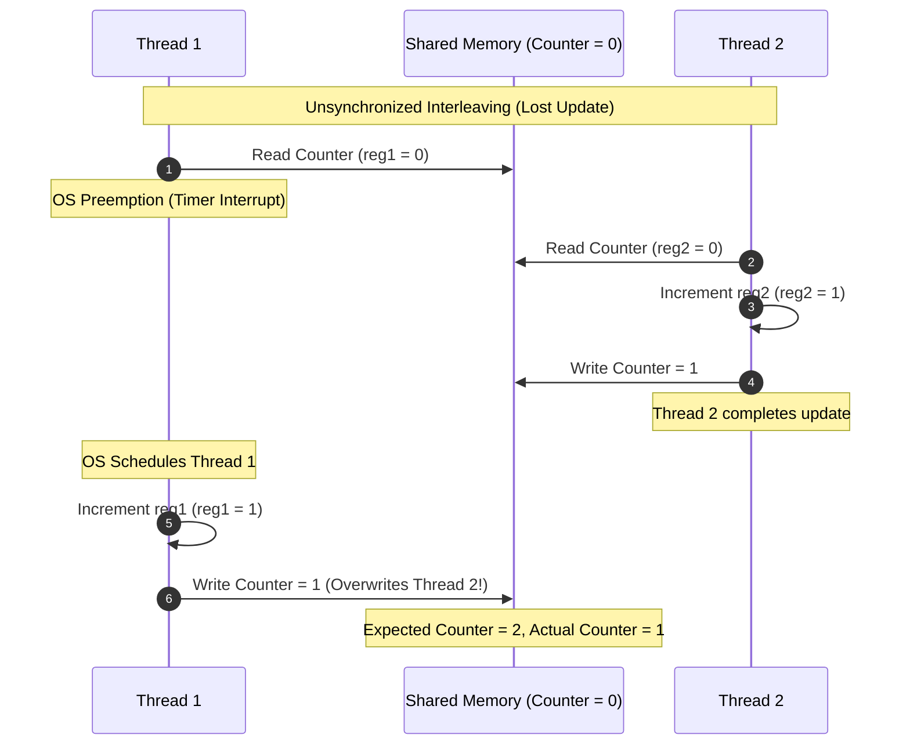
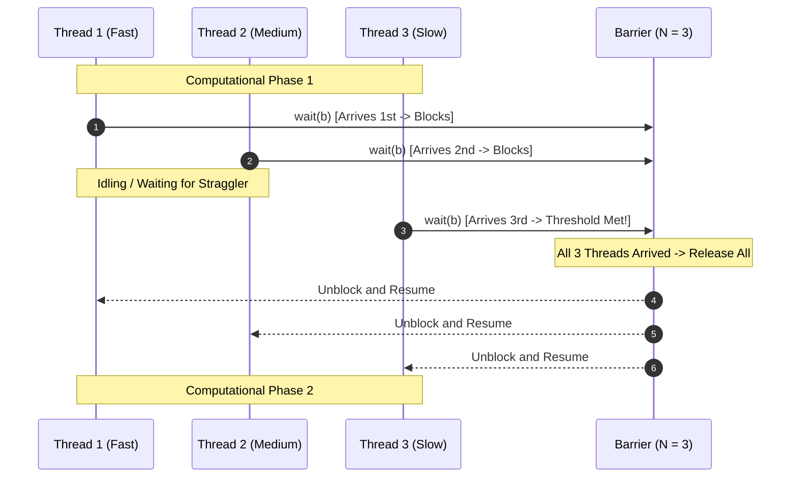
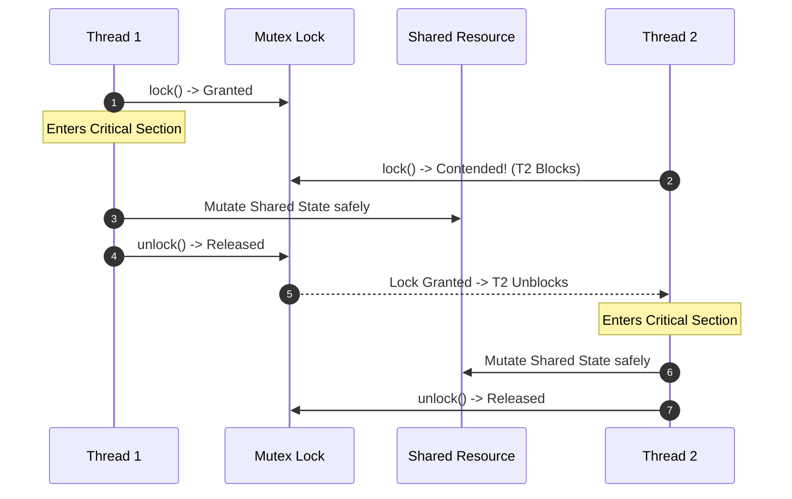
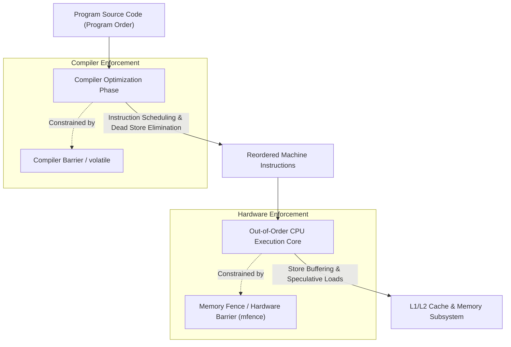

# Concurrency, Parallelism, and Rust: Writing Multithreaded Code

Writing correct multithreaded programs requires coordinating concurrent execution across preemptive OS scheduling intervals, eliminating data races through coarse- or fine-grained synchronization primitives, and enforcing memory consistency across compiler and CPU instruction reordering.

---

## Writing Multithreaded Code: Motivation & Overview

In modern multicore systems, multithreaded software leverages hardware parallelism to execute distinct instruction streams simultaneously across shared virtual address spaces. However, shared-memory concurrency introduces fundamental nondeterminism into execution ordering.

### The Source of Nondeterminism: Preemptive Scheduling
Modern operating systems manage concurrent threads using **Preemptive Scheduling**. 
- The OS scheduler preempts running threads based on hardware timer interrupts and allotted execution intervals (**Time Quantum**).
- Preemption can occur at arbitrary assembly instruction boundaries rather than clean source-code statement boundaries.
- Because thread scheduling depends on external physical factors—such as hardware interrupts, cache misses, OS scheduler decisions, and core clock fluctuations—the exact sequence in which instructions execute across multiple threads is nondeterministic.

### Fundamental Limitations of Naive Approaches
Naive approaches to coordinating concurrent work invariably fail in production:
- **Unsynchronized Shared State**: Attempting to share mutable variables without explicit synchronization results in race conditions, corrupted data structures, and silent data loss.
- **Timing Assumptions (Sleep-Based Coordination)**: Introducing arbitrary delays (`sleep()`) to allow another thread to finish assumes deterministic timing that real-world hardware and OS schedulers do not guarantee.
- **Single-Threaded Mental Models**: Compilers and modern out-of-order processors assume single-threaded execution semantics when optimizing code, aggressively reordering or eliminating memory reads and writes unless explicitly constrained by synchronization boundaries.

### Synchronization Paradigms: Coarse-Grained vs. Fine-Grained
To eliminate nondeterministic defects, multithreaded systems employ two distinct granularities of synchronization:
1. **Coarse-Grained Synchronization (Barriers)**: Coordinates groups of threads at macroscopic phase boundaries, halting all participating threads until the entire cohort completes a computational stage.
2. **Fine-Grained Synchronization (Mutual Exclusion Locks)**: Protects individual localized memory regions or data structures (**Critical Sections**), permitting arbitrary thread interleavings outside the critical section while guaranteeing exclusive access within it.

---

## Architecture & Core Mechanics

### 1. Data Races and Instruction Interleavings

A **Data Race** occurs when concurrent execution paths perform unsynchronized, conflicting accesses to shared memory.

#### The Three Conditions of a Data Race
A program exhibits a data race if and only if all three of the following conditions hold simultaneously:
1. Two or more concurrent instructions from distinct threads access the same physical or virtual memory address.
2. At least one of the accesses is a **write** operation.
3. No synchronization primitive (e.g., lock, barrier, channel, or happens-before edge) mandates a strict order between the accesses.

#### The Fundamental Concurrency Rule: Multiple Readers XOR One Writer
Safe concurrent memory access adheres to the principle of **Aliasing XOR Mutability**:
$$\text{Concurrent Access Safe} \iff (\text{All Accesses are Reads}) \lor (\text{Access is Exclusively Single-Threaded})$$
You may have multiple concurrent reader threads, or exactly one writer thread, but **never both simultaneously** without synchronization.

#### Combinatorial Explosion of Instruction Interleavings
The fundamental reason concurrent bugs (**Heisenbugs**) are difficult to detect via testing is the astronomical number of valid instruction schedules.
- If $X$ independent threads each execute $N$ instructions, the number of distinct execution schedules (interleavings) preserving per-thread program order is given by the multinomial coefficient:
  $$\frac{(X \cdot N)!}{(N!)^X}$$
- For $X = 2$ threads executing $N$ instructions each, this reduces to the binomial coefficient:
  $$\binom{2N}{N} = \frac{(2N)!}{(N!)^2}$$
- By Stirling's approximation, this grows asymptotically on the order of $\Theta\left(\frac{4^N}{\sqrt{N}}\right)$. Even for two short threads with $N = 20$ assembly instructions, $\binom{40}{20} \approx 1.37 \times 10^{11}$ possible schedules exist.
- In practice, the vast majority of interleavings may execute without error during unit tests, while a tiny fraction of edge-case preemptions corrupt state under high production load.



#### Core Strategies for Eliminating Data Races
Systems engineers eliminate data races through three foundational strategies:
1. **Disjoint Memory Partitioning**: Divide working memory so threads operate on independent, non-overlapping memory regions throughout execution, aggregating results via a parallel reduction or gather at the end.
2. **Immutable Shared Data**: Restrict shared variables to read-only access after initialization, eliminating all concurrent writes.
3. **Mutual Exclusion & Synchronization**: Wrap shared mutable access within synchronization primitives—such as mutual exclusion locks, barriers, or message-passing channels—that enforce a strict happens-before ordering.

---

### 2. Coarse-Grained Synchronization: Barriers

A **Barrier** is a synchronization primitive that forces a predetermined cohort of $N$ threads to wait at a designated synchronization point until all $N$ threads have arrived.



#### Barrier Mechanics & Operational Flow
- **Initialization**: A barrier is initialized with an arrival threshold of $N$ threads (`barrier_init(&b, N)`).
- **Execution (`wait(b)`)**: When a thread reaches the barrier, it invokes `wait(b)`.
  - An internal counter tracking arrived threads increments atomically.
  - If the counter is less than $N$, the calling thread suspends execution (sleeps or blocks) and yields the processor.
  - When the $N$-th thread arrives, the condition is satisfied: the barrier resets its internal counter and signals all $N - 1$ waiting threads to resume.
- **Computation Staging**: Barriers enable phased computation (e.g., iterative stencil algorithms, physical simulations, matrix transforms). In Phase 1, threads write intermediate values to disjoint memory buffers. The barrier guarantees that all Phase 1 writes are complete and visible before any thread enters Phase 2 to consume those outputs.
- **Trade-offs**: Barriers drastically reduce race conditions across computational stages, but they introduce processor idling (**Bubbling** or straggler penalty) if workload imbalances cause fast threads to block waiting for slow threads.

---

### 3. Fine-Grained Synchronization: Mutual Exclusion Locks

A **Mutual Exclusion Lock (Mutex)** is a fine-grained synchronization primitive that guarantees that at most one thread can execute a designated **Critical Section** of code at any given time.

#### Core Operations
- **`lock()` / `acquire()`**: The calling thread attempts to claim ownership of the mutex.
  - If the mutex is currently unlocked, the calling thread claims ownership and enters the critical section immediately.
  - If the mutex is already held by another thread, the calling thread blocks (or spins) until the owner releases it.
- **`unlock()` / `release()`**: The owner thread relinquishes ownership, allowing exactly one waiting thread to claim the lock and proceed.



#### Interleaving Granularity: Mutex vs. Barrier
- **Barriers**: Force strict global phase lockstep. All threads must finish Phase $K$ before any thread executes Phase $K+1$. Interleavings across phases are completely prohibited.
- **Locks**: Restrict interleaving **only** within the critical section. Outside the critical section, threads run completely decoupled, maximizing instruction throughput and core utilization at the expense of permitting far more global execution interleavings.

#### The Dangers and Overheads of Locks
1. **Deadlock**: Occurs when two or more threads circular-wait for locks held by each other (e.g., Thread 1 holds Lock A and requests Lock B, while Thread 2 holds Lock B and requests Lock A). Also occurs if a thread attempts to re-acquire a non-reentrant lock it already holds, or if an early function return skips `unlock()`.
2. **Performance Overhead**:
   - An uncontended lock/unlock cycle on modern x86-64 hardware requires atomic read-modify-write instructions (such as `LOCK CMPXCHG`) and cache coherency bus traffic, costing on the order of **tens to 100 nanoseconds**.
   - Under heavy contention, operating system kernel context switches (e.g., Linux `futex` sleep and wake syscalls) cost microseconds, degrading parallel scaling.
3. **Debugging Complexity**: Lock-related race conditions and timing bugs are nondeterministic and sensitive to hardware timing, making reproduction exceptionally difficult.

#### Alternatives to Mutex Locks
To avoid lock contention and deadlocks, modern systems employ alternative concurrency architectures:
- **Message Passing & Channels**: Based on Communicating Sequential Processes (CSP) and functional decomposition. Threads share data by sending messages over thread-safe queues rather than sharing raw memory addresses.
- **Lock-Free and Wait-Free Data Structures**: Algorithms built on hardware atomic primitives (`compare-and-swap`, `fetch-and-add`) without blocking operating system threads. Highly performant but mathematically complex to design correctly.
- **Share-Nothing Architecture**: Partition memory strictly so each thread owns exclusive mutable state, eliminating the need for locks entirely.
- **Specialized Lock Flavors**:
  - **Reader-Writer Locks (`RwLock`)**: Allow unlimited concurrent readers or one exclusive writer, mitigating read-heavy contention.
  - **Spinlocks**: Repeatedly poll an atomic variable in a tight loop instead of putting the thread to sleep; optimal for extremely short critical sections where context switch overhead exceeds wait time.

---

### 4. Memory Reordering: Compiler and Hardware Fences

In concurrent programming, program order in source code does **not** guarantee physical execution order in memory. Both compilers and modern processors dynamically reorder memory operations to maximize execution throughput.



#### Compiler Reordering
The optimizing compiler treats code under the assumption that it executes within a single-threaded environment (**As-If Rule**):
- **Optimizations**: Compilers reorder independent memory reads and writes, hoist loop-invariant loads into CPU registers, coalesce writes, and eliminate seemingly "redundant" stores.
- **Concurrency Bug**: If Thread 1 writes data to a buffer and then sets `flag = 1`, an optimizing compiler may reorder the store to `flag` before the buffer writes if it detects no single-threaded data dependency between them. A concurrent Thread 2 polling `flag` will observe `flag == 1` and read uninitialized buffer memory.
- **Mitigation Mechanisms**:
  - **`volatile` Keyword**: In C/C++, tells the compiler that the variable may change unexpectedly outside the program flow. Prevents the compiler from caching the value in a CPU register or omitting reads/writes. **Critical caveat**: `volatile` does **not** generate hardware memory fences and does **not** make multithreaded operations atomic or safe against CPU reordering.
  - **Compiler Barriers**: Directives (such as `asm volatile("" ::: "memory")` or `atomic_signal_fence`) instructing the compiler that no memory operations before the barrier may be moved after it, and vice versa.

#### Hardware (CPU) Reordering & Memory Models
Even if the compiler emits machine instructions in exact source order, modern out-of-order superscalar CPUs reorder execution at the silicon level:
- **Store Buffers & Cache Coherency**: To hide the high latency of writing back to L1/L2 caches or main memory, modern CPUs place pending writes into hardware **Store Buffers** while continuing to execute subsequent read instructions immediately.
- **Total Store Order (TSO) on x86-64**: Under x86-64 TSO, older writes can be delayed past younger reads to different memory addresses (**Store-Load Reordering**).
- **Weakly-Ordered Architectures (ARM, POWER)**: Can reorder reads and writes in almost any combination (Store-Store, Load-Load, Load-Store, Store-Load) unless explicit fence instructions are executed.
- **Mitigation (Memory Fences / Hardware Barriers)**:
  - Assembly fence instructions (e.g., `MFENCE`, `SFENCE`, `LFENCE` on x86-64, or `DMB` on ARM) force the CPU pipeline and store buffers to drain and synchronize, ensuring all pending memory accesses are globally visible before subsequent instructions execute.

---

## Concrete Walkthrough & Execution Trace

### Scenario: Shared Bank Account Counter

Two concurrent threads (`Thread 1` and `Thread 2`) increment a shared variable `balance` initialized to 100. Each thread executes a high-level update `balance = balance + 10`.

At the assembly level, this update compiles into three distinct instructions:
1. `LOAD R, [balance]` (Read current balance into CPU register)
2. `ADD  R, 10`        (Add 10 to register value)
3. `STORE [balance], R` (Write updated register value back to memory)

---

### Trace 1: Unsynchronized Execution (Data Race & Lost Update)

```
Initial State:
  Memory: balance = 100
  Thread 1: R1 = undefined
  Thread 2: R2 = undefined

Execution Trace:
  t = 0: Thread 1 executes LOAD R1, [balance]       -> R1 = 100
  t = 1: Thread 1 executes ADD  R1, 10              -> R1 = 110
  t = 2: [OS Preemption: Timer interrupt fires. OS switches context to Thread 2]
  t = 3: Thread 2 executes LOAD R2, [balance]       -> R2 = 100 (Stale value!)
  t = 4: Thread 2 executes ADD  R2, 10              -> R2 = 110
  t = 5: Thread 2 executes STORE [balance], R2      -> Memory: balance = 110
  t = 6: [OS Preemption: OS switches context back to Thread 1]
  t = 7: Thread 1 executes STORE [balance], R1      -> Memory: balance = 110 (Overwrites Thread 2!)

Final State:
  Memory: balance = 110
  Post-condition Violation: Expected balance = 120, Actual balance = 110 (Lost update of 10 units).
```

---

### Trace 2: Synchronized Execution with Mutex Lock

```
Initial State:
  Memory: balance = 100, lock.state = UNLOCKED
  Thread 1: R1 = undefined, blocked = false
  Thread 2: R2 = undefined, blocked = false

Execution Trace:
  t = 0: Thread 1 invokes lock(&m)                  -> lock.state = LOCKED (Owned by T1)
  t = 1: Thread 1 executes LOAD R1, [balance]       -> R1 = 100
  t = 2: [OS Preemption: Timer interrupt fires. OS switches context to Thread 2]
  t = 3: Thread 2 invokes lock(&m)                  -> Lock held by T1!
         Thread 2 transitions to BLOCKED state, yields CPU.
  t = 4: [OS switches context back to Thread 1]
  t = 5: Thread 1 executes ADD  R1, 10              -> R1 = 110
  t = 6: Thread 1 executes STORE [balance], R1      -> Memory: balance = 110
  t = 7: Thread 1 invokes unlock(&m)                -> lock.state = UNLOCKED, T2 unblocked.
  t = 8: Thread 2 scheduled, acquires lock(&m)      -> lock.state = LOCKED (Owned by T2)
  t = 9: Thread 2 executes LOAD R2, [balance]       -> R2 = 110 (Fresh value!)
  t = 10: Thread 2 executes ADD  R2, 10             -> R2 = 120
  t = 11: Thread 2 executes STORE [balance], R2     -> Memory: balance = 120
  t = 12: Thread 2 invokes unlock(&m)               -> lock.state = UNLOCKED

Final State:
  Memory: balance = 120, lock.state = UNLOCKED
  Post-condition Preserved: Correct serialized execution.
```

---

### Trace 3: Coarse-Grained Synchronization with Barrier

Three worker threads (`T1`, `T2`, `T3`) process array partitions in Phase 1, wait at a barrier, and aggregate sums in Phase 2.

```
Initial State:
  Barrier: threshold = 3, count = 0, generation = 0

Execution Trace:
  t = 0: T1 finishes Phase 1 work (fast thread), calls barrier_wait(&b)
         Barrier count = 1. Count < 3 -> T1 blocks.
  t = 1: T2 finishes Phase 1 work (medium thread), calls barrier_wait(&b)
         Barrier count = 2. Count < 3 -> T2 blocks.
  t = 2: T3 continues executing Phase 1 (slow straggler thread). T1 and T2 remain blocked.
  t = 3: T3 finishes Phase 1 work, calls barrier_wait(&b)
         Barrier count = 3. Count == threshold!
         Barrier increments generation to 1, resets count = 0, awakens T1 and T2.
  t = 4: T1, T2, and T3 resume simultaneously into Phase 2.

Final State:
  All Phase 1 writes globally visible before Phase 2 reads commence.
```

---

## Edge Cases, Failure Modes & Mitigations

### 1. Deadlock via Lock Order Inversions
- **Failure Mode**: When multiple locks are acquired in inconsistent orders across threads (e.g., Thread 1 locks $L_1$ then $L_2$; Thread 2 locks $L_2$ then $L_1$), circular waiting produces complete system deadlock.
- **Mitigation**: Enforce a strict **Global Lock Acquisition Hierarchy**. All threads must acquire locks in a globally defined order (e.g., sorted by memory address or numerical ID). Alternatively, use lock ordering tools or language abstractions like RAII guards and `std::lock()` which acquire multiple locks atomically using deadlock-avoidance algorithms.

### 2. Double-Locking and Unreleased Locks
- **Failure Mode**: A thread holding a non-reentrant mutex attempts to acquire it a second time, immediately deadlocking with itself. Similarly, if an error path or early `return` exits a function before calling `unlock()`, all future threads requesting the lock block indefinitely.
- **Mitigation**: Rely on scoped RAII locks (such as Rust's `MutexGuard` or C++ `std::lock_guard`) where lock release is tied deterministically to stack unwinding and scope exit.

### 3. Barrier Stragglers & Thread Skew
- **Failure Mode**: If work is unevenly decomposed across threads, early-arriving threads spend excessive processor cycles idling at `wait(b)`. The throughput of the entire system collapses to the speed of the slowest thread (**Amdahl's bottleneck**).
- **Mitigation**: Implement dynamic load balancing or work-stealing task queues instead of static barrier phases when task durations exhibit high variance.

### 4. Memory Consistency Violations on Flag-Based Signaling
- **Failure Mode**: Implementing communication using raw shared flags (e.g., `while (!ready);`) without memory barriers or atomics. Compilers may optimize the loop into an infinite loop `if (!ready) while (true);`, or the CPU may reorder reads of data before the read of `ready`.
- **Mitigation**: Never use raw plain variables for cross-thread signaling. Use atomic types with explicit memory orderings (`acquire`/`release`) or condition variables.

---

## Formal Analysis / Protocol Specification

### 1. Interleaving Combinatorics
#### Formal Definition
For $X$ threads where thread $j$ executes $N_j$ instructions, the total number of valid instruction interleavings $S$ preserving individual thread order is:
$$S = \frac{\left(\sum_{j=1}^X N_j\right)!}{\prod_{j=1}^X (N_j!)}$$
When all $X$ threads execute an identical number of instructions $N$:
$$S(X, N) = \frac{(X \cdot N)!}{(N!)^X}$$
For two threads ($X = 2$):
$$S(2, N) = \binom{2N}{N} = \frac{(2N)!}{(N!)^2} \sim \frac{4^N}{\sqrt{\pi N}} \quad \text{as } N \to \infty$$

#### Simplified Explanation
Imagine shuffling two decks of cards together while keeping the cards in each deck in their original order. The number of ways to interleave them explodes exponentially. Even a tiny 20-instruction routine yields billions of valid execution paths, meaning you can never verify multithreaded correctness simply by running a test a few hundred times.

---

### 2. Data Race Condition
#### Formal Definition
Let $I$ be the set of memory access instructions executed in a concurrent program. A data race exists if:
$$\exists \, i_1, i_2 \in I \quad \text{such that:}$$
$$\begin{aligned}
\text{Thread}(i_1) &\neq \text{Thread}(i_2) \\
\land \quad \text{Addr}(i_1) &= \text{Addr}(i_2) \\
\land \quad (\text{IsWrite}(i_1) &\lor \text{IsWrite}(i_2)) \\
\land \quad \neg(i_1 \prec_{hb} i_2 &\lor i_2 \prec_{hb} i_1)
\end{aligned}$$
where $\prec_{hb}$ denotes the formal **Happens-Before** strict partial order relation.

#### Simplified Explanation
Two different threads touch the exact same memory location at the same time, at least one of them is changing the data, and there is no rule or lock forcing one to go before the other.

---

## Deep Dive

### Hardware Memory Models: x86-64 TSO vs. Weakly-Ordered ARM
Hardware platforms implement different memory consistency guarantees at the silicon level:
- **x86-64 Total Store Order (TSO)**: x86 hardware provides relatively strong ordering guarantees. It guarantees that:
  - Loads are not reordered with other loads (No Load-Load reordering).
  - Stores are not reordered with other stores (No Store-Store reordering).
  - Stores are not reordered with older loads (No Load-Store reordering).
  - **However, stores can be reordered with younger loads to different addresses (Store-Load reordering)** due to hardware store buffers.
  - As a result, Peterson's algorithm or Dekkers's algorithm fails on x86-64 unless an explicit `MFENCE` instruction is inserted between the flag store and the turn load.
- **Weakly-Ordered Architectures (ARM64, RISC-V, POWER)**: These architectures allow almost all combinations of memory access reordering to maximize silicon energy efficiency and speculative pipeline depth. Loads and stores can be committed out of order unless paired with acquire-release barriers (`LDAR`/`STLR` on ARM64) or data memory barriers (`DMB`).
- **Language Standards (C11, C++11, Rust)**: Modern languages abstract physical hardware differences by defining an abstract memory model based on the **Happens-Before** relationship. A program free of data races under sequentially consistent or acquire-release atomic semantics is guaranteed to behave predictably across all CPU architectures.

---

## Industry Standard Terms

| Course Term | Industry / Standard Term |
| :--- | :--- |
| **Barrier** | Barrier Synchronization / `pthread_barrier_t` / `std::sync::Barrier` |
| **Lock / Acquire / Release** | Mutual Exclusion Lock (Mutex) / `pthread_mutex_t` / `std::sync::Mutex` |
| **Data Race** | Data Race (Undefined Behavior under C11/C++11/Rust Memory Models) |
| **Interleaving** | Instruction Schedule / Interleaving Semantics |
| **Volatile** | `volatile` qualifier (disables compiler register caching; not a thread-safety mechanism) |
| **Compiler Barrier** | Compiler Memory Barrier / Optimization Barrier (`atomic_signal_fence`) |
| **Memory Fence** | Hardware Memory Barrier (`MFENCE` / `atomic_thread_fence`) |
| **Channels** | Message Passing / CSP Channel / `std::sync::mpsc` |

---

## Related

- [[Concurrency, Parallelism, and Rust/Threads and Cores|Threads and Cores]] — Hardware processors vs virtual cores, thread abstraction, preemptive scheduling, and cache coherence
- [[Concurrency, Parallelism, and Rust/The Concurrent Mindset|The Concurrent Mindset]] — Task vs data parallelism, Amdahl's law, and dependency dataflow DAGs
- [[Concurrency, Parallelism, and Rust/Coroutines|Coroutines]] — Cooperative multitasking vs preemptive threads and CSP rendezvous channels
- [[Concurrency, Parallelism, and Rust/Stack Management and Channels|Stack Management and Channels]] — Assembly context switching and channel queue mechanics
- [[Operating Systems/Concurrency/Synchronization/Mechanics/Locks/Locks|Operating Systems: Locks]] — Hardware atomic instructions (`test_and_set`, `compare_and_swap`) and OS sleep locks
- [[Operating Systems/Concurrency/Synchronization/Mechanics/Race Conditions/Race Condition|Operating Systems: Race Conditions]] — Operating system race conditions and scheduling interleavings
- [[Operating Systems/Concurrency/Problems/Deadlocks|Operating Systems: Deadlocks]] — Coffman deadlock conditions, resource allocation graphs, and avoidance