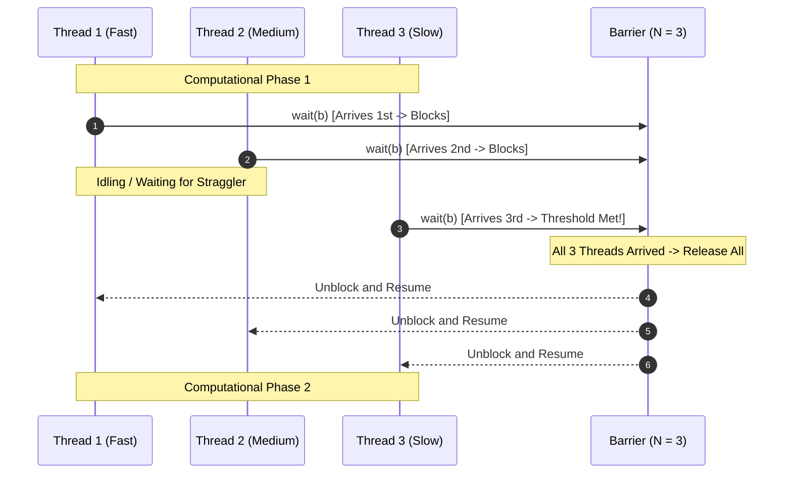

# Writing Multithreaded Code: Barriers

## 2. Coarse-Grained Synchronization: Barriers

A **Barrier** is a synchronization primitive that forces a predetermined cohort of $N$ threads to wait at a designated synchronization point until all $N$ threads have arrived.

### Barrier Mechanics & Operational Flow
- **Initialization**: A barrier is initialized with an arrival threshold of $N$ threads (`barrier_init(&b, N)`).
- **Execution (`wait(b)`)**: When a thread reaches the barrier, it invokes `wait(b)`.
  - An internal counter tracking arrived threads increments atomically.
  - If the counter is less than $N$, the calling thread suspends execution (sleeps or blocks) and yields the processor.
  - When the $N$-th thread arrives, the condition is satisfied: the barrier resets its internal counter and signals all $N - 1$ waiting threads to resume.
- **Computation Staging**: Barriers enable phased computation (e.g., iterative stencil algorithms, physical simulations, matrix transforms). In Phase 1, threads write intermediate values to disjoint memory buffers. The barrier guarantees that all Phase 1 writes are complete and visible before any thread enters Phase 2 to consume those outputs.
- **Trade-offs**: Barriers drastically reduce race conditions across computational stages, but they introduce processor idling (**Bubbling** or straggler penalty) if workload imbalances cause fast threads to block waiting for slow threads.

## Industry Standard Terms

| Course Term | Industry / Standard Term |
| :--- | :--- |
| **Barrier** | Barrier Synchronization / `pthread_barrier_t` / `std::sync::Barrier` |

## Related

- [[Concurrency, Parallelism, and Rust/Writing Multithreaded Code|Writing Multithreaded Code]] — Hub for this topic
- [[Concurrency, Parallelism, and Rust/Writing Multithreaded Code/Data Races and Interleavings|Data Races and Interleavings]] — Race conditions, combinatorial explosion, and formal conditions
- [[Concurrency, Parallelism, and Rust/Writing Multithreaded Code/Mutual Exclusion Locks|Mutual Exclusion Locks]] — Fine-grained synchronization, hazards, and alternatives
