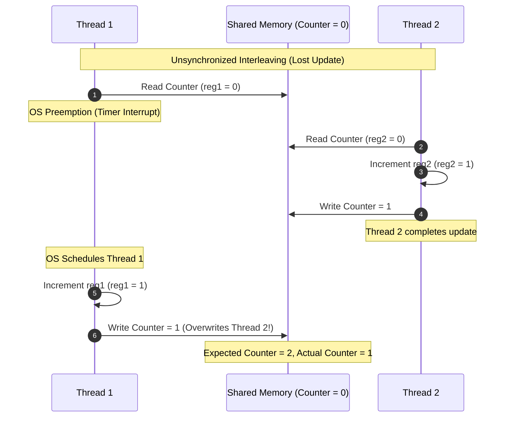

# Writing Multithreaded Code: Data Races and Interleavings

## Architecture & Core Mechanics

### 1. Data Races and Instruction Interleavings

A **Data Race** occurs when concurrent execution paths perform unsynchronized, conflicting accesses to shared memory.

#### The Three Conditions of a Data Race
A program exhibits a data race if and only if all three of the following conditions hold simultaneously:
1. Two or more concurrent instructions from distinct threads access the same physical or virtual memory address.
2. At least one of the accesses is a **write** operation.
3. No synchronization primitive (e.g., lock, barrier, channel, or happens-before edge) mandates a strict order between the accesses.

#### The Fundamental Concurrency Rule: Multiple Readers XOR One Writer
Safe concurrent memory access adheres to the principle of **Aliasing XOR Mutability**:
$$\text{Concurrent Access Safe} \iff (\text{All Accesses are Reads}) \lor (\text{Access is Exclusively Single-Threaded})$$
You may have multiple concurrent reader threads, or exactly one writer thread, but **never both simultaneously** without synchronization.

#### Combinatorial Explosion of Instruction Interleavings
The fundamental reason concurrent bugs (**Heisenbugs**) are difficult to detect via testing is the astronomical number of valid instruction schedules.
- If $X$ independent threads each execute $N$ instructions, the number of distinct execution schedules (interleavings) preserving per-thread program order is given by the multinomial coefficient:
  $$\frac{(X \cdot N)!}{(N!)^X}$$
- For $X = 2$ threads executing $N$ instructions each, this reduces to the binomial coefficient:
  $$\binom{2N}{N} = \frac{(2N)!}{(N!)^2}$$
- By Stirling's approximation, this grows asymptotically on the order of $\Theta\left(\frac{4^N}{\sqrt{N}}\right)$. Even for two short threads with $N = 20$ assembly instructions, $\binom{40}{20} \approx 1.37 \times 10^{11}$ possible schedules exist.
- In practice, the vast majority of interleavings may execute without error during unit tests, while a tiny fraction of edge-case preemptions corrupt state under high production load.

#### Core Strategies for Eliminating Data Races
Systems engineers eliminate data races through three foundational strategies:
1. **Disjoint Memory Partitioning**: Divide working memory so threads operate on independent, non-overlapping memory regions throughout execution, aggregating results via a parallel reduction or gather at the end.
2. **Immutable Shared Data**: Restrict shared variables to read-only access after initialization, eliminating all concurrent writes.
3. **Mutual Exclusion & Synchronization**: Wrap shared mutable access within synchronization primitives—such as mutual exclusion locks, barriers, or message-passing channels—that enforce a strict happens-before ordering.

## Formal Analysis / Protocol Specification

### 1. Interleaving Combinatorics
#### Formal Definition
For $X$ threads where thread $j$ executes $N_j$ instructions, the total number of valid instruction interleavings $S$ preserving individual thread order is:
$$S = \frac{\left(\sum_{j=1}^X N_j\right)!}{\prod_{j=1}^X (N_j!)}$$
When all $X$ threads execute an identical number of instructions $N$:
$$S(X, N) = \frac{(X \cdot N)!}{(N!)^X}$$
For two threads ($X = 2$):
$$S(2, N) = \binom{2N}{N} = \frac{(2N)!}{(N!)^2} \sim \frac{4^N}{\sqrt{\pi N}} \quad \text{as } N \to \infty$$

#### Simplified Explanation
Imagine shuffling two decks of cards together while keeping the cards in each deck in their original order. The number of ways to interleave them explodes exponentially. Even a tiny 20-instruction routine yields billions of valid execution paths, meaning you can never verify multithreaded correctness simply by running a test a few hundred times.

---

### 2. Data Race Condition
#### Formal Definition
Let $I$ be the set of memory access instructions executed in a concurrent program. A data race exists if:
$$\exists \, i_1, i_2 \in I \quad \text{such that:}$$
$$\begin{aligned}
\text{Thread}(i_1) &\neq \text{Thread}(i_2) \\
\land \quad \text{Addr}(i_1) &= \text{Addr}(i_2) \\
\land \quad (\text{IsWrite}(i_1) &\lor \text{IsWrite}(i_2)) \\
\land \quad \neg(i_1 \prec_{hb} i_2 &\lor i_2 \prec_{hb} i_1)
\end{aligned}$$
where $\prec_{hb}$ denotes the formal **Happens-Before** strict partial order relation.

#### Simplified Explanation
Two different threads touch the exact same memory location at the same time, at least one of them is changing the data, and there is no rule or lock forcing one to go before the other.

## Industry Standard Terms

| Course Term | Industry / Standard Term |
| :--- | :--- |
| **Data Race** | Data Race (Undefined Behavior under C11/C++11/Rust Memory Models) |
| **Interleaving** | Instruction Schedule / Interleaving Semantics |

## Related

- [[Concurrency, Parallelism, and Rust/Writing Multithreaded Code|Writing Multithreaded Code]] — Hub for this topic
- [[Concurrency, Parallelism, and Rust/Writing Multithreaded Code/Nondeterminism and Synchronization Paradigms|Nondeterminism and Synchronization Paradigms]] — Preemptive scheduling and coarse vs fine granularity
- [[Concurrency, Parallelism, and Rust/Writing Multithreaded Code/Barriers|Barriers]] — Coarse-grained synchronization
