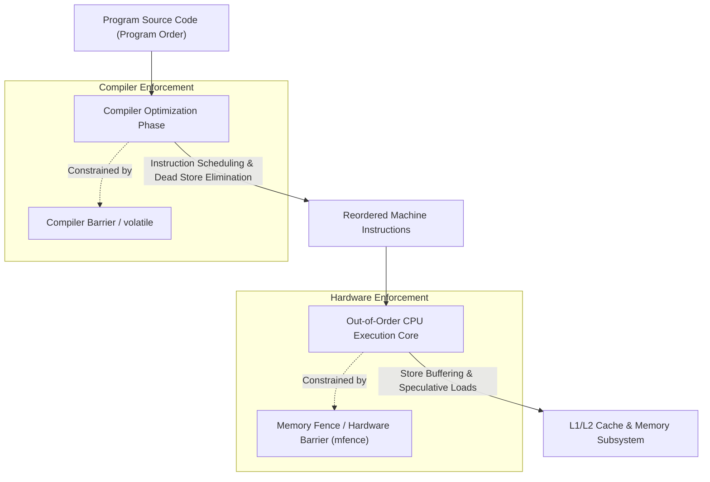

# Writing Multithreaded Code: Memory Reordering and Fences

## 4. Memory Reordering: Compiler and Hardware Fences

In concurrent programming, program order in source code does **not** guarantee physical execution order in memory. Both compilers and modern processors dynamically reorder memory operations to maximize execution throughput.

### Compiler Reordering
The optimizing compiler treats code under the assumption that it executes within a single-threaded environment (**As-If Rule**):
- **Optimizations**: Compilers reorder independent memory reads and writes, hoist loop-invariant loads into CPU registers, coalesce writes, and eliminate seemingly "redundant" stores.
- **Concurrency Bug**: If Thread 1 writes data to a buffer and then sets `flag = 1`, an optimizing compiler may reorder the store to `flag` before the buffer writes if it detects no single-threaded data dependency between them. A concurrent Thread 2 polling `flag` will observe `flag == 1` and read uninitialized buffer memory.
- **Mitigation Mechanisms**:
  - **`volatile` Keyword**: In C/C++, tells the compiler that the variable may change unexpectedly outside the program flow. Prevents the compiler from caching the value in a CPU register or omitting reads/writes. **Critical caveat**: `volatile` does **not** generate hardware memory fences and does **not** make multithreaded operations atomic or safe against CPU reordering.
  - **Compiler Barriers**: Directives (such as `asm volatile("" ::: "memory")` or `atomic_signal_fence`) instructing the compiler that no memory operations before the barrier may be moved after it, and vice versa.

### Hardware (CPU) Reordering & Memory Models
Even if the compiler emits machine instructions in exact source order, modern out-of-order superscalar CPUs reorder execution at the silicon level:
- **Store Buffers & Cache Coherency**: To hide the high latency of writing back to L1/L2 caches or main memory, modern CPUs place pending writes into hardware **Store Buffers** while continuing to execute subsequent read instructions immediately.
- **Total Store Order (TSO) on x86-64**: Under x86-64 TSO, older writes can be delayed past younger reads to different memory addresses (**Store-Load Reordering**).
- **Weakly-Ordered Architectures (ARM, POWER)**: Can reorder reads and writes in almost any combination (Store-Store, Load-Load, Load-Store, Store-Load) unless explicit fence instructions are executed.
- **Mitigation (Memory Fences / Hardware Barriers)**:
  - Assembly fence instructions (e.g., `MFENCE`, `SFENCE`, `LFENCE` on x86-64, or `DMB` on ARM) force the CPU pipeline and store buffers to drain and synchronize, ensuring all pending memory accesses are globally visible before subsequent instructions execute.

## Industry Standard Terms

| Course Term | Industry / Standard Term |
| :--- | :--- |
| **Volatile** | `volatile` qualifier (disables compiler register caching; not a thread-safety mechanism) |
| **Compiler Barrier** | Compiler Memory Barrier / Optimization Barrier (`atomic_signal_fence`) |
| **Memory Fence** | Hardware Memory Barrier (`MFENCE` / `atomic_thread_fence`) |

## Related

- [[Concurrency, Parallelism, and Rust/Writing Multithreaded Code|Writing Multithreaded Code]] — Hub for this topic
- [[Concurrency, Parallelism, and Rust/Writing Multithreaded Code/Mutual Exclusion Locks|Mutual Exclusion Locks]] — Fine-grained synchronization, hazards, and alternatives
- [[Concurrency, Parallelism, and Rust/Writing Multithreaded Code/Bank Account Traces|Bank Account Traces]] — Unsynchronized, mutex, and barrier executions
