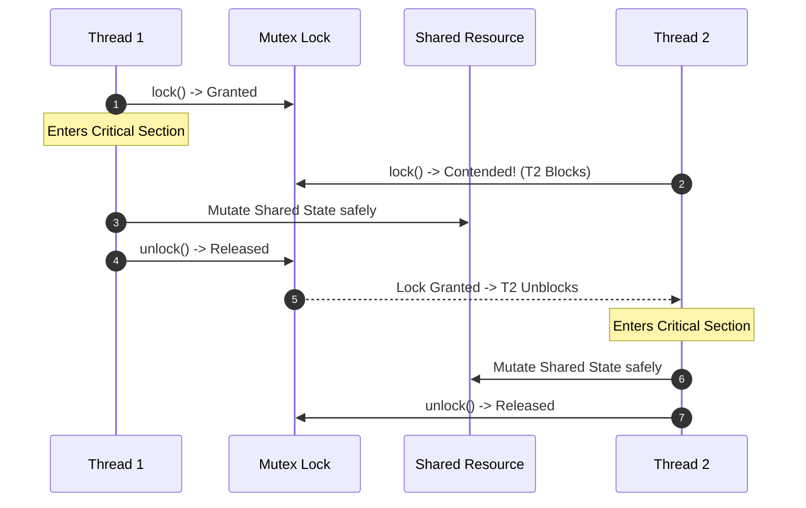

# Writing Multithreaded Code: Mutual Exclusion Locks

## 3. Fine-Grained Synchronization: Mutual Exclusion Locks

A **Mutual Exclusion Lock (Mutex)** is a fine-grained synchronization primitive that guarantees that at most one thread can execute a designated **Critical Section** of code at any given time.

### Core Operations
- **`lock()` / `acquire()`**: The calling thread attempts to claim ownership of the mutex.
  - If the mutex is currently unlocked, the calling thread claims ownership and enters the critical section immediately.
  - If the mutex is already held by another thread, the calling thread blocks (or spins) until the owner releases it.
- **`unlock()` / `release()`**: The owner thread relinquishes ownership, allowing exactly one waiting thread to claim the lock and proceed.

### Interleaving Granularity: Mutex vs. Barrier
- **Barriers**: Force strict global phase lockstep. All threads must finish Phase $K$ before any thread executes Phase $K+1$. Interleavings across phases are completely prohibited.
- **Locks**: Restrict interleaving **only** within the critical section. Outside the critical section, threads run completely decoupled, maximizing instruction throughput and core utilization at the expense of permitting far more global execution interleavings.

### The Dangers and Overheads of Locks
1. **Deadlock**: Occurs when two or more threads circular-wait for locks held by each other (e.g., Thread 1 holds Lock A and requests Lock B, while Thread 2 holds Lock B and requests Lock A). Also occurs if a thread attempts to re-acquire a non-reentrant lock it already holds, or if an early function return skips `unlock()`.
2. **Performance Overhead**:
   - An uncontended lock/unlock cycle on modern x86-64 hardware requires atomic read-modify-write instructions (such as `LOCK CMPXCHG`) and cache coherency bus traffic, costing on the order of **tens to 100 nanoseconds**.
   - Under heavy contention, operating system kernel context switches (e.g., Linux `futex` sleep and wake syscalls) cost microseconds, degrading parallel scaling.
3. **Debugging Complexity**: Lock-related race conditions and timing bugs are nondeterministic and sensitive to hardware timing, making reproduction exceptionally difficult.

### Alternatives to Mutex Locks
To avoid lock contention and deadlocks, modern systems employ alternative concurrency architectures:
- **Message Passing & Channels**: Based on Communicating Sequential Processes (CSP) and functional decomposition. Threads share data by sending messages over thread-safe queues rather than sharing raw memory addresses.
- **Lock-Free and Wait-Free Data Structures**: Algorithms built on hardware atomic primitives (`compare-and-swap`, `fetch-and-add`) without blocking operating system threads. Highly performant but mathematically complex to design correctly.
- **Share-Nothing Architecture**: Partition memory strictly so each thread owns exclusive mutable state, eliminating the need for locks entirely.
- **Specialized Lock Flavors**:
  - **Reader-Writer Locks (`RwLock`)**: Allow unlimited concurrent readers or one exclusive writer, mitigating read-heavy contention.
  - **Spinlocks**: Repeatedly poll an atomic variable in a tight loop instead of putting the thread to sleep; optimal for extremely short critical sections where context switch overhead exceeds wait time.

## Industry Standard Terms

| Course Term | Industry / Standard Term |
| :--- | :--- |
| **Lock / Acquire / Release** | Mutual Exclusion Lock (Mutex) / `pthread_mutex_t` / `std::sync::Mutex` |
| **Channels** | Message Passing / CSP Channel / `std::sync::mpsc` |

## Related

- [[Concurrency, Parallelism, and Rust/Writing Multithreaded Code|Writing Multithreaded Code]] — Hub for this topic
- [[Concurrency, Parallelism, and Rust/Writing Multithreaded Code/Barriers|Barriers]] — Coarse-grained synchronization
- [[Concurrency, Parallelism, and Rust/Writing Multithreaded Code/Memory Reordering and Fences|Memory Reordering and Fences]] — Compiler and hardware reordering
