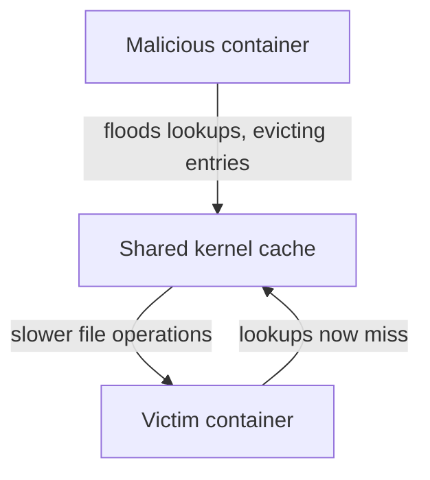

# Containers: Cgroups

**Cgroups** (control groups) provide the resource-control half of container isolation. While [[Datacenter Systems/Containers/Namespace Isolation|namespaces]] restrict what a container can see, cgroups restrict how much of the machine it can use.

## Resource Weights and Limits

Cgroups attach **resource weights or limits** to a group of processes. They cover:
- Memory usage
- The CPU scheduler (how much CPU time the group gets)
- I/O state (disk and device bandwidth)

## Limits on Internal Kernel Data Structures

Cgroups can also limit the use of some internal kernel data structures:
- Maximum number of open file descriptors per cgroup.
- Maximum number of active processes per cgroup.

Without these limits, one container could exhaust a kernel table that every container depends on.

## Shared Kernel Data Structures Remain a Weakness

Only some kernel data structures can be limited per cgroup. **Most kernel data structures are shared**, for example:
- The buffer cache
- The inode cache
- The negative file lookup cache

Sharing has performance effects, and it is an attack vector:
- The **negative file lookup cache** remembers that a file lookup failed, so repeated lookups for a missing name do not have to go back to the file system.
- A malicious process can **flush** this cache, so that other containers' lookups miss and must be redone, slowing down their performance.
- This works because the cache belongs to the one shared kernel, not to any container.

## Industry Standard Terms

| Course Term | Industry / Standard Term |
| :--- | :--- |
| Cgroups | Linux control groups (cgroup v1 / v2) |
| Negative file lookup cache | Negative dentry cache |
| Resource weights | `cpu.weight`, `memory.max`, `io.weight`, `pids.max` settings |

## Related

- [[Datacenter Systems/Containers|Containers]] — Hub
- [[Datacenter Systems/Containers/Namespace Isolation|Namespace Isolation]]
- [[Datacenter Systems/Containers/Containers vs Virtual Machines|Containers vs Virtual Machines]] — Security implications of the shared kernel
- [[Operating Systems/Virtualization/Containers and Virt|Containers and Virtualization]]
