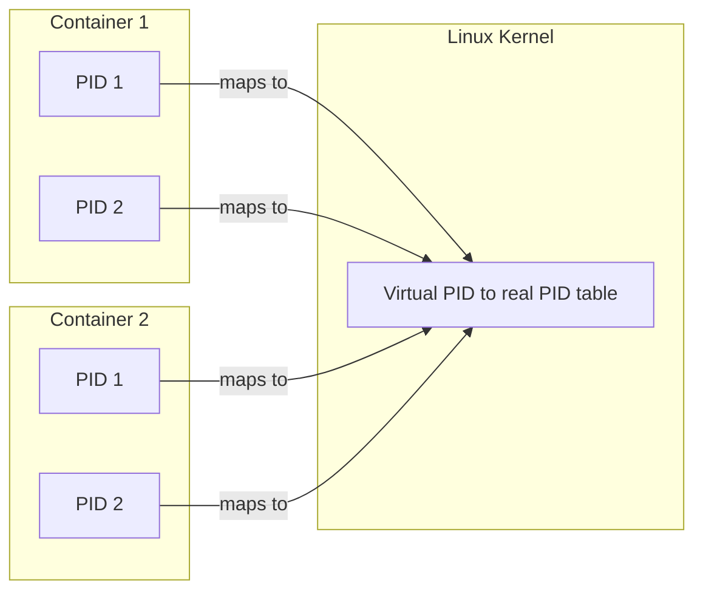

# Containers: Namespace Isolation

**Namespace isolation** is how a shared kernel gives each container its own private view of the system. Each category of kernel-visible resource is virtualized separately.

## File Systems

- The application is given its own **virtual file system**, so it believes it sits at the root (`/`).
- The kernel maintains the single physical file system as a set of virtual roots, one per container.

## System Calls

### Process Syscalls
Syscalls that act on processes only apply to processes **within the container**.
- Per-container process numbering starts from 1 (a **virtual PID**), so each container has its own "init" process.
- Virtual PIDs are mapped to the real kernel process IDs inside Linux. The kernel keeps this translation table, which is how it stays the single owner of all real processes.

### Network Syscalls
- Each container has its own **IP address and MAC address**.
- These are multiplexed by the kernel: many containers share the same physical network card, and the kernel decides which container each packet belongs to. See [[Datacenter Systems/Containers/Network Virtualization|Network Virtualization]].

### System Resource Queries
- Listing all processes shows only the processes inside the container.
- Memory usage reports likewise cover only the container.

Namespaces only control what a container can *see*. What it can *consume* is controlled by [[Datacenter Systems/Containers/Cgroups|Cgroups]].

## Industry Standard Terms

| Course Term | Industry / Standard Term |
| :--- | :--- |
| Name space isolation | Linux namespaces (`mnt`, `pid`, `net`, `uts`, `ipc`, `user`) |
| Virtual file system root | Mount namespace / `chroot` / `pivot_root` |
| Virtual PID | PID namespace |
| Per-container IP and MAC | Network namespace with virtual Ethernet (`veth`) pairs |

## Related

- [[Datacenter Systems/Containers|Containers]] — Hub
- [[Datacenter Systems/Containers/OS-Level Virtualization|OS-Level Virtualization]]
- [[Datacenter Systems/Containers/Cgroups|Cgroups]]
- [[Operating Systems/Virtualization/Containers and Virt|Containers and Virtualization]]
