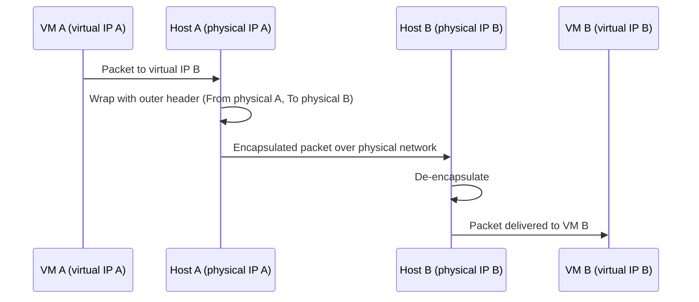

# Containers: Network Virtualization

For packets to reach the right [[Datacenter Systems/Virtual Machines|Virtual Machine]] or [[Datacenter Systems/Containers|container]], the network must know where to send them, so every virtual endpoint needs a unique identity.

## The Problem

- We need to know where to send packets.
- Each process (VM or container) needs a unique **MAC address, IP address**, and so on.
- Physical IP addresses alone will not work: we need a **virtual IP address** (and virtual MAC) that tells the hypervisor where each packet should go.

## Mapping Physical Machines to Virtual Machines

The virtual addresses must be mapped onto physical machines. This is done by **encapsulation**:

- **On send**: The host OS wraps each packet with an extra header addressed *To* the physical machine IP of the destination VM *from* the physical machine IP of the source VM.
- **On receive**: The host OS de-encapsulates the packet and forwards it to the VM.

## Addressing Rules

- Each physical machine has a unique IP address and MAC address.
- Each virtual machine also has its own unique IP address and MAC address.
- Because every VM has its own address, **virtual machines on the same physical machine can both listen on port 80** without conflict.

## Software Implementation

A piece of software grabs the packet and wraps it with headers so it can reach the destination machine. The **same issue applies to containers**: each container also has its own IP and MAC, multiplexed by the kernel (see [[Datacenter Systems/Containers/Namespace Isolation|Namespace Isolation]]).

## Industry Standard Terms

| Course Term | Industry / Standard Term |
| :--- | :--- |
| Wrapping with extra header | Overlay network / tunneling (VXLAN, GRE, Geneve) |
| Software that wraps packets | Virtual switch (Open vSwitch), software-defined networking (SDN) |
| Virtual IP / MAC per VM | vNIC address |

## Related

- [[Datacenter Systems/Containers|Containers]] — Hub
- [[Datacenter Systems/IO Virtualization|IO Virtualization]] — Virtual network devices
- [[CSE461 Index|CSE461 — Computer Networks]] — IP, MAC addressing, and encapsulation
