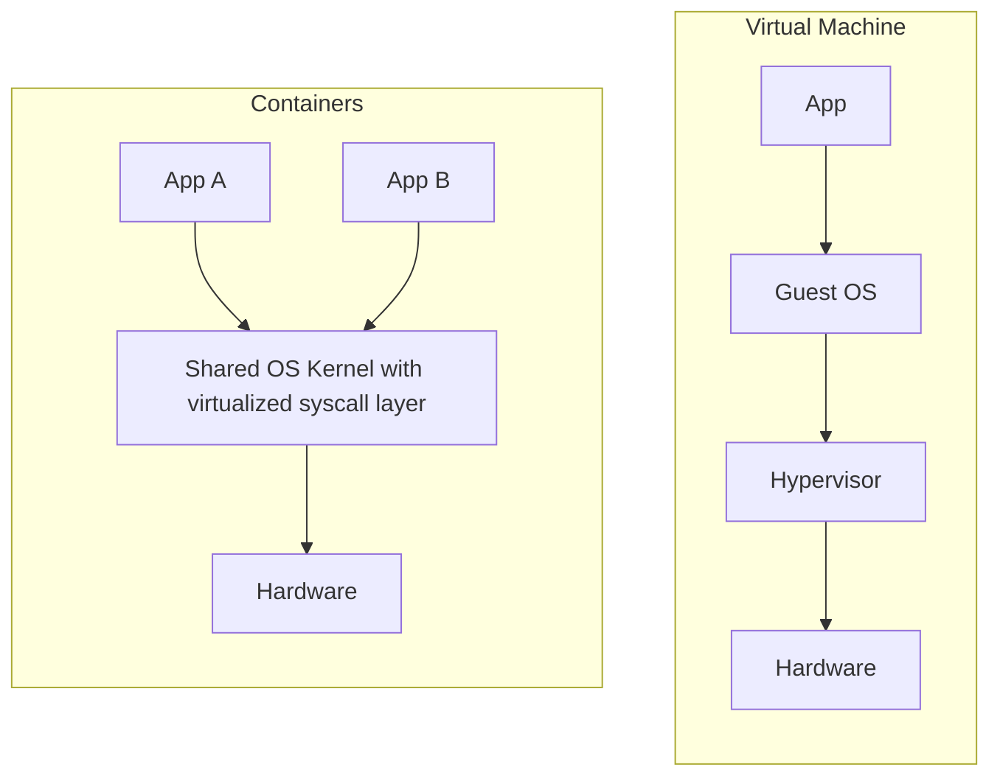

# Containers: OS-Level Virtualization

Containers solve many of the problems that full hardware virtualization leaves open by virtualizing a different layer: the **system call interface** rather than the hardware interface.

## Two Kinds of Virtual Machine Hypervisors

Before contrasting containers with [[Datacenter Systems/Virtual Machines|Virtual Machines]], recall where the hypervisor runs:

- **Native (Type-1) VM**: The hypervisor runs directly on the hardware. This is what the cloud uses.
- **Type-2 VM**: The hypervisor runs as an application on top of a host OS. Running a VM inside your own computer is a Type-2 VM.

## Virtualizing the Syscall Interface

A container is a **group of processes that appear to have an entire machine to themselves**. The key properties:

- **One OS kernel, many isolated applications**: Every container shares the same kernel.
- **Each container is just a process**: There is no guest OS inside it, unlike a VM which boots a full OS.
- **No hypervisor**: Instead there is a virtualization layer inside the kernel that virtualizes the syscall layer. Because the application only talks to the OS through syscalls, changing what the syscalls return changes what the application can see.
- **You can only see your own resources**: A container cannot observe processes, files, or network identities that belong to other containers (see [[Datacenter Systems/Containers/Namespace Isolation|Namespace Isolation]]).

## Programming Language Virtualization

A third place to put the virtualization boundary is the programming language runtime:

- The process contains the language program plus a **VM**, which is an abstract hardware machine that the compiler compiles for.
- This gives better **portability**, because only the VM needs porting rather than every program.
- It also pushes the job of reading and checking the code from the compiler to the runtime.

## Why Containers Were Created

- **Different trust assumption**: Hypervisors are optimized for distrusting processes, since a cloud tenant can run anything. On a desktop you can generally trust the processes because you are the person running them.
- **Security isolation origin**: Containers were created to isolate applications for security. The idea came from the web browser: to handle a complex document, the browser starts a new process in case the document contains a virus, isolating the file from the file system.

## Industry Standard Terms

| Course Term | Industry / Standard Term |
| :--- | :--- |
| Native (Type-1) VM | Bare-metal hypervisor (ESXi, Xen, KVM) |
| Type-2 VM | Hosted hypervisor (VirtualBox, VMware Workstation) |
| Container virtualization layer | Container runtime on top of Linux namespaces and cgroups (Docker, containerd, runc) |
| Programming language VM | Managed runtime (JVM, CLR) |

## Related

- [[Datacenter Systems/Containers|Containers]] — Hub
- [[Datacenter Systems/Containers/Namespace Isolation|Namespace Isolation]] — How the syscall layer is virtualized
- [[Datacenter Systems/Containers/Containers vs Virtual Machines|Containers vs Virtual Machines]]
- [[Datacenter Systems/Execution Environments and Virtualization|Execution Environments and Virtualization]]
