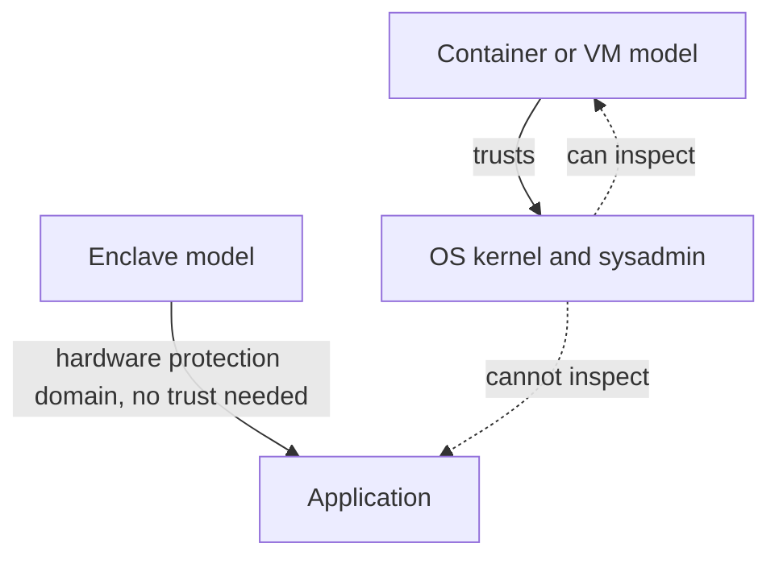

# Containers: Serverless Functions and Enclaves

The execution model is a **moving target**. Industry wants to add support for both [[Datacenter Systems/Virtual Machines|Virtual Machines]] and [[Datacenter Systems/Containers|Containers]], and two further models are emerging.

## Third Model: Serverless Functions

- Built on **functional programming**.
- A **limited API** keeps the interface small.
- Functions are **invoked on demand** rather than running continuously.

## Fourth Model: Enclaves

- **Motivation**: Applications do not trust the cloud operator.
- The application is protected from the OS kernel and the system administrator. The current model (VMs and containers) trusts both, but a system administrator can be malicious.
- Applications execute within a **hardware-enforced protection domain**, so the protection does not depend on trusting the software below.

## Industry Standard Terms

| Course Term | Industry / Standard Term |
| :--- | :--- |
| Serverless functions | Function-as-a-Service (AWS Lambda, Google Cloud Functions) |
| Enclaves | Trusted Execution Environments (Intel SGX, AMD SEV, ARM TrustZone) |

## Related

- [[Datacenter Systems/Containers|Containers]] — Hub
- [[Datacenter Systems/Containers/Containers vs Virtual Machines|Containers vs Virtual Machines]]
- [[Datacenter Systems/Workloads and Software Infrastructure|Workloads and Software Infrastructure]] — Cloud security
