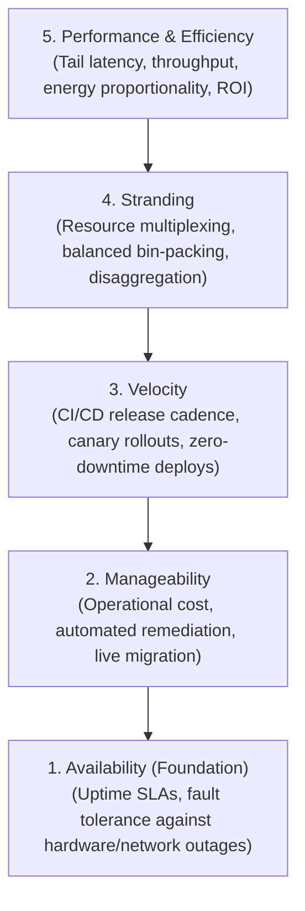

# Course Introduction and Overview: Cloud Operator Pyramid of Concerns

## Cloud Operator Pyramid of Concerns (Google)

Operational priorities in hyperscale cloud environments follow a strict hierarchical dependency model:

![[Screenshots/Cloud Operator Pyramid of Google.png]]

The fundamental architectural principle governing this pyramid is **structural precedence**:
> **Precedence Invariant**: Lower tiers carry strictly higher operational weight than higher tiers. If an architectural change improves performance or feature velocity but compromises availability or operational manageability, it is rejected.

1. **Availability (The Foundation)**:
   - Measures the percentage of time that cloud services correctly process requests.
   - Must survive power grid failures, optical fiber cuts, top-of-rack (ToR) switch crashes, kernel panics, and human configuration mistakes.
   - High availability targets typically require "four nines" (99.99%) or "five nines" (99.999%) uptime.
2. **Manageability**:
   - Focuses on total cost of ownership (TCO) and operational overhead.
   - Systems must support non-disruptive rolling kernel updates, firmware flashes, hardware decommissioning, and automated error mitigation without human intervention.
3. **Velocity**:
   - The speed with which engineering teams can safely deploy new code and infrastructure improvements to production.
   - Enabled by automated canary analysis, hermetic container builds, and blue-green deployments.
4. **Stranding (Resource Utilization & Multiplexing)**:
   - **Resource Stranding** occurs when a physical server has exhausted one critical resource (e.g., 100% of its DRAM is allocated) while other resources (e.g., 70% of CPU cores and disk I/O) remain unallocated and unusable.
   - Mitigated via bin-packing schedulers, dynamic oversubscription, and hardware disaggregation.
5. **Performance and Efficiency (The Peak)**:
   - Optimizing request latency, query throughput, FLOPS per watt, and infrastructure return on investment (ROI).

## Industry Standard Terms

| Course Term | Industry / Production Term |
| :--- | :--- |
| **Cloud Operator Pyramid** | SRE Hierarchy of Needs / Cloud Operational Maturity Model |
| **Stranding** | Stranded Capacity / Fragmented Resource Allocation |
| **Disaggregation** | Composable Infrastructure / Disaggregated Memory (CXL) / NVMe-oF |

## Related

- [[Datacenter Systems/Course Introduction and Overview|Course Introduction and Overview]] — Hub for this topic
- [[Datacenter Systems/Course Introduction and Overview/Cloud Service Abstraction Hierarchy|Cloud Service Abstraction Hierarchy]] — IaaS, PaaS, and SaaS layering
- [[Datacenter Systems/Course Introduction and Overview/Primary Datacenter Engineering Concerns|Primary Datacenter Engineering Concerns]] — Core engineering concerns of datacenter design
