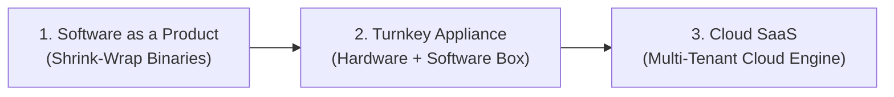

# Course Introduction and Overview: Datacenter Challenges and Software Delivery

## Datacenter Systems Motivation & Overview

Traditional computing models relied on standalone servers or desktop workstations executing shrink-wrapped applications. Modern warehouse-scale computing (WSC) emerged because modern internet services require continuous availability, extreme scale, and sub-millisecond latencies that no single physical machine can satisfy.

### Common Engineering Challenges in Datacenter Systems

Building and operating warehouse-scale infrastructure introduces five fundamental engineering challenges:

1. **Performance Analysis at Scale**: Tracing distributed execution paths, pinpointing tail-latency bottlenecks across thousands of microservices, and identifying inter-service contention without introducing massive tracing overhead.
2. **Low Latency and High Throughput**: Balancing massive request concurrency (millions of queries per second) with strict single-digit millisecond latency Service Level Objectives (SLOs).
3. **Extreme Scale & Elastic Provisioning**: Handling diurnal and seasonal traffic spikes dynamically through horizontal auto-scaling without over-provisioning idle resources.
4. **Hardware Specialization & Co-design**: Tailoring distributed software runtimes to specialized hardware (such as GPUs, TPUs, SmartNICs, FPGAs, Non-Volatile Memory, and NVMe-oF fabrics).
5. **Full-System Experimentation**: Safely evaluating runtime optimizations, kernel scheduler changes, and network protocols in live production clusters without disrupting multi-tenant availability.

### Evolution of Software Delivery Models

The industry transitioned through three distinct deployment paradigms to reach modern cloud architecture:

#### 1. Software as a Product
- **Mechanism**: The vendor compiles and packages standalone application binaries shipped directly to customers for on-premises installation across heterogeneous desktop and server hardware.
- **Trade-offs**:
  - *Advantages*: Complete customer data sovereignty; zero vendor hosting infrastructure cost.
  - *Disadvantages*: Massive porting matrix; difficult bug reproduction across diverse OS/hardware combinations; fragmented upgrade cycles; rampant software piracy.

#### 2. Turnkey Appliance
- **Mechanism**: The vendor packages software with pre-qualified, proprietary server hardware as an integrated appliance (e.g., enterprise healthcare record systems like Epic, hardware firewalls, or dedicated storage appliances). Telemetry, billing, and global updates backhaul to a vendor-operated datacenter.
- **Trade-offs**:
  - *Advantages*: Eliminates the hardware compatibility and porting problem by standardizing the execution environment.
  - *Disadvantages*: High capital expenditure (CapEx) for customers; physically rigid (users cannot access systems remotely unless additional hardware is purchased); vendor must build and maintain high-availability distributed backends for updates and telemetry.

#### 3. Cloud-Based Software as a Service (SaaS)
- **Mechanism**: The backend runs entirely inside hyperscale cloud datacenters across shared pools of compute and storage. Users interact via thin clients (web browsers, mobile applications, or commodity workstations) while the cloud backend performs all heavy processing, state storage, replication, and backup.
- **Trade-offs**:
  - *Advantages*: Seamless 24/7 global accessibility; continuous zero-downtime feature delivery; elastic auto-scaling; multi-datacenter geographic fault tolerance.
  - *Disadvantages*: Total reliance on network connectivity; multi-tenant security risks; operational complexity of managing large-scale distributed consensus and data consistency.

## Industry Standard Terms

| Course Term | Industry / Production Term |
| :--- | :--- |
| **Turnkey Appliance** | On-Premises Hardware Appliance / Integrated System |
| **Fan-Out Bottleneck** | Tail-at-Scale / Straggler Problem / Scatter-Gather Amplification |

## Related

- [[Datacenter Systems/Course Introduction and Overview|Course Introduction and Overview]] — Hub for this topic
- [[Datacenter Systems/Course Introduction and Overview/Cloud Service Abstraction Hierarchy|Cloud Service Abstraction Hierarchy]] — IaaS, PaaS, and SaaS layering
