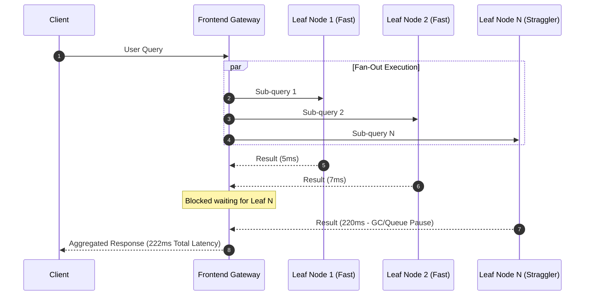

# Course Introduction and Overview: Primary Datacenter Engineering Concerns

## Primary Datacenter Engineering Concerns

Beyond the hierarchical pyramid, datacenter operators manage several intersecting technical constraints:

### 1. Tail Latency and Parallel Request Fan-out
In modern cloud backends, a single user request fans out across hundreds or thousands of leaf nodes (e.g., parallel search indexing, recommendation retrieval, database sharding). Because the root node must aggregate responses from all leaf nodes, the end-to-end request latency is governed by the **tail latency** (99th or 99.9th percentile) of the slowest leaf node ("straggler"):

### 2. Multi-Tenant Isolation: Security vs. Performance
Datacenters multiplex multiple competing tenants on the same physical hardware:
- **Security Isolation**: Hypervisors and container namespaces prevent tenants from accessing sibling memory or executing side-channel attacks (e.g., Spectre, Meltdown).
- **Performance Isolation**: Prevents a "noisy neighbor" or "whale tenant" from monopolizing shared physical resources (L3 CPU cache, memory bus bandwidth, PCIe lanes, or Top-of-Rack network switch buffers).

### 3. Energy Consumption, Cooling, and Carbon Footprint
- Datacenters consume approximately 1% to 2% of total worldwide electricity generation, with compute demand compounding at ~40% annually due to distributed AI/ML workloads.
- Infrastructure efficiency is measured via **Power Usage Effectiveness (PUE)**, driving innovations in liquid immersion cooling, free-air economizers, and energy-proportional computing.

## Industry Standard Terms

| Course Term | Industry / Production Term |
| :--- | :--- |
| **Whale Tenant** | Noisy Neighbor / Resource Hog / Unbounded Consumer |

## Related

- [[Datacenter Systems/Course Introduction and Overview|Course Introduction and Overview]] — Hub for this topic
- [[Datacenter Systems/Course Introduction and Overview/Cloud Operator Pyramid of Concerns|Cloud Operator Pyramid of Concerns]] — Google's pyramid of operator concerns
- [[Datacenter Systems/Course Introduction and Overview/Class Roadmap and Prerequisites|Class Roadmap and Prerequisites]] — Class topics and expected background
