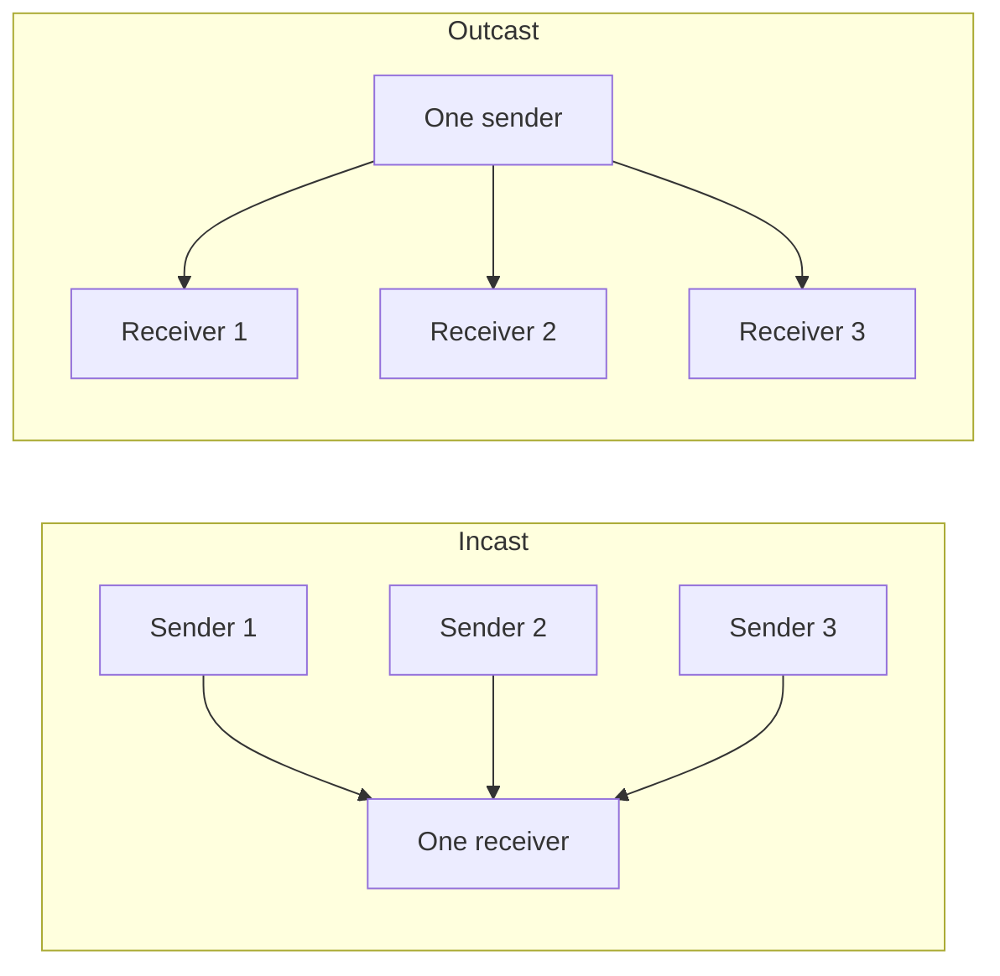
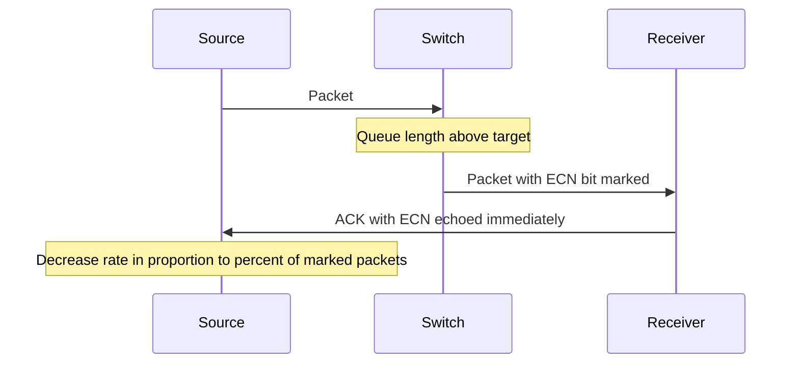

# Datacenter Networking: Data Center Congestion Control

This note starts from the intuition that overload can leave a system in a worse state than the load alone would explain (traffic and overload management), then states what a datacenter network must achieve (goals), explains why congestion is unavoidable in this setting, catalogs the traffic patterns that cause it (incast/outcast, ECMP collisions), and finally covers the mechanisms used against it: TCP congestion control, ECN, and DCTCP.

---

## Traffic Congestion

![[Traffic Flow vs Occupancy.png]]

- The analogy is cars on a road: the graph plots flow (cars per hour) against occupancy (%).
- Flow rises with occupancy up to a point, but once the road gets too occupied, flow falls even though there are more cars on it.
- Congestion therefore reduces useful throughput rather than just delaying it.

## Overload Management

- Temporary overload can put a system into a poorly performing state, which may persist even after the overload disappears.
- Solutions:
  - Defer or turn away the heaviest (or least profitable) users.
  - Degrade service: return a partial result using fewer resources.

---

## Goals

### Low Latency When There Is No Contention

- Adding even one round-trip delay can be noticeable.
- Send a new message as quickly as possible, particularly for short messages, since they are typically the most latency-sensitive.

### Short Messages Still Get Through Under Contention

- Even if sharing a link with large transfers, small messages should get through very quickly.
  - This implies larger transfers must cause little to no queueing.
- Packet loss leads to long-tail latency because of timeout plus retry (especially bad for RDMA).
- We should expect some extra delay due to contention. The question is: do we have space in the network to send a message?
- We want to strike a balance between managing contention and getting the lowest possible latency for the short messages in the network.
- Short messages should ideally have priority over larger ones.
- Constraints:
  - It is not possible to police every connection, as we would run out of memory very quickly as we scale.
  - We cannot rely on packet loss as a signal because of the long-tail effects.
  - We also want to process messages as fast as possible.

### Work Conserving

- Large messages fill link capacity (the bandwidth-delay product).
- Bandwidth is allocated fairly so longer messages do not clog the network.

### Network Oblivious to Message Size

- The network sees packets, not messages, so it does not know a message's size.

---

## Why Datacenter Network Congestion

Why not just buffer data inside the network? Any server can send any message, and the network serves the data as quickly as it can. This fails for two reasons:

- Switches have a limited number of FIFO queues (see [[Datacenter Systems/Datacenter Networking/Store-and-Forward Switch Internals|Store-and-Forward Switch Internals]]).
  - For example, one per priority level, not one per application.
  - Therefore there is no performance isolation between applications.
- Within a FIFO queue there is **head-of-line blocking**.
  - Later messages cannot go until previous large messages finish.
  - This causes very high tail delay for short messages.

The traffic itself makes this worse:

- There is a large number of server cores per datacenter, and any core can send a message of any size to any other.
- Cores can send to the same server, rack, or cluster at the same time.
- Traffic is often bursty or correlated.
- The size of traffic is highly dispersed.
- Oversubscription, [[Datacenter Systems/Datacenter Networking/ECMP Routing|ECMP]], or link/switch failures can lead to unequal load (see [[Datacenter Systems/Datacenter Networking/Network Topology#Oversubscription|Oversubscription]]).
- Aggregate traffic patterns from parallel applications can cause congestion:
  - Replies coming back simultaneously can cause spontaneous congestion, and packets can be dropped.
  - With ECMP we can get unlucky and send all the short connections down one path while another path is completely underutilized.

---

## Saturn Congestion

![[Saturn Congestion.png]]

- Oversubscription can cause packet loss.
- Congestion is generated all the way down to the host.
- It appears in the aggregation layer.
- The network stack on the CPU side of the host may not be fast enough to process everything.

The figure breaks down where packets are dropped:

| Drop location | Share of drops |
|---|---|
| Host fanin drops (at the ToR, toward hosts) | 62.8% |
| ToR fanin drops (at the aggregation block, from the spine blocks) | 35.9% |
| ToR uplink oversubscription drops | 1.3% |

---

## Incast and Outcast

- **Incast**: correlated traffic to the same server.
  - MapReduce output data (for example, unequal distribution to reducers).
  - Parallel RPCs to sharded data, where the replies are synchronized.
  - Parallel programs whose elements synchronize with a central coordinator, for example an ML parameter server.
- Incast can also happen at the rack level: a coordinated flood to multiple servers in the same rack.
- **Outcast**: correlated traffic from the same server or the same rack.

---

## ECMP and Congestion

- ECMP randomizes among flows (source/destination pairs), choosing among several hundred possible paths in a large datacenter.
- What if ECMP assigns two large flows to the same link, mixed with some small flows?
  - There is no guarantee of equal distribution of work, except on average.
  - This creates the potential for poor tail latency for small flows.
- Link and switch failures can also lead to congestion.

---

## TCP (Internet) Congestion Control

- The source does not know the path properties:
  - Path capacity.
  - Path round-trip time.
  - Number of competing transfers (fair share).
- So it probes for how fast to send:
  - Start with a small initial window.
  - If there is no packet loss, double the rate until the first packet loss. On initialization we double our sending rate until we get a loss, and then we back off slowly.
- A buffer overrun leads to packet loss, which signals that we are sending too fast:
  - No loss: increase the window gradually.
  - Packet loss: decrease the rate quickly. We do this once we have found the initial sending speed, so we can further stabilize to a pace.

### Congestion Control Fairness

- For very long transfers, TCP eventually converges to a fair rate.
- "Eventually" could take many round trips.

### ECN: Early Congestion Notification

- Without ECN, TCP keeps increasing its rate until buffers are full and packets are dropped, which causes long delays for short messages and even longer tail latency.
- Instead, the switch marks an **ECN bit** in the packet if there is a large queue.
  - The ECN bit is returned to the sender in the TCP (delayed) ACK by the receiver.
  - The sender treats an ECN-marked packet like a packet drop: AIMD.
- ECN is largely not used on the internet, but it is widely used in datacenter networks.

### DCTCP: Datacenter TCP (2010)

| Role | DCTCP behavior | Swift (comparison) |
|---|---|---|
| Switch | Mark ECN if queue length is greater than a target | Directly measures whether path delay is greater than a target |
| Receiver | Return the ECN bit immediately (no delayed ACK) | Similar |
| Source | Decrease rate in proportion to the percentage of ECN-marked packets | |

- As congestion builds, more packets are marked, so the sender backs off further.
- DCTCP is foiled by a rapid onset or decrease of congestion (incast), since the feedback arrives too slowly.

---

## Formal Analysis

### Formal Definition

For DCTCP, let $F$ be the fraction of packets marked with ECN in the most recent window. The sender's decrease is proportional to $F$:

$$\text{cwnd} \leftarrow \text{cwnd} \cdot \left(1 - \frac{\alpha}{2}\right), \qquad \alpha \approx F \text{ (smoothed over recent windows)}$$

The switch marks a packet when its queue length satisfies $q > K$ for a target $K$.

### Simplified Explanation

The switch raises a flag whenever its line gets too long. The more flagged packets the sender sees, the harder it slows down, so a mild jam causes a gentle slowdown instead of TCP's all-or-nothing halving.

---

## Deep Dive

- The formula above (the $\alpha$ smoothing and the $1 - \alpha/2$ factor) is the standard DCTCP formulation, added here as the formal counterpart to the class statement "decrease rate proportional to the percentage of marked ECN bits".
- Core TCP congestion control (slow start, AIMD, `cwnd`) is covered in depth in [[Networking/Transport/Transport Layer - TCP Congestion Control|TCP Congestion Control]], and router-side mechanisms in [[Networking/Transport/Network-Side Congestion Control|Network-Side Congestion Control]].

---

## Industry Standard Terms

| Course term | Industry equivalent |
|---|---|
| ECN: Early Congestion Notification | Explicit Congestion Notification (ECN) |
| Head-of-line blocking | Head-of-line (HOL) blocking |
| Incast | TCP incast / many-to-one fan-in congestion |
| Work conserving | Work-conserving scheduling (no idle capacity while work is queued) |
| Overload management | Load shedding / graceful degradation |
| Saturn | Google's datacenter network fabric generation |

---

## Related
- [[Datacenter Systems/Datacenter Networking/Datacenter Networking|Datacenter Networking]]
- [[Datacenter Systems/Datacenter Networking/Network Topology|Network Topology]]
- [[Datacenter Systems/Datacenter Networking/ECMP Routing|ECMP Routing]]
- [[Datacenter Systems/Datacenter Networking/Store-and-Forward Switch Internals|Store-and-Forward Switch Internals]]
- [[Datacenter Systems/Course Introduction and Overview/Failure Modes|Failure Modes]] — incast and stragglers
- [[Datacenter Systems/Queuing Theory/Queuing Theory|Queuing Theory]]
- [[Networking/Transport/Transport Layer - TCP Congestion Control|TCP Congestion Control]]
