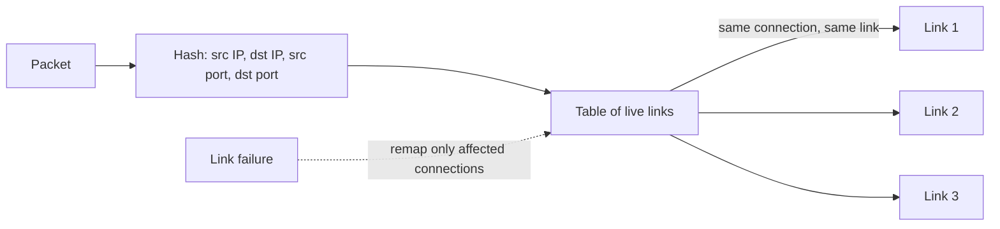

# Datacenter Networking: ECMP Routing

This note explains how a datacenter spreads traffic across the many equal-length paths a [[Datacenter Systems/Datacenter Networking/Network Topology|Clos topology]] provides, why packets of one connection must stay on one path, and what has to change when links or switches fail.

---

## Equal Cost Multipath (ECMP)

- **Equal cost multipath routing (ECMP)**: among equal-length paths to the destination, choose one pseudo-randomly.
- The choice is made by hashing the connection's identifying fields: (source IP, destination IP, source TCP port, destination TCP port).
- Every packet of the same connection hashes to the same value, so packets from the same connection are delivered in order (if there is no link or switch failure). We get a pseudorandom link and keep using it.

## Why Keep a Connection on One Path

- TCP is notoriously bad when packets are delivered out of order, which gives worse performance.
- So we send things of the same connection in the order they were sent, without reordering.

## Bandwidth Considerations

- Within a rack, servers can send to each other at full link speed.
- Between racks, aggregation and core switches limit throughput.

## ECMP with Failures

- The hash function by itself is not enough when failures are present.
- We should have a table that tracks failures so that the assignment of affected connections can change (replacing failed links).
- If a failure happens, we change the assignment of the affected connections without changing the others.

---

## Formal Analysis

### Formal Definition

With $N$ equal-cost next hops, the chosen link is

$$\text{link} = h(\text{src IP},\ \text{dst IP},\ \text{src port},\ \text{dst port}) \bmod N$$

and on a failure the failed link is replaced in a failure-tracking table so only the connections that used it are reassigned.

### Simplified Explanation

Roll dice using the connection's identity, so the same connection always rolls the same number and takes the same road. When a road closes, only the travelers on that road get re-rolled.

---

## Industry Standard Terms

| Course term | Industry equivalent |
|---|---|
| ECMP | Equal-Cost Multi-Path (flow-level load balancing) |
| Connection (src/dst IP and ports) | Flow / 5-tuple (with protocol) |
| Table that tracks failures | Resilient hashing |

---

## Related
- [[Datacenter Systems/Datacenter Networking/Datacenter Networking|Datacenter Networking]]
- [[Datacenter Systems/Datacenter Networking/Network Topology|Network Topology]]
- [[Datacenter Systems/Datacenter Networking/Data Center Congestion Control#ECMP and Congestion|ECMP and Congestion]]
