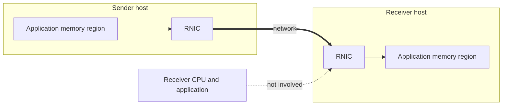

# Datacenter Networking: Network APIs

This note covers the three interfaces an application can use to talk over the datacenter network, ordered from the most abstracted to the most direct: stream sockets, datagram sockets, and RDMA.

---

## Stream Sockets

- **Stream sockets** provide a bidirectional, reliable, ordered byte stream.
  - They behave like reading and writing to a file or a UNIX pipe.
  - The guest OS network stack handles packet framing and retransmission.
  - This lets us view the network as if it were inside our own machine: the network handles everything.

## Datagram Sockets

- **Datagram sockets** provide unreliable, unordered message delivery.
  - Used by DNS, the original NFS, and the original Facebook memcache.
  - We use them when speed matters more than delivery: the cost of getting a packet late outweighs the cost of not getting it at all.

## RDMA

- **RDMA (Remote Direct Memory Access)** reads or writes directly between an application and a remote application's memory region.
  - It is **one-sided communication**: no application involvement on the remote side.
  - RDMA also supports reliable or unreliable message passing with application involvement, which can be configured to work more like a traditional socket.
- We tell the NIC to read from one location and store to another.
  - The NIC must ensure the access is safe and secure.
  - The software on the other side is not aware that this happens, because it happens entirely inside the NIC.
- The hardware that makes this possible is described in [[Datacenter Systems/Datacenter Networking/Network Interface Cards#RDMA Network Interface Card (RNIC)|RNIC]].

| API | Reliability | Ordering | Remote application involved | Typical use |
|---|---|---|---|---|
| Stream socket | Reliable | Ordered | Yes | General client/server traffic |
| Datagram socket | Unreliable | Unordered | Yes | DNS, original NFS, original memcache |
| RDMA (one-sided) | Handled by the NIC | Per NIC | No | Low-latency remote memory access |

---

## Industry Standard Terms

| Course term | Industry equivalent |
|---|---|
| Stream socket | TCP socket (`SOCK_STREAM`) |
| Datagram socket | UDP socket (`SOCK_DGRAM`) |
| One-sided communication | One-sided RDMA verbs (READ/WRITE) |

---

## Related
- [[Datacenter Systems/Datacenter Networking/Datacenter Networking|Datacenter Networking]]
- [[Datacenter Systems/Datacenter Networking/Network Layers and Packet Path|Network Layers and Packet Path]]
- [[Datacenter Systems/Datacenter Networking/Network Interface Cards|Network Interface Cards]]
- [[Networking/Transport/Transport Layer - UDP and Port Demultiplexing|UDP and Port Demultiplexing]]
- [[Networking/Transport/Transport Layer - Transmission Control Protocol (TCP)|Transmission Control Protocol (TCP)]]
