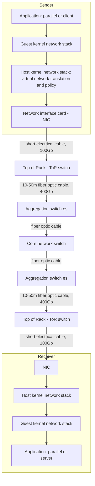

# Datacenter Networking: Network Layers and Packet Path

This note walks through what a datacenter network is made of, from the bottom up. It starts with the protocol layers and what each one does in a datacenter, then shows the contents of a single packet, and finally follows a packet along the physical path from the sending application to the receiving application.

---

## Network Terminology

- **Layer 1: Physical layer** — electrical cable or fiber optic.
  - Packet loss is rare but non-zero.
  - The longer the cable and the higher the bandwidth, the better the shielding must be, because long high-bandwidth cables are more prone to interference.
- **Layer 2: Ethernet**
  - Routing between machines on a link, and connecting switches together.
  - Switches look at **MAC addresses**.
- **Layer 3: IP**
  - Routing, plus **RDMA/RoCE** traffic (see [[Datacenter Systems/Datacenter Networking/Network APIs#RDMA|RDMA]]).
  - Datacenter switches often look at both layer 2 and layer 3 at the same time.
  - All switches perform the same tasks: looking at the IP header and connecting onward toward the internet.
- **Layer 4: TCP**
  - Also carries RDMA/RoCE traffic.
  - Provides retransmission and congestion control, so it needs to manage drops.
  - Requires some Ethernet header data to handle its work.
- **Layer 7: Application**
  - The actual data.

---

## Packet Header Stack

![[Packet Header Stack.png]]

A packet is a stack of headers wrapped around the application data:

| Region | Contents | Address type |
|---|---|---|
| Outer headers | Eth, IP | Physical addresses |
| Inner headers | Eth, IP, TCP | Virtual addresses (the guest's view) |
| Payload | App frame, App data | The actual application bytes |
| Trailer | Eth CRC (virtual), Eth CRC (physical) | Integrity check for each Ethernet layer |

- The maximum packet size is 1500 bytes, or 9000 bytes for a jumbo frame. The average packet is only about 500 bytes, so headers are a significant share of what is sent.
- The two inner/outer header sets exist because of [[Datacenter Systems/Containers/Network Virtualization|network virtualization]]: the guest sees virtual addresses while the physical network routes on physical addresses.
- The two **[[Networking/Definitions/Cyclic Redundancy Check (CRC)|Ethernet CRC]]** fields (one virtual, one physical) are used to check whether data was lost or corrupted.
- If we use NICs, we can process packets as they come in, which gives lower latency:
  - The NIC can send packets while it is still checking the checksum.
  - The NIC can calculate the CRC incrementally as bytes arrive, instead of waiting for the whole packet to enter memory. See [[Datacenter Systems/Datacenter Networking/Network Interface Cards|Network Interface Cards]].

---

## Path of Data

Data is transmitted in a datacenter from the top of the sender's stack, down to the wire, through a cable, a switch, and another cable, and then up the receiver's stack until it reaches the application layer.

- Each hop adds latency, so the more hops, the higher the latency.
- There are different types of cable because of the medium and other factors, which is why the cabling is not standardized:
  - Electrical cables are more expensive due to the shielding they need.
  - Optical cables require lasers, which is the expensive part.

### Endpoints

- **Sender**: the application, which is either a parallel application or a client.
- **Receiver**: the application, which is either a parallel application or a server.

### Components Common to Both Sides

The sender and receiver each have the same chain of components between the application and the first cable:

- Guest kernel network stack
- Host kernel network stack
  - Performs virtual network translation and policy.
- Network interface card (NIC)
- Short electrical cable (100Gb) to the Top of Rack (ToR) switch
- Top of Rack (ToR) switch
- 10-50m fiber optic cable (400Gb) to the aggregation switch(es)
- Aggregation switch(es)

In the middle, traffic crosses: fiber optic <-> core network switch <-> fiber optic cable. See [[Datacenter Systems/Datacenter Networking/Network Topology|Network Topology]] for how these switch tiers are arranged.

---

## Deep Dive

- The 100Gb electrical cable is kept short precisely because of the shielding and interference constraint above: a short run inside the rack can stay electrical and cheap, while the longer 10-50m runs between racks use fiber and its lasers.

---

## Industry Standard Terms

| Course term | Industry equivalent |
|---|---|
| Top of Rack (ToR) switch | Leaf switch |
| Aggregation switch | Spine / distribution-tier switch |
| Core network switch | Super-spine / core tier |
| RDMA/RoCE | Remote Direct Memory Access over Converged Ethernet |
| Jumbo frame | Jumbo frame (MTU of 9000 bytes) |

---

## Related
- [[Datacenter Systems/Datacenter Networking/Datacenter Networking|Datacenter Networking]]
- [[Datacenter Systems/Datacenter Networking/Network APIs|Network APIs]]
- [[Datacenter Systems/Datacenter Networking/Network Interface Cards|Network Interface Cards]]
- [[Datacenter Systems/Containers/Network Virtualization|Network Virtualization]]
- [[Networking/Definitions/Media Access Control (MAC)|Media Access Control (MAC)]]
- [[Networking/Definitions/Internet Protocol (IP)|Internet Protocol (IP)]]
