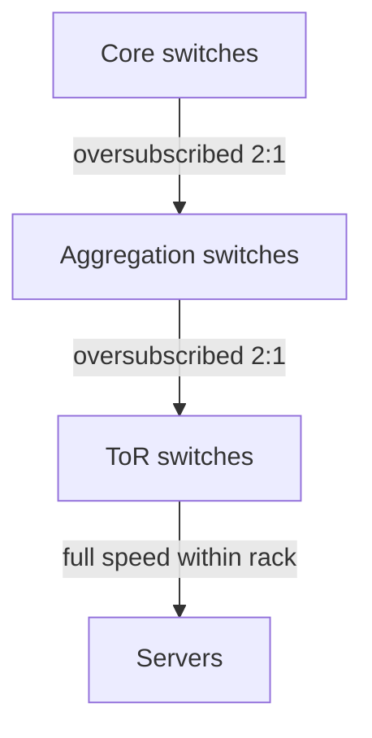

# Datacenter Networking: Network Topology

This note builds up the shape of a datacenter network. It starts with the question of why we cannot simply use one enormous switch, introduces the Top of Rack (ToR) switch as the first building block, shows how racks are connected into a hierarchy (and doubled for fault tolerance), then generalizes the hierarchy into Clos networks (fat trees), and finally explains **oversubscription**, the cost-saving compromise real datacenters make.

---

## Why Not One Super Large Switch

Why shouldn't we just create one super large switch that interconnects all of the servers together?

- **Space**: a switch with a port for every server would be physically enormous.
- **Routing state**: it would have to store routing information for every server.
- **Scalability**: it does not scale.
- Switches are built for **full bisection bandwidth**, meaning the switch could talk to everyone at full speed.
- If such a switch were fault tolerant, it would simplify a lot of traffic management problems, but building one is not practical, so we use many smaller switches instead.

---

## Top of Rack (ToR) Switch

- A ToR switch routes:
  - To other servers in the same rack.
  - To servers in other racks.
- **Bisection bandwidth**: can all servers send at full speed at the same time?

![[ToR Switch.png]]

- Link bandwidth has increased to 400 gigabits per second.
- The topology is hierarchical: layers of switches sit above the rack switches that connect to the actual servers.
- The weakest connection in the topology is the worst case, but the effective bandwidth also depends on the routing algorithm (see [[Datacenter Systems/Datacenter Networking/ECMP Routing|ECMP Routing]]).
- Inside each switch, packets are handled by the design in [[Datacenter Systems/Datacenter Networking/Store-and-Forward Switch Internals|Store-and-Forward Switch Internals]].

---

## Connected Racks

![[Connecting Racks.png]]

- Racks are typically organized in a hierarchical topology.
- For fault tolerance, we double everything so a backup can take over for a failed component.
  - This is expensive.
  - Other fault tolerance methods such as Paxos or Raft can also be used.
  - Doubling everything also doubles our bandwidth.
- To provide full bisection bandwidth, the core switch essentially has to behave as one large switch, even though it only has a couple of wires tying things together.
- It is better for packets of the same connection to go down the same path:
  - Locality: they can be processed together.
  - Out-of-order delivery can cause cache misses.

---

## Clos Networks

- We can build a logical $n \times n$ switch out of smaller $k \times k$ switches, for any $k$ and $n$. This is a **Clos network**.

![[Clos Network.png]]

- Folding a Clos network over on itself (so that inputs and outputs are the same set of servers) gives a **folded Clos network**, also called a **fat tree**.

![[Folded Clos Network (Fat Tree).png]]

---

## Oversubscription

- Providing full bisection bandwidth between all pairs of servers in the datacenter is expensive:
  - Number of switches.
  - Number of links, which is roughly $n \log n$ in the number of servers.
- **Oversubscription** reduces cost by providing a smaller bisection bandwidth.
  - Usually written 2:1 or 4:1, meaning half or a quarter as many uplinks as downlinks.
  - A 4:1 ratio means 4 times the bandwidth going down compared to going up to the next higher layer in the topology.
- Datacenters often oversubscribe at both the aggregation and core layers:
  - 2:1 from ToR to aggregation switches (racks within the same cluster).
  - Another 2:1 from aggregation to core (cross-cluster racks).
  - Between datacenters, even less bandwidth is provided (10:1 in Jupiter).
- Scaling switches is expensive; it is simple to do with a cloud-based network topology.

![[Oversubscribed Clos Network.png]]

- Google's network became oversubscribed, which is even worse for cross-cluster connections.
- Google transitioned to also use the Firehose 1.1 fabric, a "bag-on-the-side" Clos, to mitigate the oversubscription.

---

## Formal Analysis

### Formal Definition

For a switch layer with $d$ downlinks and $u$ uplinks of equal capacity, the oversubscription ratio is

$$\text{ratio} = \frac{d}{u}:1, \qquad \text{effective bisection bandwidth fraction} = \frac{u}{d}$$

Full bisection bandwidth corresponds to $d = u$ (a ratio of 1:1). Ratios compound across layers: 2:1 at the ToR-to-aggregation layer and another 2:1 at the aggregation-to-core layer leave cross-cluster traffic with $\frac{1}{2} \cdot \frac{1}{2} = \frac{1}{4}$ of the full bandwidth.

### Simplified Explanation

A 4:1 ratio means that if every server below a switch sends at once, only one quarter of that traffic can leave the switch at a time. Each oversubscribed layer shrinks the share further.

---

## Deep Dive

- The compounding calculation above (multiplying the per-layer fractions) assumes all traffic must cross both layers, which is the worst case for cross-cluster traffic.

---

## Industry Standard Terms

| Course term | Industry equivalent |
|---|---|
| Top of Rack (ToR) switch | Leaf switch |
| Aggregation switch | Spine / pod switch |
| Folded Clos network | Fat tree / leaf-spine topology |
| Bisection bandwidth | Bisection bandwidth |
| Oversubscription 2:1 | Oversubscription ratio (downlink : uplink capacity) |
| Bag-on-the-side Clos (Firehose 1.1) | Overlay / side-fabric added to relieve a congested network |

---

## Related
- [[Datacenter Systems/Datacenter Networking/Datacenter Networking|Datacenter Networking]]
- [[Datacenter Systems/Datacenter Networking/Network Layers and Packet Path|Network Layers and Packet Path]]
- [[Datacenter Systems/Datacenter Networking/Store-and-Forward Switch Internals|Store-and-Forward Switch Internals]]
- [[Datacenter Systems/Datacenter Networking/ECMP Routing|ECMP Routing]]
- [[Datacenter Systems/Datacenter Networking/Data Center Congestion Control|Data Center Congestion Control]]
- [[Datacenter Systems/Warehouse-Scale Computer Architecture/Hardware Building Blocks|Hardware Building Blocks]]
- [[Datacenter Systems/Warehouse-Scale Computer Architecture/Failure Modes|Failure Modes]] — bisection bandwidth limits
