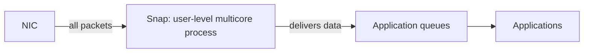
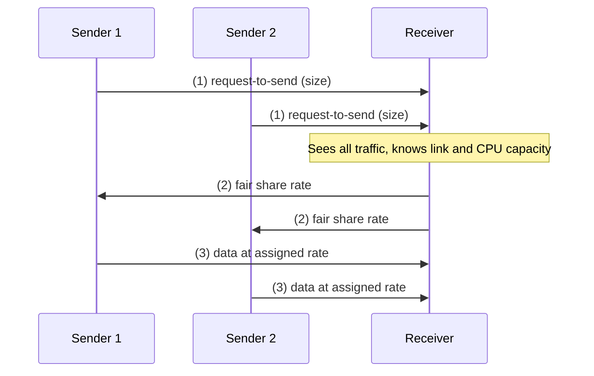

# Datacenter Networking: Snap, Swift, and Advanced Congestion Control

This note continues [[Datacenter Systems/Datacenter Networking/Data Center Congestion Control|Data Center Congestion Control]]. It starts with the switch-assisted signals (ECN, DCTCP), moves to moving the transport out of the kernel (Google Snap) and measuring delay instead of marking bits (Swift), then covers why incast still hurts and how receiver-driven control fixes it, switch-heavy designs (HPCC), and finally per-hop backpressure (BFC).

---

## Switch-Assisted Signals

### ECN

- **[[Networking/Transport/Network-Side Congestion Control|ECN]]** requires switch cooperation.
- It is a protocol that was developed for the internet but lost out to TCP's loss-based approach there.
- It carries only **one bit**, which tells us whether there is congestion.

### DCTCP

- Configures **one threshold** at the switch.
- Requires switch cooperation.
- The receiver acknowledges with the **bits we got back**, and these are returned to the sender as a fraction of marked packets.
- The sender no longer uses plain AIMD (halving on any signal). Because it reacts in proportion to the fraction marked, it can **hug closer to the threshold** than the AIMD algorithm allows.

---

## Google Snap

- **Bypass the OS kernel**: the Linux kernel TCP stack is slow and hard to change.
- Snap **reimplements the transport in a user-level multicore process**:
  - The NIC forwards all packets to Snap.
  - Snap delivers data into application queues.
  - The implementation can be **replaced on the fly, with no downtime for applications**.

---

## Swift

Swift is the update to Snap's congestion control. It is **delay based**.

### Measuring Delay

- Swift **directly measures the end-to-end path delay**:
  - Network switch queueing delay plus receiver processing delay.
  - Measured by **NIC hardware** at the source and the destination.
- This is **more precise than the binary ECN bit**.
- If delay is greater than a **target delay**, the sender adjusts its window using AIMD.
- If the network is sufficiently regular, we can **measure every packet** we send. Seeing how long each takes lets us react with the congestion control algorithm.
- It still uses AIMD, so there is still some noise, but it requires a threshold: the target delay.
- It uses a **minimum congestion window** based on the switches and the receiver.

### Rate Pacing Instead of ACK Clocking

- Enabled by Snap running **continuously on dedicated cores**.
- TCP's ACK clocking needs a smooth operating phase to work smoothly. If packets pile up, the window protocol lets us send the entire chunk at once, which creates noise as we burst into the servers.
- Rate pacing fixes the periods of not sending enough or not being able to send.
- Pacing is **CPU intensive**: we are calculating a rate we are allowed to send, so we cannot just send a burst of packets.
- The fine-grained rate prevents bursty arrivals and prevents us from running right up against the bandwidth limit of the network.
- TCP also has a rate-based mode: when the sender is disconnected for a while, it later goes back to ACK-based mode.

| Aspect | ACK clocking (TCP window) | Rate pacing (Swift) |
|---|---|---|
| What releases packets | Arriving ACKs | A computed sending rate |
| After a pile-up of packets | Whole window can go out in one burst | No burst; packets leave at the allowed rate |
| Cost | Cheap | CPU intensive; needs dedicated cores |
| Effect on receivers | Bursts into the servers add noise | Smooth, fine-grained arrivals |

---

## Incast

- Swift handles incast better than TCP for larger incasts, but feedback is still slow.

### Small Messages

- Flood the Snap host input queues.
- Cause delay and packet loss to **unrelated containers**.
- Feedback is only helpful if the incast is **sustained over multiple rounds**.

### Medium to Large Messages

- Fill the buffers in the upstream ToR switch, and maybe the aggregation switch.
- Cause delay and packet loss for traffic to unrelated servers and containers.
- Feedback may arrive **too late**.
- It takes **multiple rounds** until we hit the equilibrium.

### Receiver-Driven Congestion Control

To reach the equilibrium faster, rely on the receiver:

- The **destination is the best position to schedule arriving incast traffic**: it sees all traffic and knows its link and CPU capacity.
- The sender initially sends a **request-to-send** with the size of the request.
  - This adds a round-trip delay if the message is not part of an incast.
- The receiver **assigns each sender its fair share rate**, one that both the receiver and the upstream ToR can handle.
- The sender uses that rate.
- This lets us determine how many bytes each sender is allowed to send **after the first round**, better than TCP and the switch-signal approaches.

---

## HPCC: High Precision Congestion Control

- Relies more on **switches**, since they contain more information about packets.
- Each switch reports **how full its queue is**. The maximum queue along the path is carried to the sender.
- Dividing by the extent of queueing gives a **fractional fair share**, which is echoed back to the sender.
- It reaches the equilibrium **faster than Swift**.
- All of these schemes (DCTCP, Swift, HPCC) rely on the **receiver echoing information back to the sender**.

---

## Throughput Variance Over Time

- The **number of hops** determines the delay, and the number of racks can add to this.
- In datacenters the round trip has been around **20 microseconds**.
- **Bandwidth has been going up**.
- The **bandwidth-delay product (BDP)** determines how much traffic we should inject into the network blindly, in order to saturate the network before any information can come back from the receiver.
- One-round incasts tend to become bigger as bandwidth grows.

---

## BFC: Backpressure Flow Control

### Per-Hop Feedback

- Involve the switches in sending us congestion information, rather than just forwarding packets: packets go onward by forwarding, and information goes back by the switch **generating a new packet to the sender**.
- Feedback can come from the **top of rack switch**, so it is a **one-hop round trip** instead of end to end.
- This is **per-hop feedback instead of end-to-end control**:
  - Keep state only about **active flows**.
  - **Dynamic queue assignment**.
  - **Pause upstream** as soon as we have a big enough queue.
  - **Zero loss in almost all cases**.

### Why End-to-End Is Too Slow

- With 100 Gbps+ links, most bytes are in flows that **finish in one RTT**.
  - Long flows cannot modulate load fast enough to control queueing.
  - The load at a switch is highly variable from one RTT to the next.

### The State Problem

- Looking at every connection, with each switch checking how much each connection is allowed to send, **runs out of state in the switches** at scale.
- That approach is good within a host or a rack.
- To get around it, be more approximate:
  - Only look at **active flows** (things that are currently sending).
  - Push back a flow together with similar flows sending at the same time.

---

## Comparison

| Scheme | Signal | Who computes the rate | Notes |
|---|---|---|---|
| ECN | One bit from the switch | Sender (AIMD) | Lost to TCP on the internet |
| DCTCP | Fraction of marked bits | Sender, proportional decrease | Hugs the threshold closer than AIMD |
| Swift | Measured end-to-end delay | Sender (AIMD vs target delay) | NIC timestamps; pacing |
| Receiver-driven | Request-to-send with size | Receiver assigns fair share | Extra RTT if not an incast |
| HPCC | Max queue from switches | Sender, from fractional share | Faster equilibrium than Swift |
| BFC | Per-hop pause from switches | Switches | One-hop feedback; zero loss |

---

## Industry Standard Terms

| Course term | Industry equivalent |
|---|---|
| Snap | User-space (kernel-bypass) network stack |
| Swift | Delay-based congestion control |
| Rate pacing | Packet pacing |
| ACK clocking | Self-clocking window protocol |
| Request-to-send, fair share rate | Receiver-driven / credit-based transport (e.g., Homa, ExpressPass) |
| HPCC | In-network telemetry (INT) based congestion control |
| BFC | Per-hop backpressure / hop-by-hop flow control |
| Active flows | Per-flow queueing with a bounded number of queues |

---

## Related

- [[Datacenter Systems/Datacenter Networking/Data Center Congestion Control|Data Center Congestion Control]]: goals, incast/outcast, TCP, ECN, DCTCP
- [[Datacenter Systems/Datacenter Networking/Store-and-Forward Switch Internals|Store-and-Forward Switch Internals]]: the queues that BFC and HPCC observe
- [[Datacenter Systems/Datacenter Networking/Network Interface Cards|Network Interface Cards]]: NIC hardware timestamps used by Swift
- [[Datacenter Systems/Datacenter Networking/Datacenter Networking|Datacenter Networking]]
- [[Datacenter Systems/Course Introduction and Overview/Failure Modes|Failure Modes]]: incast
- [[Networking/Transport/Transport Layer - TCP Congestion Control|TCP Congestion Control]]
