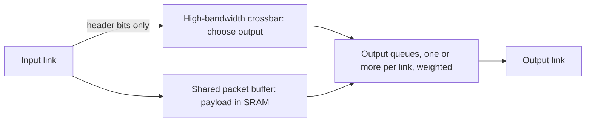

# Datacenter Networking: Store-and-Forward Switch Internals

This note looks inside a single datacenter switch: how a packet is received, buffered, routed, and sent out again.

---

## Store-and-Forward Behavior

- The switch receives the packet in its entirety, stores it in memory, and then makes a decision about where to forward it before sending it out.
- Because the whole packet is stored first, switches can be complex and can actually look at the packet.
- Links are fully duplex.

## Queues

- There are often multiple output queues per link.
- A weight can be assigned to each queue (**weighted fair queueing**): the scheduler serves queues in proportion to their weights.

## Internal Structure

![[Store-and-Forward Switch Internals.png]]

- **Shared packet buffers** at the top are basically SRAM, which makes the crossbar cheaper to build. Only the payload goes into the shared packet buffers.
- Only the header bits we are interested in go into the high-bandwidth **crossbar**.
- The switch is basically a digital signal processor: it must decide which output the packet should go on.

---

## Industry Standard Terms

| Course term | Industry equivalent |
|---|---|
| Output queues with weights | Per-port egress queues with weighted fair queueing / DWRR scheduling |
| Shared packet buffers | Shared-memory switch buffer |
| Crossbar | Switch fabric |

---

## Related
- [[Datacenter Systems/Datacenter Networking/Network Topology|Network Topology]]
- [[Datacenter Systems/Datacenter Networking/Data Center Congestion Control|Data Center Congestion Control]] — switches have a limited number of FIFO queues
- [[Networking/Transport/Weighted Fair Queuing|Weighted Fair Queuing]]
- [[Networking/Definitions/Store and forward packet switching|Store and forward packet switching]]
