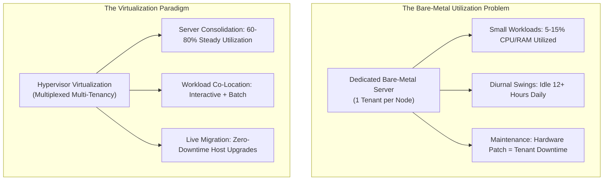

# Execution Environments and Virtualization: Application Taxonomy and Consolidation

## Execution Environments and Virtualization Motivation & Overview

The central design question in modern datacenter engineering is: **In what execution environment should datacenter applications execute?**

Datacenter operators build facilities costing hundreds of millions of dollars, housing tens of thousands of physical servers, high-speed network fabrics, and multi-megawatt power distribution units. To achieve financial return on investment (ROI) and minimize operational waste, operators must maximize hardware **resource utilization**.

### Taxonomy of Datacenter Applications
Datacenters execute virtually every class of modern software, each exhibiting drastically different resource profiles, arrival patterns, and latency tolerances:

| Workload Category | Production Examples | Resource Profile | Operational Characteristics & Latency Sensitivity |
| :--- | :--- | :--- | :--- |
| **Websites & E-Commerce** | Etsy, eBay, DoorDash, small retail sites | Low CPU, low memory footprint | **Interactive, sporadic, diurnal**: Dedicated physical servers are massively wasteful; workloads require only a tiny fraction of a single machine. |
| **Traditional Enterprise SaaS** | Gmail, Salesforce, Epic Healthcare | High CPU, heavy network I/O | **Interactive, diurnal**: Heavy daytime concurrency, predictable diurnal troughs at night. |
| **Scientific & Engineering Computing** | Climate simulations, genomics, CAD | Heavy CPU, massive memory | **Non-interactive batch**: Compute-intensive, long-running (hours to days), tolerant to queuing delays. |
| **Machine Learning (ML)** | LLM pre-training, real-time inference | Heavy GPU/TPU, high memory bandwidth, NVLink | **Hybrid**: Model training runs as long-running batch jobs; inference requires strict sub-50ms tail-latency response times. |
| **Content Distribution & Streaming** | Netflix, Spotify, Zoom | Extreme network bandwidth, high storage I/O | **Bandwidth-bound, diurnal**: Highly sensitive to packet jitter and bufferbloat. |
| **Data Analytics & Web Indexing** | Google Search indexing, MapReduce, Spark | Heavy CPU, heavy disk/network I/O | **Background batch**: High-throughput distributed processing across thousands of nodes. |
| **Network Functions (NFV)** | Cloud firewalls, NAT gateways, VPN endpoints | Heavy CPU, line-rate packet I/O | **Interactive, strictly latency-critical**: Microsecond packet processing budgets. |
| **File Sharing & Cloud Storage** | Dropbox, Google Drive, OneDrive | Heavy storage capacity, moderate network | **Non-interactive, diurnal**: High disk write volume, background sync. |

### The Limits of Dedicated Bare-Metal Servers
Deploying each application into its own isolated, bare-metal physical server leads to catastrophic hardware underutilization:
- **Resource Fragmentation**: Small web services or retail frontends require only a tiny fraction of a modern multi-core server (e.g., 2 cores out of 64, 4 GB of RAM out of 256 GB). Allocating an entire physical node to one small app wastes the remaining capacity.
- **Diurnal Usage Inefficiency**: Human-facing applications follow strict **diurnal cycles** (traffic peaks during daylight business hours and collapses by 80% to 90% during nighttime hours). Dedicated servers sit completely idle for over half of their operational lifespan.
- **Inelastic Provisioning**: If an application suddenly becomes popular or experiences seasonal surges (e.g., Black Friday), physical hardware cannot scale up instantly without manual racking and cabling.

### The Economics of Consolidation & Workload Co-Location
To solve underutilization, operators use **server consolidation** (multiplexing multiple independent applications onto shared physical machines).

A key architectural insight of datacenter computing is **complementary workload pairing**:
- **Interactive Foreground Tasks** (e.g., web search, checkout services) have strict latency targets and cannot be delayed.
- **Background Batch Tasks** (e.g., web indexing, video encoding, model training) have relaxed deadlines and can be throttled or paused.
- By co-locating interactive applications with background tasks on the same physical host, the datacenter can pause background tasks during peak daytime interactive traffic, and resume background processing at maximum throughput during nighttime diurnal troughs, driving average server utilization from 10–15% up to 70–80%.

### The Core Tension: Consolidation vs. Isolation
While consolidation raises utilization, it directly threatens the top priority of the Cloud Operator Pyramid: **Availability**.
- Consolidating workloads requires near-perfect **isolation** between tenants. A buggy, crashed, or malicious application must never degrade the performance or stability of co-located applications.
- Furthermore, human users abandon services if latency spikes: empirical datacenter studies show that if website response times degrade by more than **0.5 seconds (500 ms)**, user traffic and revenue drop precipitously. Therefore, resource sharing must preserve strict **tail-latency bounds**.

## Industry Standard Terms

| Course Term | Industry / Production Term |
| :--- | :--- |
| **Server Consolidation** | Multi-Tenant Bin-Packing / Workload Colocation |

## Related

- [[Datacenter Systems/Execution Environments and Virtualization|Execution Environments and Virtualization]] — Hub for this topic
- [[Datacenter Systems/Execution Environments and Virtualization/Why OS Process Isolation Fails|Why OS Process Isolation Fails]] — Limits of process isolation in multi-tenant clouds
