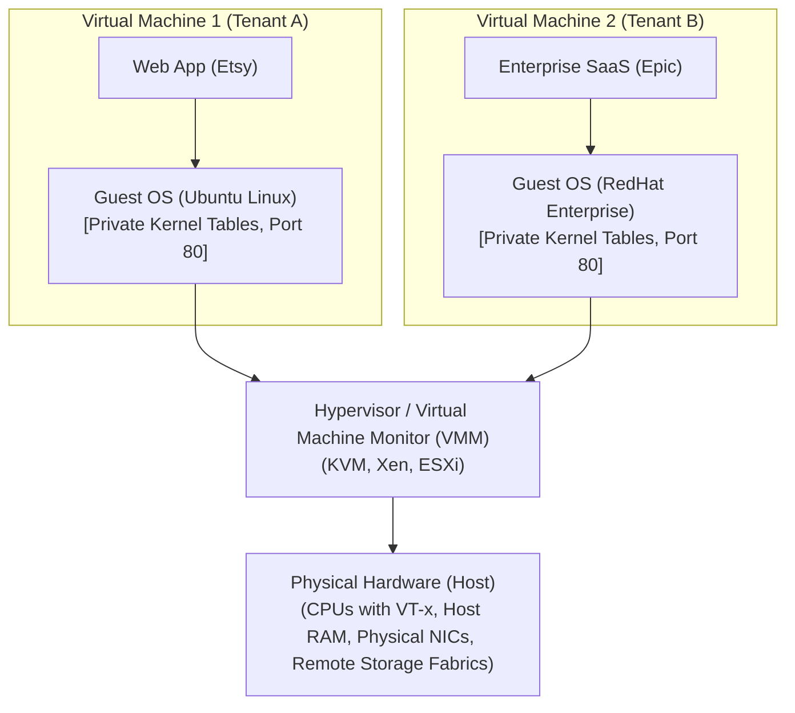

# Execution Environments and Virtualization: Virtualization Abstraction and Hypervisor

## The Virtualization Abstraction

To overcome the catastrophic limitations of bare-metal process sharing, datacenters adopt **Virtualization**.

```
Formal Principle (Popek & Goldberg, 1974):
"A virtual X is an efficient, isolated duplicate of the real X."
```

Where the virtualized entity is:
$$X \in \{\text{Processor, Memory, Storage/Disk, Network Interface, Machine, Datacenter}\}$$

Virtualization satisfies three foundational architectural criteria:
1. **Duplicate**: A virtual $X$ behaves identically to physical $X$. Guest software executing inside a virtual machine cannot detect that it is executing on virtualized rather than physical hardware (with the sole exception of minor timing differences).
2. **Isolated**: Multiple virtual instances execute concurrently on the same underlying physical host with complete mutual non-interference. Faults, crashes, and malicious exploits in one virtual machine are strictly bounded within its private sandboxed boundary.
3. **Efficient**: Virtual machines achieve execution speeds approaching bare-metal physical hardware. This requires that the vast majority of CPU instructions execute **directly on the physical hardware processor**, bypassing software interpretation or emulation traps.

---

## Virtual Machine Architecture & The Hypervisor

A **Virtual Machine (VM)** represents a full software execution container running its own independent **Guest Operating System**, multiplexed across physical machine resources by the **Hypervisor** (also known as the **Virtual Machine Monitor - VMM**).



### Core Architectural Roles
- **Guest Operating System**: The operating system kernel running inside the virtual machine. It believes it owns the physical machine, manages its own private process tables, configures its own network ports (multiple VMs can each have their own independent port 80), and handles its own virtual memory.
- **Guest Application**: User-space programs running on top of the Guest OS.
- **Host Operating System / Hypervisor (VMM)**: The privileged software layer that abstracts, virtualizes, and multiplexes physical hardware among multiple guest virtual machines.

## Industry Standard Terms

| Course Term | Industry / Production Term |
| :--- | :--- |
| **Virtual X** | Popek-Goldberg Virtual Resource / Virtualized Abstraction |
| **Guest OS** | Virtual Machine Operating System / Guest Kernel |

## Related

- [[Datacenter Systems/Execution Environments and Virtualization|Execution Environments and Virtualization]] — Hub for this topic
- [[Datacenter Systems/Execution Environments and Virtualization/Why OS Process Isolation Fails|Why OS Process Isolation Fails]] — Limits of process isolation in multi-tenant clouds
- [[Datacenter Systems/Execution Environments and Virtualization/Multi-Tier Virtual Memory Hierarchy|Multi-Tier Virtual Memory Hierarchy]] — GVA, GPA, and HPA tiers
