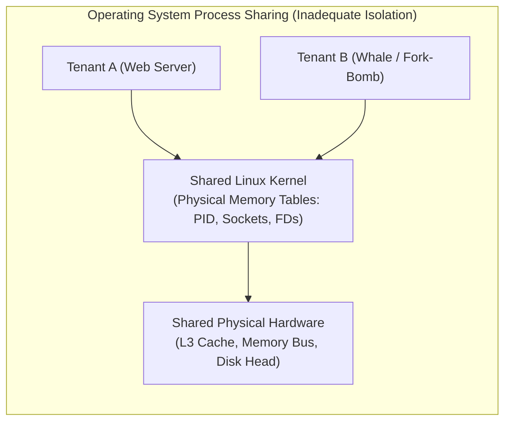

# Execution Environments and Virtualization: Why OS Process Isolation Fails

## Why Traditional OS Process Isolation Fails in Multi-Tenant Clouds
The standard abstraction provided by operating systems to isolate applications is the **Linux Process**. While processes provide separate virtual address spaces and user-space privilege separation, they fail to provide the rigorous isolation required for multi-tenant datacenter infrastructure:

### 1. Performance Interference & Noisy Neighbors
- **Shared Hardware Access Patterns**: Operating system kernels do not virtualize low-level hardware structures. If Tenant A performs sequential disk reads while Tenant B performs random disk seeks on the same physical drive, the drive head thrashing degrades Tenant A’s sequential throughput by orders of magnitude.
- **Memory Bus & Cache Contention**: A memory-intensive application continuously evicts cache lines from the shared L3 CPU cache and saturates the memory controller bus, causing drastic tail-latency spikes in latency-sensitive sibling processes.
- **Best-Effort Scheduling**: Default OS CPU schedulers (e.g., Linux Completely Fair Scheduler - CFS) operate on a best-effort basis. While suitable for single-user workstations, in a multi-tenant cloud a CPU-intensive "whale tenant" can hoard scheduling slices, starving sibling processes.

### 2. Namespace & Port Collisions
- Standard processes share the host networking stack and port space.
- If multiple independent tenants on the same physical machine each want to run an HTTP web server bound to default port 80 or 443, they collide: only one process can bind to port 80 on a given physical IP address. Multiplexing requires complex reverse proxies or virtualization.

### 3. Shared Kernel State & Resource Exhaustion
- Applications execute in **virtual memory** (nearly unlimited 64-bit address space).
- However, the **Linux kernel operates in physical memory**, maintaining fixed-size internal data structures:
  - Process table (`PID_MAX`, typically 32,768 or 4,194,304 entries)
  - Open file descriptor table (`NR_FILE`)
  - Socket buffers and connection tracking tables (`conntrack`)
  - Kernel memory buffers for Write-Ahead Logs and page caches
- If a rogue, buggy, or malicious tenant executes a fork-bomb (`:(){ :|:& };:`) or opens millions of unclosed sockets, it completely exhausts the shared kernel table space. Once exhausted, **no other tenant on that machine can spawn a new process, allocate a thread, or open a network connection**, causing total node failure.

### 4. Security Vulnerabilities
- All processes share the exact same monolithic kernel code. A privilege escalation vulnerability or kernel memory corruption bug in any system call (`sys_ioctl`, `sys_bpf`) grants the attacker full root access to inspect, modify, or terminate every sibling process on the host.

### 5. Operational Maintenance & Upgrade Friction
- In a bare-metal process model, upgrading the host operating system kernel requires **rebooting the physical machine**.
- This introduces severe operational failure modes:
  - How long will the machine remain offline?
  - What if the physical machine fails to POST or kernel-panics during reboot?
  - What happens to active tenant workloads that have not finished their stateful computation?
- Furthermore, upgrading the host OS can introduce library incompatibilities (`glibc` version mismatches) that silently break legacy tenant applications.

## Industry Standard Terms

| Course Term | Industry / Production Term |
| :--- | :--- |
| **Whale Tenant** | Noisy Neighbor / Resource Hog / Unbounded Consumer |

## Related

- [[Datacenter Systems/Execution Environments and Virtualization|Execution Environments and Virtualization]] — Hub for this topic
- [[Datacenter Systems/Execution Environments and Virtualization/Application Taxonomy and Consolidation|Application Taxonomy and Consolidation]] — Application types, bare-metal limits, and the consolidation vs isolation tension
- [[Datacenter Systems/Execution Environments and Virtualization/Virtualization Abstraction and Hypervisor|Virtualization Abstraction and Hypervisor]] — The virtualization abstraction and VM architecture
