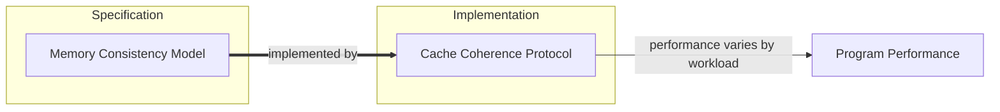
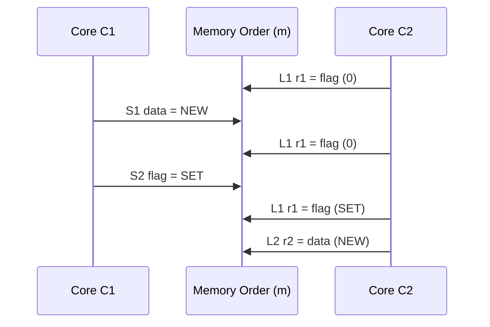
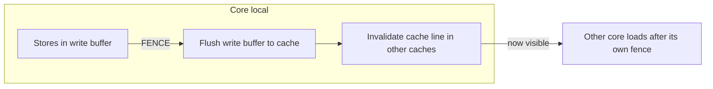
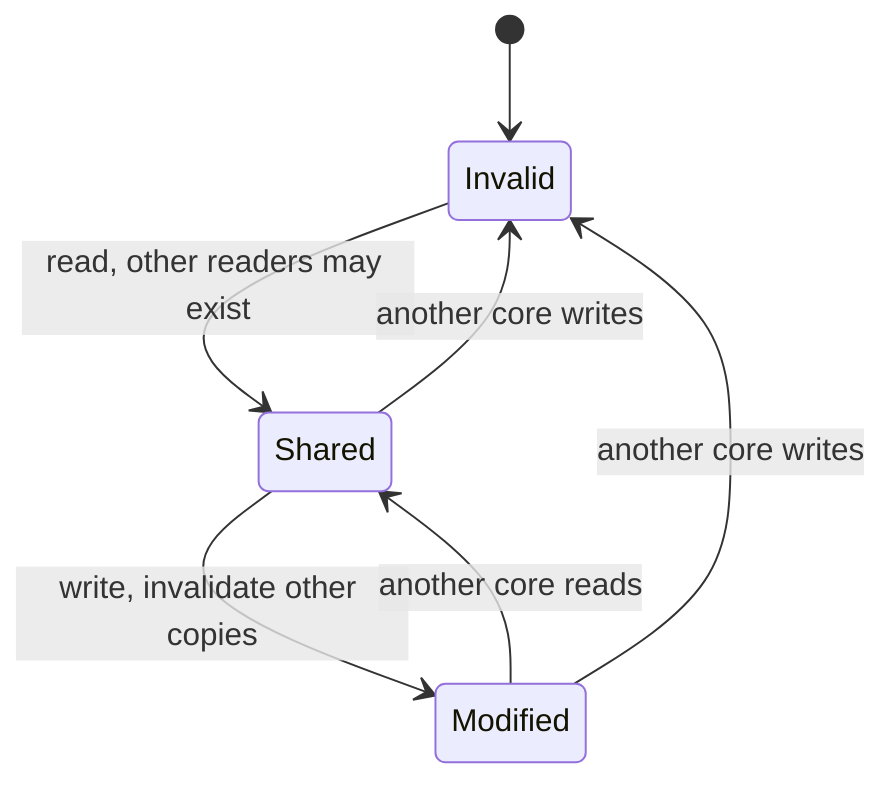

# Datacenter Systems: Memory Consistency and Cache Coherence

When several cores read and write the same memory, the hardware must decide what each core is allowed to observe. This note starts with the split between **memory consistency** (the specification) and **cache coherence** (an implementation), then walks through increasingly relaxed consistency models: Sequential Consistency, Total Store Order (with the write buffers that motivate it), and Weak Consistency with FENCEs and atomics. It ends with the cache coherence phases that make a chosen model fast.

---

## Consistency vs Coherence

- **Memory consistency**: the *specification* of what the memory system may and must do.
  - Constrains what the implementation is allowed to do (**correctness**).
  - Constrains what the implementation must do (**progress**).
  - Defines program semantics, and many consistency models are possible.
  - It is required so that every core sees the same thing when data is mutated.
  - Non-portable programming languages require rewriting code for each different architecture; portable programming languages trade this away for performance.
- **Cache coherence**: an *implementation* of a specific memory consistency model.
  - It is a program optimization: many implementations are possible, with different performance implications for different types of programs.

---

## Sequential Consistency

- A **single processor** is sequential if the result is the same as if operations were executed in the order specified by the program.
- A **multiprocessor** is **sequentially consistent** if each core executes sequentially and all operations occur in some single global sequential order.
- Processor clocks cannot be synchronized. We do not know when each CPU starts, and CPUs run at different speeds, so any interleaving of the per-core sequential program orders is permitted.
- Mental model: imagine a **switch** between the processors and memory that selects which core's next operation reaches memory.

![[Implementing Sequential Consistency Abstract.png]]

- Because the interleaving is arbitrary, code must be written so that one flag is observed before the other side continues. One core's operations can complete before the other's are able to.
- No real CPU implements sequential consistency, because it allows no parallelization optimizations.

### Example: Data and Flag

![[Example of Sequential Consistency.png]]

- Notation: `<p` is program order of a single core, `<m` is the global memory order.
- Core C1 executes `S1: data = NEW` then `S2: flag = SET`.
- Core C2 spins on `L1: r1 = flag` until it reads `SET`, then executes `L2: r2 = data`.
- Both stores land in memory order in C1's program order, so by the time C2 sees `flag == SET`, `data == NEW` is already in memory. C2 reads `NEW`.

---

## Write Buffers

- Optimization: a **store** can complete in one cycle.
  - The store is just saved into a **write buffer** and completes asynchronously.
  - On a **load**, the core checks whether the latest value is in its write buffer; if so, it returns that value.
- Therefore a load can complete before a prior store, unless both are on the same processor and to the same location.
- Write buffers are **processor-local**. A core always gets the latest write from its own buffer, but it also means other cores reading the cache or DRAM will not see that write until the buffer has been flushed.
- This is not allowed in the sequential model.

![[Write Buffers Multi-core.png]]

---

## Total Store Order

**Total Store Order (TSO)** is the model that x86 implements, and it is what write buffers produce.

- `x <p y` means x before y in program order.
- `x <m y` means x before y in global memory order.
- Cores insert loads and stores into `<m` in program order even when `a != b`:
  - if `load(a) <p load(b)` then `load(a) <m load(b)`
  - if `load(a) <p store(b)` then `load(a) <m store(b)`
  - if `store(a) <p store(b)` then `store(a) <m store(b)`
  - The one exception is a **load after a store**, which may be reordered before it because of the write buffer.
- Every load gets its value from the last store before it in global memory order, or from the last store to that location from the same processor (the write buffer).
- It **still requires synchronization**.

### Worked Example

![[Total Store Order Quiz Program.png]]

Initially `x = 0` and `y = 0`.

| Core 1 | Core 2 |
|---|---|
| `S1: x = NEW` | `S2: y = NEW` |
| `L1: r1 = x` | `L2: r2 = y` |
| `L3: r3 = y` | `L4: r4 = x` |

- `r1` and `r2` are **local reads**: each is served from the core's own write buffer, so `r1 = NEW` and `r2 = NEW`.
- Once we read from other CPUs that have write buffers, all bets are off.
- `r3` and `r4` depend on the total store order: Core 2's `y = NEW` is either still in Core 2's write buffer (so Core 1 reads `0`) or has been flushed (so Core 1 reads `NEW`). The same holds for `r4`.
- So `r3 = r4 = 0` is a legal outcome under TSO, which sequential consistency would forbid.

---

## Synchronization in Practice

- Most practical concurrent programs use **atomics**, **locks**, or both.

### Is Total Store Order Necessary?

- Execution **within a critical section** follows the rules of sequential execution.
  - Instructions can run in parallel if there are no dependencies, e.g. loads and stores to different locations.
- Lock acquires occur in a globally serial order.
  - All loads and stores must complete before the lock is released.
- So sequential consistency is only needed at lock acquire/release, and when passing ownership between threads.

---

## Weak Consistency: FENCE and Atomics

- **FENCE** (x86 term; also known as a **barrier**): all operations before the FENCE are visible to all operations that happen after it.
  - Used for lock release, i.e. releasing ownership of data touched in the critical section.
  - A `TOTAL_BARRIER` can be inserted into the instruction stream. It tells the write and stream buffers not to cross the barrier, and ensures write buffers have been flushed so other CPUs see what we did.
  - It is **core-local**:
    - Pending writes flush to the caches, which triggers invalidation of the cache line (this can impact other cores if the line is shared, but the write buffer would flush anyway).
    - The CPU does not try to pre-fetch anything after the fence instruction.
    - It does not impact other programs, since it only affects our own instruction stream.
- **Atomic instructions**: used to acquire and release locks.
  - Only per-core writes.

---

## Cache Coherence: Single Writer / Multiple Readers

- Program execution typically goes through distinct phases:
  - If no CPU is modifying a memory location, multiple CPUs often read it concurrently: **shared**.
  - If a CPU is modifying a memory location, no other CPU typically reads it concurrently: **exclusive / modified**.
  - A location can be **uncached (invalid)**, living only in main memory.
- The goal is to make these distinct phases efficient.
- We also need a way for a value written in one CPU's cache to be transferred to the next reader.
- Implementation approach: observe how programs operate and work with it. Readers hold copies in their caches; the writer signals the others to **invalidate** their copies before it writes. The protocol that tracks these states is MESI.

---

## Need to Remember

- Sequential ordering.
- Total store ordering (x86).
- Weak consistency: requires locks, fences, and atomics to synchronize processors.
- Everything after this is a performance optimization.
- Keep in mind that coherence implements the memory consistency model of the architecture.

---

## Industry Standard Terms

| Course term | Industry equivalent |
|---|---|
| Sequential Consistency | Sequential Consistency (SC) |
| Total Store Order | TSO (x86-TSO, SPARC TSO) |
| Weak Consistency | Relaxed / weak memory ordering |
| FENCE / barrier / `TOTAL_BARRIER` | Memory fence (`mfence`), memory barrier |
| Write buffer | Store buffer |
| Shared / Exclusive / Modified / Invalid | MESI cache line states |
| QPI cache coherence across sockets | Inter-socket coherence fabric |

---

## Related
- [[Datacenter Systems/Server Memory Systems|Server Memory Systems]] — Cache hierarchy and QPI cache coherence across sockets
- [[Concurrency, Parallelism, and Rust/Introduction to Rust|Introduction to Rust]] — Data races and happens-before ordering
- [[CSE451 Index|CSE451 — Operating Systems]] — Locks and synchronization primitives
