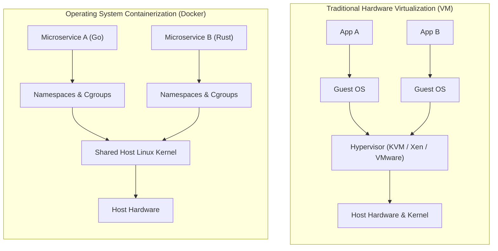

# Microservices: Docker and Kubernetes

## Containers: Docker & Kubernetes

Datacenter services are deployed inside lightweight containers rather than full virtual machines:

### Docker
- Provides OS-level virtualization by leveraging Linux kernel primitives:
  - **Namespaces** (`pid`, `net`, `mnt`, `ipc`, `uts`, `user`): Provide isolated views of processes, network interfaces, routing tables, and filesystem mounts.
  - **Control Groups (`cgroups`)**: Enforce hard limits and accounting on physical resource consumption (CPU quotas, memory limits, block I/O, network bandwidth).
- Packages binaries, dependencies, and filesystem layers into immutable **OCI Container Images**.

### Kubernetes (K8s)
- Datacenter container orchestration engine that automates multi-node deployment, scaling, and lifecycle management.
- **Pod**: The atomic deployable unit in Kubernetes, representing a tightly coupled group of one or more containers sharing:
  - The same Linux network namespace (same IP address and port space, able to communicate over `localhost`).
  - Shared storage volumes.

## Related

- [[Datacenter Systems/Microservices, RPC, and Cloud Infrastructure|Microservices]] — Hub for this topic
- [[Datacenter Systems/Microservices, RPC, and Cloud Infrastructure/gRPC and Protocol Buffers|gRPC and Protocol Buffers]] — gRPC, protobuf, and wire encoding
- [[Datacenter Systems/Microservices, RPC, and Cloud Infrastructure/Go and GCP Lab Infrastructure|Go and GCP Lab Infrastructure]] — Go systems programming and GCP lab setup
