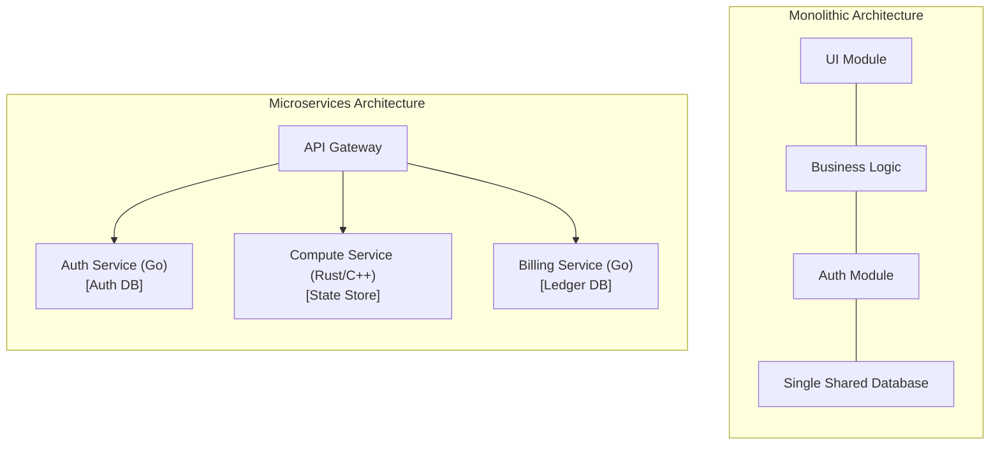

# Microservices: Monolith vs Microservices

## Quiz Section 1 Motivation & Overview

Modern warehouse-scale applications cannot be effectively deployed as single monolithic binaries across thousands of servers. Systems engineers decompose complex applications into network-accessible services while balancing the trade-offs between monolithic efficiency and distributed decoupling.

### Architectural Comparison: Monolith vs. Microservices

| Architectural Dimension | Monolithic Architecture | Microservices Architecture |
| :--- | :--- | :--- |
| **Communication Mechanism** | In-memory function calls; pointer dereferencing ($\approx 1\text{--}5\text{ ns}$). | Network [[Distributed Systems/RPC/Remote Procedure Call (RPC)\|Remote Procedure Calls (RPC)]] ($\approx 0.5\text{--}10\text{ ms}$). |
| **Resource Efficiency** | Requires up to **80% fewer computing resources** for equivalent throughput (zero serialization or network stack overhead). | Higher compute/memory overhead due to protocol marshaling, socket buffers, and redundant per-service runtimes. |
| **Fault Isolation & Blast Radius** | Poor: A memory leak, null-pointer panic, or CPU spinlock in one module crashes the entire application process. | High: Service failures remain bounded to individual processes; upstream callers can degrade gracefully or retry. |
| **Data Architecture** | Single shared relational database schema with direct table joins and ACID guarantees. | **Database-per-service pattern**: Each microservice strictly encapsulates its private data store; cross-service joins are forbidden. |
| **Technology Heterogeneity** | Constrained to a single programming language runtime and shared dependency tree. | **Polyglot ecosystem**: Each service adopts the optimal language (e.g., C++/Rust for low-latency kernels, Go for networking, TypeScript for UI). |
| **Observability & Debugging** | Straightforward: Single stack traces and local profiling tools. | Complex: Requires distributed tracing (e.g., OpenTelemetry, Jaeger) to trace requests hopping across dozens of RPC boundaries. |

## Industry Standard Terms

| Course Term | Industry / Production Term |
| :--- | :--- |
| **Microservice** | Service-Oriented Architecture (SOA) / Distributed Service |
| **Serialization** | Marshaling / Pickling / Wire Encoding |
| **Pod** | Colocated Container Group / Atomic Scheduling Unit |

## Related

- [[Datacenter Systems/Microservices, RPC, and Cloud Infrastructure|Microservices]] — Hub for this topic
- [[Datacenter Systems/Microservices, RPC, and Cloud Infrastructure/RPC and Pass-by-Value Semantics|RPC and Pass-by-Value Semantics]] — Remote procedure call semantics
