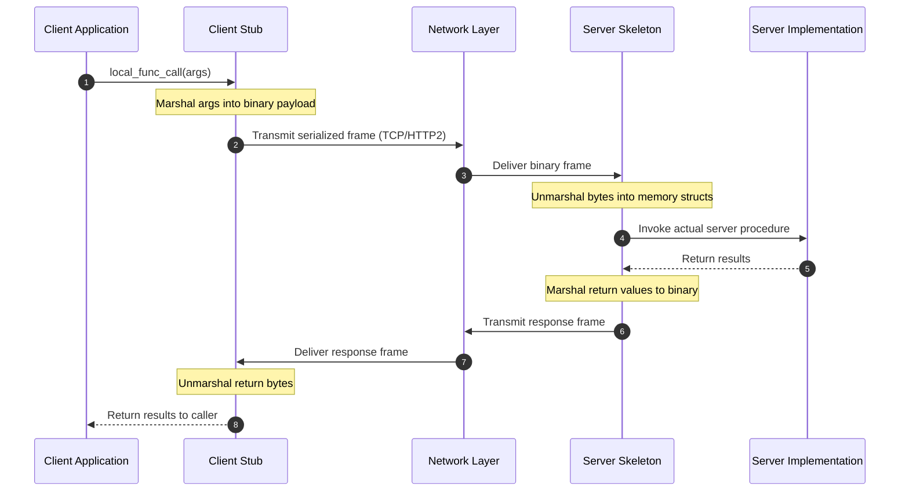

# Microservices: RPC and Pass-by-Value Semantics

## Remote Procedure Call (RPC) & Pass-by-Value Semantics

An RPC mechanism abstracts network communication by enabling a program on a local machine to invoke a procedure or subroutine in a remote address space as if it were a local function call.

### Pass-by-Value Invariant
In local procedural languages (like C or Go), functions can pass arguments either **by value** (copying data) or **by reference** (passing memory addresses/pointers). 
> **RPC Address Space Invariant**: Across a network boundary, memory pointers are completely meaningless because the client and server occupy distinct physical virtual address spaces. Therefore, **all RPC communication is strictly pass-by-value**. Every data object must be serialized into contiguous bytes, transmitted across the network, and reconstructed in the remote address space.

## Related

- [[Datacenter Systems/Microservices, RPC, and Cloud Infrastructure|Microservices]] — Hub for this topic
- [[Datacenter Systems/Microservices, RPC, and Cloud Infrastructure/Monolith vs Microservices|Monolith vs Microservices]] — Architectural comparison
- [[Datacenter Systems/Microservices, RPC, and Cloud Infrastructure/gRPC and Protocol Buffers|gRPC and Protocol Buffers]] — gRPC, protobuf, and wire encoding
