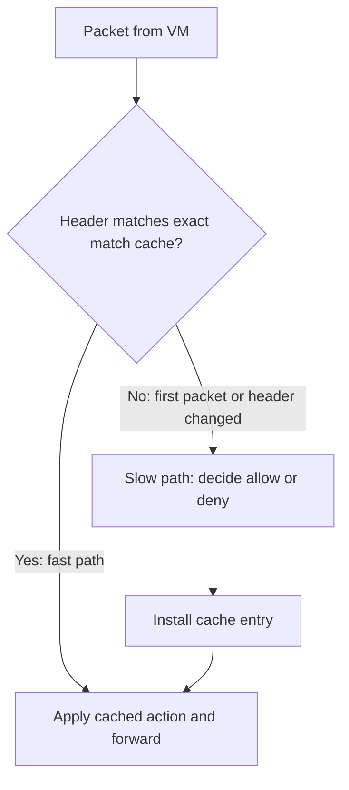
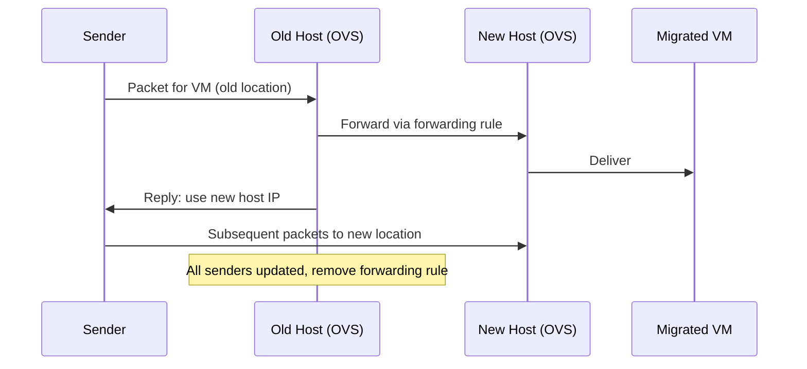

# Network Virtualization: Open vSwitch

Each physical machine has a single unique IP address and MAC address, but every [[Datacenter Systems/Virtual Machines|Virtual Machine]] must believe it has its own network identity. We need a way to **multiplex** the physical network interface so that each VM (or [[Datacenter Systems/Containers|container]]) gets its own addresses. The basic idea of virtual addresses and encapsulation is covered in [[Datacenter Systems/Containers/Network Virtualization|Containers: Network Virtualization]]; this note covers how a cloud provider actually implements it.

## Open vSwitch (OVS)

**Open vSwitch** is a programmable layer in the Host OS that transforms virtual-to-physical packets on send and physical-to-virtual packets on receive. Doing this transformation in software is **costly**, so OVS is built around making the common case fast.

### Flow Setup and the Exact Match Cache

- **First packet of a connection**: slow path. Logic runs to decide whether the connection is allowed at all (ACLs, addressing) and which transformation to apply.
- **Subsequent packets**: fast path through an **exact match cache**. If the packet's connection header matches a cached entry, perform the cached action ("if header matches, do X").
- The cache uses a **bitmask** over the header fields to do a fast lookup. This assumes the **shape of the packet stays the same** for the rest of the connection. If the header changes, the lookup **misses** and the packet falls back to the slow path.

### Match + Action Model

OVS works on **match + action** rules: a programmable transformation, multiplexing, and demultiplexing of packets. To manage the complexity of deciding per connection, the **Network Virtualization Platform (NVP)** pre-programs the table lookups for **all possible connections**, rather than computing them at connection start.

## Porting Applications from On-Premise to the Cloud

### Requirements

We want to move a distributed application from an on-premise setting into the cloud without changing it. The on-premise physical network provided:

- DHCP or hardwired IP addresses
- ACLs to limit which machines can talk to which other machines
- Network resource limits for QoS
- Connectivity to the outside world

### How OVS Satisfies Them

- VMs (or containers) running the distributed application can **use the same addresses as before**.
- The same ACLs and resource limits are enforced by the OVS transformations running in the **source host OS**.
- Connectivity to on-premise and the outside world goes through a **gateway**.

## When I/O Is Hardware Virtualized

If the device I/O is virtualized in hardware (see [[Datacenter Systems/IO Virtualization/SR-IOV and IOMMU|SR-IOV and IOMMU]]), packets can bypass the Host OS and OVS cannot transform them in software. The solution varies by cloud vendor, and each vendor built its own answer:

| Vendor | Solution | Approach |
| :--- | :--- | :--- |
| Amazon | Nitro | NIC ASIC |
| Azure | Catapult | NIC FPGA |
| Google | Snap | Host OS server running on **dedicated cores** (software route) |

- Google Snap runs a copy of the network stack on each dedicated core, which behaves similarly to running on dedicated hardware.

## VM Migration

To move a VM to a new machine without breaking connections:

1. Modify OVS on the **old host** to forward packets to the new host. This is a **forwarding rule**.
2. Reply to each sender that still uses the old location, informing it to use the **new host IP address**.
3. In the background, notify all nodes to use the new host.
4. Once all senders have learned the new location, we can do whatever we want to the original machine, and the forwarding rule is **removed from the old host**.

## Industry Standard Terms

| Course Term | Industry / Standard Term |
| :--- | :--- |
| Open vSwitch (OVS) | Virtual switch / software-defined networking (SDN) data plane |
| Network Virtualization Platform (NVP) | SDN controller |
| Exact match cache | Flow cache (fast path / microflow cache) |
| First packet logic | Slow path / flow setup |
| Match + action | OpenFlow-style flow rules |
| Gateway | Edge router / VPN gateway |
| Nitro NIC ASIC, Catapult NIC FPGA | SmartNIC / DPU offload |

## Related

- [[Datacenter Systems/Containers/Network Virtualization|Containers: Network Virtualization]] — Virtual IP/MAC addresses and encapsulation
- [[Datacenter Systems/IO Virtualization|IO Virtualization]] — Virtual and hardware-virtualized devices
- [[Datacenter Systems/Workloads and Software Infrastructure/Live VM Migration Trace|Live VM Migration Trace]] — Migration of VM state
- [[CSE461 Index|CSE461 — Computer Networks]] — IP, MAC addressing, and encapsulation
